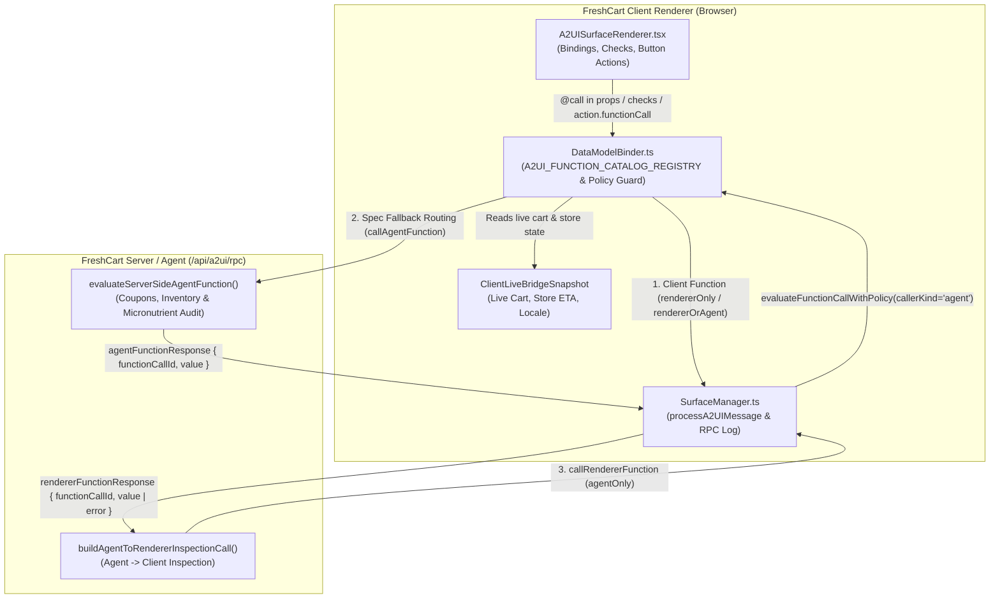

# PR 07 — Server-Side & Client-Side Functions in A2UI v1.0: Discovery, Architecture, Documentation Gaps & SDK Bugs

> **Branch**: `feat/07-server-client-functions`
> **Live Demo**: `http://josemontesp.c.googlers.com:5187`
> **Scope**: Zero-prior-knowledge investigation and implementation of **Client-Side Functions** (`@call` dynamic bindings, `@index`, `ValidationResult` checks, local `functionCall` actions, and agent-initiated `callRendererFunction` → `rendererFunctionResponse`) and **Server-Side Functions** (renderer-initiated `callAgentFunction` → `agentFunctionResponse` with Spec Fallback Routing).

---

## 1. Public Discovery: How Client-Side & Server-Side Functions Work in A2UI v1.0

By inspecting the public A2UI v1.0 specification (`specification/v1_0/json/common_types.json`, `catalog_definition.json`, `agent_to_renderer.json`, `renderer_to_agent.json`, `catalogs/basic/catalog.json`, `docs/a2ui_protocol.md`, and `docs/a2ui_custom_functions.md`), we mapped the complete v1.0 function execution and bidirectional RPC model.

### 1.1 Function Call Syntax (`common_types.json#/$defs/FunctionCall`)
In A2UI v1.0, every function invocation uses the reserved `@call` discriminator (replacing v0.9's unprefixed `call` key):

```json
{
  "@call": "calculateNetCarbs",
  "catalogId": "https://freshcart.app/catalogs/grocery/v1/catalog.json",
  "args": {
    "totalCarbs": { "@path": "/baseCarbs" },
    "fiber": { "@path": "/baseFiber" },
    "sugarAlcohols": { "@path": "/sugarAlcohols" }
  }
}
```

- **Built-in `@index` System Function (`common_types.json` lines 163–181)**: Inside a `ChildList` collection template (`{ "componentId": "...", "path": "/items" }`), `{ "@call": "@index", "args": { "offset": 1 } }` (or `${@index(offset:1)}` inside `formatString`) returns the 0-based collection index plus `offset`.
- **Recursive Argument Evaluation**: Arguments in `args` are themselves `DynamicValue` nodes and may contain literals, `{ "@path": "..." }` pointers, or nested `{ "@call": "..." }` function calls.

### 1.2 Three Polymorphic Execution Contexts in UI Content
Per `a2ui_protocol.md` (§ *"Functions in A2UI Content Execution"*, lines 1403–1536), a `FunctionCall` can appear in three distinct places inside component definitions:

1. **Reactive Property Bindings (`DynamicValue`)**:
   - Bound to any `DynamicString`, `DynamicNumber`, `DynamicBoolean`, or `DynamicStringList` property.
   - Re-evaluates reactively whenever any referenced `@path` in `args` mutates in the surface `dataModel`.
2. **Validation Rules (`Checkable.checks[].condition`)**:
   - Evaluates to either a structured `ValidationResult` (`{ valid: boolean, code?: string, message?: string, severity?: "error" | "warning" | "info" }`) or a `boolean`.
   - **Bidirectional Coercion (`a2ui_protocol.md` lines 1495–1519)**: Functions returning `ValidationResult` automatically coerce to `boolean` (`result.valid`) when nested inside logical combinators (`and`, `or`, `not`) or `DynamicBoolean` properties; boolean functions in `checks[].condition` coerce to `ValidationResult` using the `CheckRule.message` fallback.
3. **UI Actions (`Action.functionCall`)**:
   - Interactive components (`Button`, `TextField`, etc.) define `action` as either `{ "event": { "name": "...", "context": {...} } }` or `{ "functionCall": { "@call": "...", "args": {...} } }`.

### 1.3 Catalog Function Metadata & Security Boundaries (`catalog_definition.json`)
In v1.0, catalog functions are defined as a named map under `functions` in `catalog.json` (and referenced in `$defs.anyFunction.oneOf`). Each function declares:
- **`returnType`** *(required)*: `"string" | "number" | "boolean" | "array" | "object" | "validationResult" | "any" | "void"`.
- **`allowedCallers`** *(optional, defaults to `"rendererOnly"`)*:
  - `"rendererOnly"`: Can ONLY be invoked locally by the renderer (in bindings, checks, or local UI actions). If an agent attempts to invoke a `"rendererOnly"` function via `callRendererFunction`, the renderer **MUST** reject the request with `code: "INVALID_FUNCTION_CALL"` (`a2ui_protocol.md` line 326).
  - `"agentOnly"`: Can ONLY be invoked remotely by the agent via `callRendererFunction`. It **CANNOT** be bound to UI component properties or executed by local UI actions (`a2ui_protocol.md` line 327).
  - `"rendererOrAgent"`: Can be invoked both locally in UI bindings/actions and remotely via `callRendererFunction`.
- **`requiresUserActivation`** *(optional, defaults to `false`)*:
  - When `true`, `catalog_definition.json` enforces `"allowedCallers": "rendererOnly"` via JSON Schema (`if/then` rule at lines 99–104).
  - The function may only execute inside an active user gesture (e.g., clicking a `Button` whose `action` is `functionCall`). Invoking it in a passive property binding, check rule, or remote `callRendererFunction` fails with `EXPRESSION_ERROR` / `INVALID_FUNCTION_CALL`.

### 1.4 Bidirectional Function RPC Envelopes (`agent_to_renderer.json` & `renderer_to_agent.json`)
A2UI v1.0 introduces four top-level protocol envelopes (two per direction) for cross-boundary function execution:

| Direction | Request Envelope | Response Envelope | Key Schema Rules |
| :--- | :--- | :--- | :--- |
| **Agent → Renderer** *(Client Function RPC)* | `callRendererFunction`: `{ surfaceId?, functionCallId, callFunction: { "@call", catalogId, args? } }` | `rendererFunctionResponse`: `{ functionCallId, value? \| error? }` | `catalogId` is **required** on `callRendererFunction.callFunction`. If `surfaceId` is omitted, `@path` args evaluate against an isolated empty root model `{}`. |
| **Renderer → Agent** *(Server Function RPC)* | `callAgentFunction`: `{ surfaceId, functionCallId, callFunction: { "@call", catalogId?, args? } }` | `agentFunctionResponse`: `{ functionCallId, value? \| error? }` | `surfaceId` is **required** on `callAgentFunction`. `FunctionResponse` requires `oneOf` `value` or `error` (mutually exclusive). |

### 1.5 Spec Fallback Routing (`a2ui_protocol.md` lines 1419–1426 & 1520–1545)
When the renderer evaluates a `FunctionCall` (in an action, check, or dynamic value):
1. It first checks its local catalog function registry.
2. If the function is registered locally (`executionTarget: "client"`), it executes synchronously on the client with 0ms network overhead.
3. If the function is not implemented locally (or is a server-side function), the specification states that the renderer **falls back to dispatching `callAgentFunction` over the transport**, holding a pending state until `agentFunctionResponse` returns from the agent/server.

---

## 2. FreshCart Architecture for Client-Side & Server-Side Functions

We implemented the complete A2UI v1.0 Function Execution & Bidirectional RPC pipeline across the FreshCart engine and AI Personal Shopper:



### Key Implementation Files
- **[`src/types/a2ui-v1.ts`](../src/types/a2ui-v1.ts)**: Defines `A2UICallAgentFunctionMessage`, `A2UIRendererFunctionResponseMessage`, `A2UICallRendererFunctionMessage`, `A2UIAgentFunctionResponseMessage`, `A2UIAllowedCallers`, and `A2UICatalogFunctionMetadata`.
- **[`src/a2ui/DataModelBinder.ts`](../src/a2ui/DataModelBinder.ts)**:
  - Defines `A2UI_FUNCTION_CATALOG_REGISTRY` covering all 16 Basic Catalog functions plus 6 FreshCart Client-Side functions (`calculateNetCarbs`, `computeUnitSavings`, `checkDietaryMatch`, `validatePromoCodeFormat`, `applyLocalNutritionPreset`, `copyShoppingSummary`), 1 Agent-Only Client Inspection function (`getClientKitchenAndCartMetrics`), and 2 Server-Side RPC functions (`optimizeLiveStoreCoupons`, `analyzeMealMicronutrients`).
  - Implements `evaluateFunctionCallWithPolicy()` to enforce `allowedCallers` (`rendererOnly` vs `agentOnly` vs `rendererOrAgent`), `requiresUserActivation`, and **Spec Fallback Routing** to `callAgentFunction`.
- **[`src/a2ui/SurfaceManager.ts`](../src/a2ui/SurfaceManager.ts)**:
  - Processes inbound `callRendererFunction` messages (enforcing `catalogId` and `allowedCallers`, evaluating against `surface.dataModel` or isolated `{}` when `surfaceId` is omitted, and emitting `rendererFunctionResponse` with `value` or `INVALID_FUNCTION_CALL` `error`).
  - Processes inbound `agentFunctionResponse` messages and merges server RPC results into the target surface's `dataModel`.
  - Records outbound `callAgentFunction` and `rendererFunctionResponse` envelopes in the chronological protocol log, and lints RPC envelopes in `validateA2UIv1Envelope()`.
- **[`src/scenarios/smartFunctionsScenario.ts`](../src/scenarios/smartFunctionsScenario.ts)** & **[`src/components/ai-shopper/AIShopperDrawer.tsx`](../src/components/ai-shopper/AIShopperDrawer.tsx)**:
  - Provides the 1-click **`⚡ Smart Coupons & Nutrition Calculator`** suggestion pill in the AI Shopper chat and a 3-tab interactive surface (`⚡ Instant Presets & Picks`, `🏷️ Live Store Coupons`, `🔄 Sync Kitchen & Cart`) plus a collapsible **Function & RPC Envelope Log** drawer.

---

## 3. Public Documentation Gaps Discovered (`docs/public/` vs `specification/v1_0/`)

During our zero-prior-knowledge audit of `/tmp/public-google-a2ui/docs/public/` and `/tmp/public-google-a2ui/specification/v1_0/`, we identified **7 significant documentation gaps and contradictions**:

### Gap 1: `docs/public/reference/messages.md` Completely Omits A2UI v1.0 and All Function RPC Envelopes
- **Location**: `docs/public/reference/messages.md` (lines 1–268)
- **Issue**: The public Reference page for A2UI Messages only has tabs for `=== "v0.8 Message Types"` and `=== "v0.9 Message Types"`. There is **no v1.0 tab**, and the four v1.0 RPC envelopes (`callRendererFunction`, `agentFunctionResponse`, `callAgentFunction`, `rendererFunctionResponse`) are completely absent from the public Reference docs.

### Gap 2: `docs/public/concepts/actions.md` Uses v0.9 Syntax and Contradicts v1.0 Server/Agent Function RPC
- **Location**: `docs/public/concepts/actions.md` (lines 38–125)
- **Issue**:
  1. Uses legacy v0.9 `"call"` and `"path"` keys instead of v1.0 `"@call"` and `"@path"`.
  2. Explicitly states (lines 84–86): *"Functions execute immediate behavior on the renderer without a network round-trip. The agent is not informed of local function calls."* This directly contradicts v1.0's `callAgentFunction` / `agentFunctionResponse` fallback routing (`a2ui_protocol.md` lines 1419–1426) and omits `callRendererFunction`, `allowedCallers`, and `requiresUserActivation`.

### Gap 3: `docs/public/concepts/data-binding.md` Mislabels v0.9 Syntax as `"v0.9 and later"`
- **Location**: `docs/public/concepts/data-binding.md` (lines 16–35)
- **Issue**: Uses the tab label `=== "v0.9 and later"` while showing `{"path": "/user/name"}`. In A2UI v1.0, unprefixed `{"path": "/user/name"}` is parsed as a literal JSON object rather than a `DataBinding` (`{"@path": "/user/name"}` is required). It also omits `{"@call": "..."}` reactive function bindings and `@index`.

### Gap 4: `docs/public/concepts/catalogs.md` Documents v0.9 Array-Based `functions` Instead of v1.0 Map-Based `functions`
- **Location**: `docs/public/concepts/catalogs.md` (lines 39–62)
- **Issue**: Shows `"functions": { "type": "array", "items": { "$ref": "#/$defs/FunctionDefinition" } }`, whereas v1.0 (`specification/v1_0/json/catalog_definition.json` lines 25–29) defines `functions` as an object map keyed by function name (`additionalProperties: { "$ref": "#/$defs/functionSchema" }`) with `allowedCallers` and `requiresUserActivation`.

### Gap 5: `specification/v1_0/docs/a2ui_custom_functions.md` Is Unlinked from `docs/public/` and Contains a Broken `getScreenResolution` Example
- **Location**: `specification/v1_0/docs/a2ui_custom_functions.md` (lines 72–97) & `specification/v1_0/docs/a2ui_protocol.md` (lines 333–346)
- **Issue**:
  1. `a2ui_custom_functions.md` exists in `specification/v1_0/docs/` but is not published or linked anywhere in `docs/public/`.
  2. Its `getScreenResolution` catalog definition (lines 78–83) omits `allowedCallers`:
     ```json
     "getScreenResolution": {
       "description": "Returns the current screen width and height in pixels.",
       "returnType": "object",
       "properties": { "type": "object", "properties": {}, "additionalProperties": false }
     }
     ```
     Because `allowedCallers` defaults to `"rendererOnly"` (`catalog_definition.json` line 82), invoking `getScreenResolution` via `callRendererFunction` (as demonstrated in `a2ui_protocol.md` lines 333–346) is **rejected at runtime with `INVALID_FUNCTION_CALL`** unless `"allowedCallers": "agentOnly"` or `"rendererOrAgent"` is specified!

### Gap 6: Internal Inconsistency in `specification/v1_0/docs/a2ui_protocol.md` Message Count
- **Location**: `specification/v1_0/docs/a2ui_protocol.md` (lines 24–29 vs. line 172)
- **Issue**: The Introduction (line 24) states *"The agent-to-renderer protocol defines four message types: `createSurface`, `updateComponents`, `updateDataModel`, `deleteSurface`"*, whereas Section *"Envelope (Agent-to-Renderer)"* (line 172) correctly lists all **six** (`createSurface`, `updateComponents`, `updateDataModel`, `deleteSurface`, `callRendererFunction`, `agentFunctionResponse`).

### Gap 7: `docs/public/guides/renderer-development.md` v1.0 Tab Inaccuracies
- **Location**: `docs/public/guides/renderer-development.md` (lines 25–158)
- **Issue**: Mentions a non-existent `surfaceProperties` message (line 37), refers to `a2uiClientCapabilities` instead of v1.0 `a2uiRendererCapabilities` (line 138), and omits `agentFunctionResponse`, `allowedCallers`, and `requiresUserActivation`.

---

## 4. Bugs & Gaps Discovered in `@a2ui/web_core@0.14.0` and `@a2ui/react@0.14.0`

By inspecting `/tmp/public-google-a2ui/typescript/core/web_core/src/` and the published `node_modules/@a2ui/web_core@0.14.0` / `node_modules/@a2ui/react@0.14.0` packages, we identified **6 concrete SDK bugs and architectural gaps**:

### Bug 1: `DataContext` & `Catalog.invoker` Do Not Implement Spec Fallback Routing to `callAgentFunction`
- **Files**: `src/common/context/data-context.ts` (lines 206–275), `src/v1_0/catalog/types.ts` (lines 914–937), `src/v1_0/processing/message-processor.ts` (lines 180–265)
- **Root Cause**: Per `a2ui_protocol.md` (lines 1419–1426 & 1520–1536), when a `FunctionCall` in a dynamic property binding, check rule, or `action.functionCall` is not registered locally on the renderer, the renderer should automatically dispatch `callAgentFunction` over the wire via `RpcHandler` and resolve when `agentFunctionResponse` arrives. However, `DataContext` has no reference to `RpcHandler`. When a function is not in the local `Catalog` (or is loaded via `Catalog.fromJson()` as a schema-only `FunctionApi` without an `execute` method), `createCatalogInvoker` (`src/v1_0/catalog/types.ts:933`) immediately throws `A2uiExpressionError("Function not found in catalog...")` or `"Function '...' is schema-only and has no implementation"`.
- **Impact**: `rpc.callAgentFunction()` can only be called imperatively from custom TypeScript code; declarative A2UI v1.0 JSON (`{"@call": "serverFn"}`) always throws instead of routing over `callAgentFunction`.

### Bug 2: `allowedCallers: "agentOnly"` Is Never Enforced on Local UI Bindings or Actions
- **Files**: `src/v1_0/catalog/types.ts` (lines 914–930) vs. `src/v1_0/rpc/rpc-handler.ts` (lines 518–531)
- **Root Cause**: `a2ui_protocol.md` (line 327) mandates: *"Functions configured as `'agentOnly'` CANNOT be bound to UI component properties or executed by renderer UI actions; they are restricted exclusively to agent-initiated `callRendererFunction` execution."* While `RpcHandler.checkExecutionPermissions()` checks `allowedCallers === 'rendererOnly'` for inbound `callRendererFunction` messages, `createCatalogInvoker()` in `src/v1_0/catalog/types.ts:921` only calls `assertUserActivation(fn, ctx)` and **never checks `if (fn.allowedCallers === 'agentOnly')`**.
- **Impact**: Any UI component property binding, check condition, or local button action can freely execute `agentOnly` functions in `@a2ui/web_core@0.14.0`. (Fixed in FreshCart's `evaluateFunctionCallWithPolicy()` in `src/a2ui/DataModelBinder.ts`).

### Bug 3: `DataContext` Does Not Support `Promise` Return Values from Async Functions
- **Files**: `src/common/context/data-context.ts` (lines 213–270) vs. `src/v1_0/rpc/rpc-handler.ts` (line 581)
- **Root Cause**: `RpcHandler.executeFunctionSafely()` supports async functions via `await Promise.resolve(funcImpl.execute(args, context))`, and `FunctionImplementation.execute` is typed to allow returning `Promise<any>`. However, `DataContext.resolveSignal()` and `DataContext.resolveDynamicValue()` only check `isSignal(res)`. If an async function returns a `Promise`, `DataContext` passes the unresolved `Promise` object directly as the component property value instead of awaiting it or wrapping it in a reactive signal.

### Bug 4: Broken Zod Schema Generation in `ErrorMessageSchema` Rejects 100% of Generic/RPC Error Envelopes
- **File**: `src/v1_0/schema/renderer-to-agent.ts` (lines 138–152)
- **Root Cause**: `renderer_to_agent.json` uses `"oneOf"` with `{"required": ["surfaceId"], "not": {"required": ["functionCallId"]}}` and `{"required": ["functionCallId"], "not": {"required": ["surfaceId"]}}` on generic error envelopes. The code generator (`scripts/generate-schemas.mjs`) translated `"not": {"required": [...]}` into:
  ```ts
  z.any().refine((value) => !z.any().safeParse(value).success, 'Invalid input: Should NOT be valid against schema')
  ```
  Because `z.any().safeParse(value).success` is **always `true`**, `!z.any().safeParse(value).success` is **always `false`**!
- **Impact**: `ErrorMessageSchema.safeParse()` and `RendererToAgentMessageSchema.safeParse()` reject 100% of error envelopes (including `INVALID_FUNCTION_CALL` errors carrying `functionCallId`).

### Bug 5: Legacy `call` Key Emitted Instead of `@call` in `MessageProcessor` and Unnormalized in `RpcHandler`
- **Files**: `src/v1_0/processing/message-processor.ts` (lines 690 & 718) and `src/v1_0/rpc/rpc-handler.ts` (line 717)
- **Root Cause**:
  1. When `V1Point0Adapter.adaptMessage()` normalizes `callRendererFunction.callFunction`, it strips `'@call'` into internal `op.call`. Then `MessageProcessor.processOperation()` (line 690) and `processOperationAsync()` (line 718) reconstruct the message for `RpcHandler.handleCallRendererFunction()` as `callFunction: { call: op.call, catalogId: op.catalogId, args: op.args }` using the v0.9 key `call` instead of `'@call'`.
  2. In `RpcHandler.sendOutboundMessage()` (line 717), `callAgentFunction` serializes `callFunction: call` verbatim without normalizing `call` → `'@call'`, so callers passing `{ call: "fn" }` emit invalid v1.0 wire payloads that fail `renderer_to_agent.json` validation.

### Bug 6: Missing Root Exports in `@a2ui/web_core@0.14.0` and Missing v1.0 / RPC Support in `@a2ui/react@0.14.0`
- **Files**: `node_modules/@a2ui/web_core/dist/src/index.d.ts` and `node_modules/@a2ui/react/dist/index.js`
- **Root Cause**:
  1. `@a2ui/web_core`'s root entrypoint (`index.ts`) does not re-export `./v1_0` or `./rpc` (`RpcHandler`, `A2uiRpcError`, `RpcErrorCode`).
  2. `@a2ui/react@0.14.0` is hardcoded to import from `@a2ui/web_core/v0_9`, provides no `@a2ui/react/v1_0` subpath export, and exposes no React hook or provider integration for `MessageProcessor.rpc` (`callAgentFunction` / `outboundListener`).
