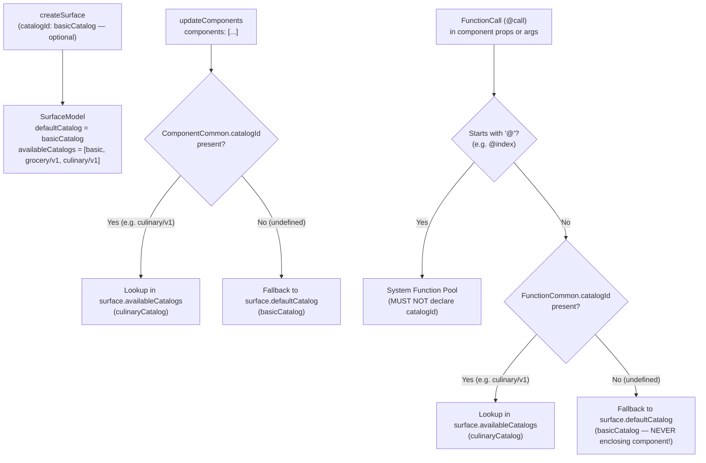

# PR 09 — A2UI v1.0 Mixed Catalogs: Architecture, FreshCart Showcase, Doc Gaps & `@a2ui/web_core` Bugs

- **Branch**: `feat/09-mixed-catalogs`
- **Live Demo URL**: `http://josemontesp.c.googlers.com:5189`
- **Protocol Version**: A2UI `v1.0` (`@a2ui/web_core@0.14.0`, `@a2ui/react@0.14.0`)
- **Verification Command**: `node scripts/verify-a2ui-v1.mjs && npm run build`

---

## (a) How Mixed Catalogs Work in A2UI v1.0

In A2UI v0.8 and v0.9, a surface was locked to a single catalog selected at `createSurface` time. If an application needed standard layout primitives (`Column`, `Row`, `Card`, `Text`, `Button`) alongside domain-specific widgets (`ProductDealCard`, `WineAndCheesePairingCard`), developers had to clone every Basic Catalog component and function into a monolithic custom catalog (`[...BASIC_COMPONENTS, customComponent]`).

**A2UI v1.0** introduces native **Mixed Catalogs (Multi-Catalog Surfaces)**, allowing a single surface to compose components and functions from arbitrarily many catalogs registered on the renderer.



### 1. Capability Advertisement & `surface.availableCatalogs`
- During capability negotiation, the renderer advertises all supported catalogs in `rendererCapabilities["v1.0"].supportedCatalogIds` (plus optional `inlineCatalogs` when `acceptsInlineCatalogs: true`).
- When `MessageProcessor` processes `createSurface`, it filters its registered `Catalog` instances by protocol version compatibility (`catalog.protocolVersion === '1.0'`) and stores the full array on `surface.availableCatalogs` (`message-processor.js:230-241`).

### 2. Optional `createSurface.catalogId` (Default vs. Catalogless Surfaces)
- In `specification/v1_0/json/agent_to_renderer.json`, `createSurface` requires **only** `["surfaceId"]`; `catalogId` is optional.
- **With `createSurface.catalogId`**: Sets `surface.defaultCatalog`. Components and `@call` functions that omit `catalogId` inherit `surface.defaultCatalog`.
- **Without `createSurface.catalogId` (Catalogless Surface)**: `surface.defaultCatalog` is `undefined`. Every component in `updateComponents` and every non-system `@call` on the surface **must** declare an explicit `catalogId`.

### 3. Strict 3-Step Catalog Resolution Order (`resolveSurfaceCatalog`)
In `@a2ui/web_core/v1_0` (`message-processor.js:647-675`), both components (`resolveComponentCatalog`) and function calls (`resolveFunctionCatalog`) use the same 3-step lookup:
1. **Explicit `catalogId` Override**: If `item.catalogId !== undefined`, look up `item.catalogId` in `surface.availableCatalogs`. If not found (including when `catalogId: ""` in v1.0), throw `A2uiCatalogError` (`CATALOG_ERROR`).
2. **Surface Default Fallback**: If `item.catalogId === undefined`, fall back to `surface.defaultCatalog` (`createSurface.catalogId`).
3. **Hard Failure**: If `surface.defaultCatalog` is also `undefined`, throw `A2uiCatalogError`. Falling back to an arbitrary entry in `supportedCatalogIds` is strictly prohibited.

### 4. The Non-Inheritance Rule for Nested `@call` Invocations
A critical v1.0 protocol rule implemented in `MessageProcessor.nestedCallRunsInCatalog` (`message-processor.js:684-696`) and `GenericBinder.scanAndPreloadDynamicValue` (`generic-binder.js:244`):
> **A `@call` nested inside a component with an explicit `comp.catalogId` does NOT inherit `comp.catalogId`!**

- During `PayloadValidator` validation (`message-processor.js:726`), `PayloadValidator` validates each component against `targetCatalog` (the component's resolved catalog). To prevent `PayloadValidator` from validating nested `@call` expressions against the enclosing component's catalog when the `@call` omits `catalogId`, `nestedCallRunsInCatalog(callCatalogId, comp.catalogId, targetCatalog, surface)` checks:
  ```js
  const effectiveId = callCatalogId ?? surface.defaultCatalog?.id;
  return effectiveId === targetCatalog.id;
  ```
- At runtime in `GenericBinder` (`generic-binder.js:244`) and `DataContext.resolveDynamicValue` (`data-context.js:211-225`), omitted `call.catalogId` resolves against `context.surface.defaultCatalog` (`createSurface.catalogId`), **not** `context.componentModel.catalog`.
- **Practical Consequence**: If a surface sets `createSurface.catalogId = basicCatalog.id`, and a `WineAndCheesePairingCard` component sets `catalogId: culinaryCatalog.id`, any culinary function call inside that card (such as `{"@call": "calculatePerServingCost", ...}`) **must still explicitly include `"catalogId": "https://freshcart.app/catalogs/culinary/v1/catalog.json"`** on the `@call` object itself!

### 5. System Functions (`@index`) Must Not Declare `catalogId`
- Functions prefixed with `@` (currently `@index` for collection template scope indexing) are reserved system functions (`SYSTEM_FUNCTIONS` in `catalog/system_functions.js`).
- `assertSystemCallNamesNoCatalog` (`message-processor.js:625-635`) throws `A2uiValidationError` if `@index` specifies any `catalogId`:
  ```json
  // VALID in v1.0:
  { "@call": "@index", "args": { "offset": 1 } }

  // INVALID in v1.0 (throws VALIDATION_FAILED):
  { "@call": "@index", "catalogId": "https://a2ui.org/specification/v1_0/catalogs/basic/catalog.json" }
  ```

### 6. Full-Replacement Catalog Semantics on `updateComponents`
- In v1.0, `updateComponents` performs a full replacement of each updated component ID, including its catalog binding (`message-processor.js:637-645`).
- If component `deal_card_1` was initially created with `catalogId: groceryCatalog.id` on a `basicCatalog` surface, and a subsequent `updateComponents` packet updates `deal_card_1` **without** repeating `catalogId: groceryCatalog.id`, `resolveComponentCatalog` re-resolves `deal_card_1` to `surface.defaultCatalog` (`basicCatalog`).

---

## (b) How Mixed Catalogs Are Showcased in FreshCart

FreshCart showcases **3 distinct A2UI v1.0 catalogs** working together on a single AI Personal Shopper surface (`mixed_catalogs_surface` in [`src/scenarios/mixedCatalogsScenario.ts`](../src/scenarios/mixedCatalogsScenario.ts)):

| # | Catalog Name | `catalogId` URI | Role on `mixed_catalogs_surface` | Components Used | `@call` Functions Used |
| :--- | :--- | :--- | :--- | :--- | :--- |
| **1** | **A2UI v1.0 Basic Catalog** | `https://a2ui.org/specification/v1_0/catalogs/basic/catalog.json` | Surface `defaultCatalog` (`createSurface.catalogId`) | `Column`, `Row`, `Card`, `Tabs`, `List`, `Text`, `Slider`, `ChoicePicker`, `CheckBox`, `Button` | `formatString`, `formatCurrency` (+ system `@index`) |
| **2** | **FreshCart Merchandising & Deal Catalog** | `https://freshcart.app/catalogs/grocery/v1/catalog.json` | Per-component & per-function `catalogId` override | `FlashCouponBanner`, `ProductDealCard`, `AisleMapLocator` | `formatSavingsBadge` |
| **3** | **FreshCart Culinary & Sommelier Catalog** | `https://freshcart.app/catalogs/culinary/v1/catalog.json` | Per-component & per-function `catalogId` override | `NutritionSummary`, `WineAndCheesePairingCard`, `RecipeStepTimeline` | `calculatePerServingCost`, `matchDietaryScore` |

### Key Implementation Files
1. **[`src/types/a2ui-v1.ts`](../src/types/a2ui-v1.ts)**:
   - Defines `A2UI_BASIC_CATALOG_ID`, `FRESHCART_GROCERY_CATALOG_ID`, `FRESHCART_CULINARY_CATALOG_ID`, and `A2UI_CATALOG_REGISTRY` metadata.
2. **[`src/a2ui/DataModelBinder.ts`](../src/a2ui/DataModelBinder.ts)**:
   - Implements `resolveFunctionCallCatalogId(call, context)` following `@a2ui/web_core/v1_0`'s 3-step resolution order.
   - Implements `calculatePerServingCost` and `matchDietaryScore` (`culinary/v1`) and `formatSavingsBadge` (`grocery/v1`).
3. **[`src/a2ui/catalogs/groceryCatalogRenderer.tsx`](../src/a2ui/catalogs/groceryCatalogRenderer.tsx)**:
   - Renders `ProductDealCard`, `AisleMapLocator` (interactive store aisle/bay/chilled-case navigator with route pinning), and `FlashCouponBanner` (clip-to-unlock merchandising coupon banner).
4. **[`src/a2ui/catalogs/culinaryCatalogRenderer.tsx`](../src/a2ui/catalogs/culinaryCatalogRenderer.tsx)**:
   - Renders `NutritionSummary` (with live `Harmony Score` and `perServingCostLabel` badges), `RecipeStepTimeline` (interactive 3-pan chef timeline with step completion toggles), and `WineAndCheesePairingCard` (sommelier & fromager tasting card with dynamic `matchDietaryScore` and `calculatePerServingCost`).
5. **[`src/a2ui/A2UISurfaceRenderer.tsx`](../src/a2ui/A2UISurfaceRenderer.tsx)**:
   - Routes each component node by `comp.catalogId || surface.catalogId || A2UI_BASIC_CATALOG_ID`.
   - Automatically renders a **Multi-Catalog Surface Provenance Bar** whenever a surface composes 2+ catalogs, displaying live component counts and `@call` functions per catalog (`basic/v1.0`, `grocery/v1`, `culinary/v1`).
6. **[`src/scenarios/mixedCatalogsScenario.ts`](../src/scenarios/mixedCatalogsScenario.ts) & [`src/components/ai-shopper/AIShopperDrawer.tsx`](../src/components/ai-shopper/AIShopperDrawer.tsx)**:
   - Adds a 1-click **`🍷 3-Catalog Surface`** pill in the AI Personal Shopper header and **`🍷 3-Catalog Chef & Sommelier Showcase`** suggestion pill in the chat composer.
7. **[`scripts/verify-a2ui-v1.mjs`](../scripts/verify-a2ui-v1.mjs)**:
   - Registers all 3 `Catalog` instances (`basicCatalog`, `groceryCatalog`, `culinaryCatalog`) in `@a2ui/web_core/v1_0`'s `MessageProcessor` with strict `validationConfig` (`unknownComponent: 'error'`, `unknownFunction: 'error'`, `danglingComponentRef: 'error'`, `unreferencedComponent: 'error'`) and verifies `buildMixedCatalogsStream()`.

---

## (c) Public Documentation Gaps Discovered

While implementing Mixed Catalogs strictly from public documentation (`/tmp/public-google-a2ui/docs/public/` and `/tmp/public-google-a2ui/specification/v1_0/`), we identified **6 major documentation gaps**:

### `DOC-GAP-MC-01`: Public Guides Still Claim Surfaces Are Locked to a Single Catalog
- **Where**:
  - `docs/public/concepts/catalogs.md` (lines 375–386):
    > *"3. Surface Creation (Agent to Client): When the agent creates a new surface, it selects the best match from the client's `supportedCatalogIds` list. This choice is locked for the lifetime of that surface."*
  - `docs/public/guides/defining-your-own-catalog.md` (lines 24–25):
    > *"Each surface renders using a single catalog, selected when the surface is created."*
- **Impact**: Directly contradicts `specification/v1_0/docs/a2ui_protocol.md` ("Support for Multiple Catalogs", lines 211–252), which allows per-component `ComponentCommon.catalogId`, per-function `FunctionCommon.catalogId`, and catalogless `createSurface` messages. Developers reading the conceptual guides are led to believe multi-catalog surfaces are impossible.

### `DOC-GAP-MC-02`: Public Catalog Docs Teach Monolithic Catalog Cloning Instead of v1.0 Multi-Catalog Mixing
- **Where**: `docs/public/concepts/catalogs.md` (lines 189–245 and 295–309).
- **Details**: The public documentation instructs developers to copy `...BASIC_COMPONENTS` and `...BASIC_FUNCTIONS` into every custom catalog (`new Catalog('https://my-company.com/catalogs/v1/custom.json', [...BASIC_COMPONENTS, customComponent], [...BASIC_FUNCTIONS])`) and warns that omitting Basic components means *"the agent won't be able to use standard layout components like Row, Column, or Text on any surface using your catalog"*.
- **Impact**: This was only true in v0.8/v0.9. In v1.0, domain catalogs (`grocery/v1`, `culinary/v1`) can remain modular and small while the surface uses `basicCatalog` as its `createSurface.catalogId`.

### `DOC-GAP-MC-03`: Undocumented Non-Inheritance Rule for Nested `@call` Inside Custom-Catalog Components
- **Where**: `specification/v1_0/docs/a2ui_protocol.md` (lines 221–244) and `docs/public/concepts/catalogs.md`.
- **Details**: Neither the protocol specification nor the public guides explain that a `@call` nested inside a component with `catalogId: "https://.../culinary/v1/catalog.json"` does **not** inherit the enclosing component's `catalogId`. Instead, if `call.catalogId` is omitted, `@a2ui/web_core/v1_0` resolves the function against `createSurface.catalogId` (`surface.defaultCatalog`).
- **Impact**: Developers naturally assume that props inside a `WineAndCheesePairingCard` (`catalogId: culinary/v1`) resolve against `culinary/v1` by default, resulting in unexpected `UNKNOWN_FUNCTION: Function 'calculatePerServingCost' not found in catalog '.../basic/catalog.json'` errors.

### `DOC-GAP-MC-04`: Undocumented `ChildSchema` / `ChildListSchema` (`markChildRef`) Requirement for Custom Container Components
- **Where**: `docs/public/concepts/catalogs.md` and `docs/public/guides/defining-your-own-catalog.md`.
- **Details**: `@a2ui/web_core/v1_0` relies on internal WeakSet markers (`markChildRef` / `isChildRef` in `catalog/reference-map.js:34-41`) attached to `ChildSchema` and `ChildListSchema` to discover parent→child component references in `buildComponentRefMap`.
- **Impact**: If a developer defines a custom container component using plain `z.object({ child: z.string() })` instead of importing `ChildSchema` from `@a2ui/web_core/v1_0`, `IntegrityChecker` (`STRICT_VALIDATION`) rejects the child component as `"Orphaned component '...': not reachable from root"`, and `NodeResolver` fails to resolve the child ID into a `ComponentNode`!

### `DOC-GAP-MC-05`: Undocumented `updateComponents` Catalog Reset Behavior in v1.0
- **Where**: `specification/v1_0/docs/a2ui_protocol.md` ("Updating Components").
- **Details**: In v0.8/v0.9, `resolveComponentCatalog` (`message-processor.js:638-643`) preserved an existing component's catalog (`existing?.catalog`) if a subsequent `updateComponents` omitted `catalogId`. In v1.0 (`surface.protocolVersion !== '0.8' && surface.protocolVersion !== '0.9'`), `updateComponents` resolves the component's catalog from scratch on every update. Omitting `catalogId` on a partial/incremental component update silently resets its catalog to `surface.defaultCatalog`.

### `DOC-GAP-MC-06`: Missing React Multi-Catalog Implementation Guide
- **Where**: `docs/public/guides/defining-your-own-catalog.md` (line 39: *"Detailed guides for each framework coming soon"*).
- **Details**: There is zero public documentation showing how `@a2ui/react` consumes multiple `Catalog` instances or how `createComponentImplementation` and `createFunctionImplementation` are wired into `MessageProcessor`.

---

## (d) Bugs & Architectural Issues in `@a2ui/web_core@0.14.0` & `@a2ui/react@0.14.0`

Through code inspection and live runtime testing against `@a2ui/web_core@0.14.0` and `@a2ui/react@0.14.0`, we uncovered **8 bugs** when mixing multiple catalogs on a single surface:

### `BUG-MC-01` (High — `schema_generator.js:908-912` & `common_types.json`): `catalog.validationSchema` Rejects Cross-Catalog `@call`s and Fails on Component-Only Catalogs
- **Location**: `node_modules/@a2ui/web_core/dist/src/catalog/schema_generator.js` (lines 908–912) and `specification/v1_0/json/common_types.json` (`#/$defs/FunctionCall`).
- **Root Cause**:
  In `common_types.json`, `FunctionCall` is defined as:
  ```json
  "FunctionCall": {
    "allOf": [
      { "$ref": "#/$defs/FunctionCommon" },
      { "$ref": "catalog.json#/$defs/anyFunction" }
    ]
  }
  ```
  When `generateValidationSchema(catalogJson, version)` builds `catalog.validationSchema`, it localizes `catalog.json#/$defs/anyFunction` to **only that single catalog's `anyFunction` list** (lines 908–912). Even worse, if a domain catalog defines components but `0` functions, `generateCatalogDefinitions` sets `anyFunction: { not: {} }`.
- **Reproduction & Impact**:
  1. On a mixed-catalog surface, validating a `basicCatalog` component that invokes `{"@call": "calculatePerServingCost", "catalogId": ".../culinary/v1/catalog.json"}` against `basicCatalog.validationSchema` fails because `calculatePerServingCost` is not in `basicCatalog.#/$defs/anyFunction`.
  2. On a component-only custom catalog (`functions: []`), `anyFunction` is `{ "not": {} }`, so `catalog.validationSchema` rejects **every** dynamic `@call` (even `formatString` or `formatCurrency` from `basicCatalog`) inside any property of that catalog's components!
- **Recommended Fix**: In `generateValidationSchema` (or a multi-catalog `generateSurfaceValidationSchema(catalogs)`), merge `$defs/anyComponent` and `$defs/anyFunction` across all linked/available catalogs on the surface rather than restricting `FunctionCall` to a single catalog's local `anyFunction`.

### `BUG-MC-02` (High — `message-processor.js:63-74` & `payload-validator.js:144`): Default `MessageProcessor` Leaves `validationConfig` `undefined` (`allowUnknown = true`), Silently Misbinding Custom Components to `basicCatalog`
- **Location**: `node_modules/@a2ui/web_core/dist/src/common/events/message-processor.js` (lines 63–74) & `payload-validator.js` (line 144).
- **Root Cause**:
  When `new MessageProcessor([basicCatalog, groceryCatalog, culinaryCatalog])` is constructed without `options.validationConfig`, `this.validationConfig` is `undefined`. Inside `PayloadValidator`:
  ```js
  get allowUnknown() {
    return this.validationConfig === undefined;
  }
  ```
  When `allowUnknown` is `true`, `PayloadValidator.validateComponent` (`payload-validator.js:244`) and `validateFunction` (`payload-validator.js:405`) return `[]` (no error) when a component or function does not exist in `targetCatalog`!
- **Reproduction & Impact**:
  If an agent omits `"catalogId": "https://freshcart.app/catalogs/grocery/v1/catalog.json"` on `ProductDealCard` (or omits it on a subsequent `updateComponents` call), `MessageProcessor` does **not** report a catalog error. Instead, it silently binds `ComponentModel.catalog = basicCatalog`. Later, when `NodeResolver` attempts to render the node, `basicCatalog.components.get("ProductDealCard")` returns `undefined` and emits an opaque `UNKNOWN_COMPONENT_TYPE` error against `basicCatalog`.
- **Recommended Fix**: Default `MessageProcessor` to `DEFAULT_VALIDATION_CONFIG` (`unknownComponent: 'error'`, `unknownFunction: 'error'`) or check whether an unknown component/function exists in a sibling catalog in `surface.availableCatalogs` to emit an actionable diagnostic (`"Component 'ProductDealCard' was not found in default catalog 'basic', but exists in available catalog 'grocery/v1' — did you forget to set catalogId?"`).

### `BUG-MC-03` (High — `component-model.js:60-67` & `message-processor.js:744`): `ComponentModel.componentTree` Drops `catalogId`
- **Location**: `node_modules/@a2ui/web_core/dist/src/common/model/component-model.js` (lines 60–67) & `message-processor.js` (line 744).
- **Root Cause**:
  In `MessageProcessor.applyComponentUpdate` (`message-processor.js:744`), `stripEnvelopeKeys(comp)` deletes `id`, `component`, `catalogId`, and `metadata` before passing `properties` to `new ComponentModel(id, type, properties, targetCatalog, metadata)`. However, `ComponentModel.componentTree` serializes:
  ```js
  get componentTree() {
    return {
      ...this._properties,
      id: this.id,
      component: this.type,
      ...(this._metadata ? { metadata: this._metadata } : {}),
    };
  }
  ```
  It never writes `catalogId: this.catalog.id`!
- **Reproduction & Impact**:
  Inspecting `surface.componentsModel.get('merch_deal_card').componentTree` returns an object without `catalogId`. Re-feeding serialized `componentTree` objects into `updateComponents` loses all per-component `catalogId` overrides and breaks multi-catalog surfaces.
- **Recommended Fix**: Include `catalogId: this.catalog.id` in `ComponentModel.componentTree`.

### `BUG-MC-04` (Medium — `surface-model.js:173-176` vs `v1_0/schema/common-types.js:160-183`): Dead `action.catalogId` Code & Missing Source Component Catalog Attribution on Dispatched Actions
- **Location**: `node_modules/@a2ui/web_core/dist/src/common/model/surface-model.js` (lines 173–176) and `node_modules/@a2ui/web_core/dist/src/v1_0/schema/common-types.js` (lines 160–183).
- **Root Cause**:
  `SurfaceModel.dispatchAction(payload, sourceComponentId)` contains:
  ```js
  const catalogId = eventPayload.catalogId ?? payload.catalogId;
  await this.onAction.emit({
    version: 'v1.0',
    action: {
      name: eventName,
      surfaceId: this.id,
      sourceComponentId,
      timestamp: new Date().toISOString(),
      context,
      ...(userMessage !== undefined && { userMessage }),
      ...(catalogId !== undefined && { catalogId }),
    },
  });
  ```
  However:
  1. `ActionSchema` in `v1_0/schema/common-types.js` uses `.strict()` on both `action` and `action.event` without defining `catalogId`, so any component that puts `catalogId` on `action` or `action.event` is rejected by `PayloadValidator` (`Unrecognized key(s) in object: 'catalogId'`).
  2. `dispatchAction` never looks up `this.componentsModel.get(sourceComponentId)?.catalog.id`, so outbound `action` payloads dispatched from a `grocery/v1` or `culinary/v1` component never identify which catalog's component triggered the action.

### `BUG-MC-05` (Medium — `schema_serializer.js:255-267` vs `schema_generator.js:545`): `Catalog.toJson()` Emits `unevaluatedProperties: false` on Custom Zod `.strict()` Components, Breaking `Catalog.fromJson()` Round-Trips
- **Location**: `node_modules/@a2ui/web_core/dist/src/catalog/schema_serializer.js` (lines 255–267) and `schema_generator.js` (line 545).
- **Root Cause**:
  In v1.0, `generateComponentValidationSchema` wraps each component schema in `allOf: [{ $ref: "common_types.json#/$defs/ComponentCommon" }, componentBody]` with `unevaluatedProperties: false` on the outer `allOf`. For `basicCatalog`, internal `specComponent()` annotations strip `additionalProperties: false` from the inner `componentBody` so `ComponentCommon` fields (`id`, `catalogId`, `accessibility`, `metadata`) are accepted.
  However, for user-authored custom components defined with `z.object({...}).strict()`, `serializeComponentModel` (`schema_serializer.js:259-267`) converts `additionalProperties: false` into `unevaluatedProperties: false` **inside the inner `componentBody`** without including `ComponentCommon`!
- **Reproduction & Impact**:
  When a custom catalog is serialized via `catalog.toJson()` (for `inlineCatalogs`) and loaded via `Catalog.fromJson()`, the inner `unevaluatedProperties: false` rejects `id`, `component`, `catalogId`, `accessibility`, and `metadata` on every custom component!

### `BUG-MC-06` (Medium — `message-processor.js:808-888`): `validateCompositionConstraints` (`allowedParents` / `allowedChildren`) Ignores `catalogId` Namespaces
- **Location**: `node_modules/@a2ui/web_core/dist/src/common/events/message-processor.js` (lines 808–888).
- **Root Cause**:
  `buildCompositionTopology` maps component IDs to bare component type names (`typeMap.set(id, compType)` without `catalogId`). When `validateParentConstraints` or `validateChildConstraints` checks `allowedParents` / `allowedChildren`, it compares bare strings (`!allowedParents.includes(parentType)`).
- **Impact**: If two catalogs on the same surface both define a component with the same name (e.g., `basicCatalog:Card` and `culinaryCatalog:Card`, or `groceryCatalog:NutritionSummary` and `culinaryCatalog:NutritionSummary`), composition constraints cannot distinguish between the two catalogs.

### `BUG-MC-07` (Medium — `rpc-handler.js:215-228` & `309-315`): `callRendererFunction` Fails Unless `allowedCallers: 'rendererOrAgent'` Is Set and Ignores `surface.defaultCatalog`
- **Location**: `node_modules/@a2ui/web_core/dist/src/rpc/rpc-handler.js` (lines 215–228 and 309–315).
- **Root Cause**:
  1. `createFunctionImplementation(api, execute)` (`catalog/types.js:141`) leaves `allowedCallers` `undefined`. In `RpcHandler.handleCallFunction` (`rpc-handler.js:216`), `(fn.allowedCallers ?? 'rendererOnly') === 'rendererOnly'` rejects all agent-initiated `callRendererFunction` RPCs unless the author manually adds `allowedCallers: 'rendererOrAgent'` onto the `FunctionApi` object.
  2. In `RpcHandler.resolveFunctionImplementation` (`rpc-handler.js:309-315`), if `callFunction.catalogId` is omitted and `this.catalogs.length > 1`, it throws `Catalog ID is required when multiple catalogs are registered` instead of falling back to `surface.defaultCatalog` (`createSurface.catalogId`).

### `BUG-MC-08` (Medium — `catalog/types.js:248` & `@a2ui/react` `chunk-QAAGXJWH.js:183-199`): `Catalog.componentRefMap` Hardcodes `V09_CHILD_REF_OPTIONS` and `@a2ui/react` Mutates `Catalog.components` In-Place
- **Location**: `node_modules/@a2ui/web_core/dist/src/catalog/types.js` (line 248) and `node_modules/@a2ui/react/dist/chunk-QAAGXJWH.js` (lines 183–199).
- **Root Cause**:
  1. `Catalog.componentRefMap` calls `buildComponentRefMap(this, V09_CHILD_REF_OPTIONS)` regardless of `this.protocolVersion`.
  2. In `@a2ui/react`, `prepareCatalogs(surface)` iterates over `surface.availableCatalogs` and mutates `catalog.components.set(name, toWebComponent(implementation))` in-place on the shared `Catalog` instance.
