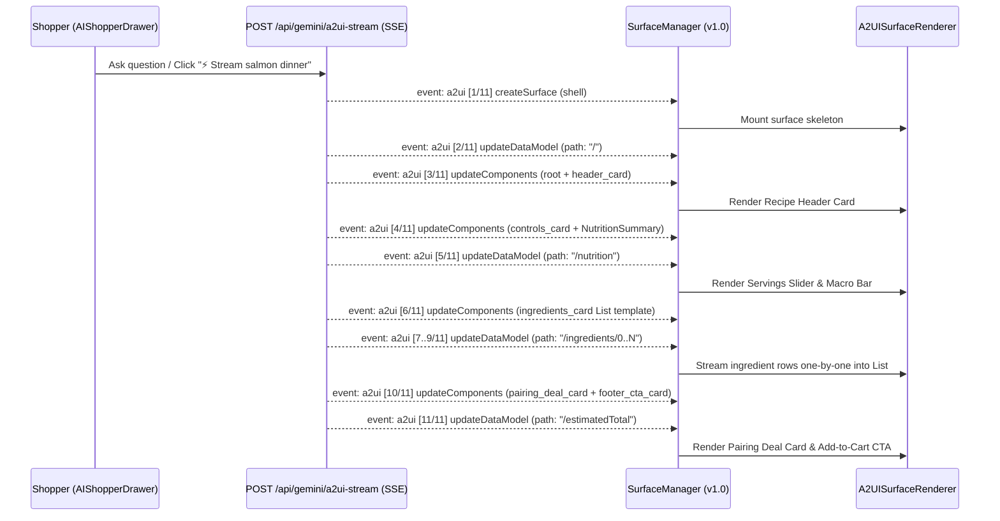

# Feature 10: Streaming in Direct JSON — A2UI v1.0 Architecture & Learnings

## Overview

This document captures our zero-prior-knowledge investigation and implementation of **Direct JSON** and **Progressive Direct JSON Streaming** in **A2UI v1.0**, based strictly on the public specification (`specification/v1_0/`), public documentation (`docs/public/`), `@a2ui/web_core@0.14.0`, and `@a2ui/agent` (`inference-formats/direct-json/`).

---

## 1. How Direct JSON & Progressive Streaming Work in A2UI v1.0

In A2UI v1.0 (`specification/v1_0/json/agent_to_renderer.json`), the protocol supports **two complementary Direct JSON patterns**:

### Pattern A: Single-Shot Direct JSON (`createSurface` with Inline `components` + `dataModel`)

New in A2UI v1.0, `CreateSurfaceMessage` (`agent_to_renderer.json#/$defs/CreateSurfaceMessage`) added optional `components` and `dataModel` fields directly inside `createSurface`:

```json
{
  "version": "v1.0",
  "createSurface": {
    "surfaceId": "chat_surface_2",
    "catalogId": "https://freshcart.app/catalogs/grocery/v1/catalog.json",
    "sendDataModel": true,
    "components": [
      {
        "id": "root",
        "component": "Column",
        "children": ["header_card", "controls_card", "ingredients_card", "footer_cta_card"]
      }
    ],
    "dataModel": {
      "recipeTitle": "## Mediterranean Herb-Crusted Salmon & Quinoa",
      "servings": 4,
      "estimatedTotal": 39.44
    }
  }
}
```

- **When to use**: Fast, atomic UI widgets, cached/precomputed blueprints, or structured single-turn responses where an entire surface is delivered in a single JSON envelope rather than 3 separate messages.

### Pattern B: Progressive Multi-Envelope Direct JSON Streaming (`createSurface` → `updateComponents` → `updateDataModel`)

For real-time LLM generation over **Server-Sent Events (SSE)** or **NDJSON (JSON Lines)**, A2UI v1.0 streams a sequence of independent envelopes targeting the same `surfaceId`:

1. **Stage 1 — `createSurface` (Surface Shell Initialization)**:
   Mounts the surface container and binds the catalog (`catalogId`) and `sendDataModel` flag immediately upon stream start (`<15ms` TTFB).
2. **Stage 2..K — Incremental `updateComponents` Batches (Top-Down UI Construction)**:
   Streams component subtrees in topological order (`root` first, followed by `header_card`, `controls_card`, `ingredients_card`, `pairing_deal_card`, `footer_cta_card`). As each batch arrives, `SurfaceManager` merges the new component definitions into `componentsById` and React re-renders the newly mounted cards immediately.
3. **Stage K+1..N — Granular JSON Pointer `updateDataModel` Updates (RFC 6901)**:
   Streams data updates at fine-grained JSON Pointer `path` targets:
   - `/` (initial headline & scalar state, with collection arrays initialized to `[]`)
   - `/nutrition` (macro breakdown object)
   - `/ingredients/0`, `/ingredients/1`, `/ingredients/2`, ... (individual collection items populating a `List` with `children: { "componentId": "ingredient_row_tpl", "path": "/ingredients" }` row-by-row in real time)
   - `/estimatedTotal`, `/lastActionConfirmation` (footer totals and status banner)



### Direct JSON LLM Inference Format (`@a2ui/agent`)

In `@a2ui/agent` (`typescript/agents/a2ui_agent/src/inference-formats/direct-json/`):
- **Unstructured / Conversational Streaming**: The LLM wraps A2UI JSON payloads inside `<a2ui-json> ... </a2ui-json>` sentinel blocks interspersed with conversational markdown.
- **Structured Output (`responseMimeType: "application/json"`)**: Uses `specification/v1_0/json/agent_to_renderer_list_wrapper.json` (`{ "messages": [ ... ] }`) because Gemini's `responseJsonSchema` requires a top-level `type: "object"` rather than a top-level array.
- **Partial JSON Healing (`readPartialMessages` in `json-reader.ts`)**: `DirectJsonResponseStream` scans incoming LLM token chunks and closes open arrays/objects on the fly for `GROWING_KEYS = ['updateComponents', 'updateDataModel']` so partial component arrays and partial data models can be dispatched to `MessageProcessor` before the LLM finishes the message.

---

## 2. How Direct JSON Streaming Is Implemented in FreshCart

1. **Real SSE Direct JSON Streaming Endpoint (`POST /api/gemini/a2ui-stream` in [`vite.config.ts`](../vite.config.ts))**:
   - Streams `Content-Type: text/event-stream; charset=utf-8` (`event: meta`, `event: token_progress`, `event: a2ui`, `event: done`).
   - Connects upstream to Gemini `:streamGenerateContent?alt=sse` when generating custom surfaces, emitting live `token_progress` events while tokens arrive, and slices the resulting A2UI v1.0 surface into progressive SSE `event: a2ui` envelopes.
   - Supports two selectable `deliveryMode` options:
     - `'progressive-sse'` (default): Emits `createSurface` -> scalar `updateDataModel` -> top-down `updateComponents` subtree batches -> item-by-item `/ingredients/0..N` `updateDataModel` JSON Pointer patches -> final totals.
     - `'single-shot-direct-json'`: Emits a single A2UI v1.0 `createSurface` envelope with inline `components` and `dataModel`.
   - Also fixes `sanitizeSurfaceEnvelopes` in `vite.config.ts`, which previously stripped inline `components` and `dataModel` from `createSurface`.
2. **Zero-Dangling-Reference Topological Subtree Slicer ([`src/services/geminiA2UIService.ts`](../src/services/geminiA2UIService.ts) & [`vite.config.ts`](../vite.config.ts))**:
   - Instead of emitting `root` in Batch 1 with `children: ["header_card", "controls_card", "ingredients_card", "footer_cta_card"]` (which creates dangling references for child IDs that haven't arrived yet), each `updateComponents` batch `i` emits `root` with `children: rootChildren.slice(0, i + 1)` together with the transitive component subtree of `rootChildren[i]`.
   - Every intermediate `updateComponents` batch is therefore a **100% self-contained tree** with zero dangling references and zero orphan components, passing both `STRICT_VALIDATION` and `RELAXED_VALIDATION`.
3. **Interactive Streaming UI & Telemetry Bar ([`src/components/ai-shopper/AIShopperDrawer.tsx`](../src/components/ai-shopper/AIShopperDrawer.tsx))**:
   - Header toggle bar lets users switch between **Progressive SSE Stream** and **Single-Shot `createSurface`** at any time.
   - Clicking any suggestion pill (`⚡ Stream salmon dinner (Live SSE)`, `🥑 Stream high-protein bowls`, `💰 Stream smart cart swaps`, `📋 Stream $120 weekly plan`) or submitting any prompt mounts the assistant bubble immediately and streams the A2UI v1.0 surface progressively in real time.
   - Each surface bubble includes a live telemetry card showing envelope progress (`k / N`), current stage label (`updateComponents` / `updateDataModel` path), component count, elapsed time, a **Replay Stream** button, and a **Try Single-Shot / Try Progressive** comparison button.

---

## 3. Public Documentation Gaps Discovered

| # | Public File | Documentation Gap | Impact on Developers |
|---|---|---|---|
| **GAP-1** | `docs/public/concepts/transports.md` (lines 54–71) | The sections for **HTTP / REST**, **WebSockets**, and **Server-Sent Events (SSE)** contain literal `// TODO: Add an example` placeholders with zero payload or code examples. | Developers have no reference for how to frame A2UI v1.0 messages over SSE (`event: a2ui\ndata: {...}\n\n`) or NDJSON streams. |
| **GAP-2** | `docs/public/concepts/data-flow.md` & `docs/public/reference/messages.md` | Both core reference pages only document **v0.8** and **v0.9**. Neither mentions A2UI **v1.0**, `createSurface` with inline `components` and `dataModel`, required `updateDataModel.value`, or v1.0's `@path` / `@call` syntax. | Developers following `reference/messages.md` emit v0.9 payloads (`{"path": "..."}` instead of `{"@path": "..."}`), which fail v1.0 validation. |
| **GAP-3** | `docs/public/guides/agent-development.md` (lines 133–182) | Only lists `ProtocolVersion.V0_8` and `V0_9`, claims `A2UI_SCHEMA` defines non-existent operations named `"render"` and `"update"` (lines 160–161), and ends at line 182 with `TODO: Continue this guide with examples of how to parse, validate, and send the output to the client renderer without the A2A extension.` | Agent authors cannot learn about `<a2ui-json>`, `DirectJsonResponseStream`, or `agent_to_renderer_list_wrapper.json` from the public guide. |
| **GAP-4** | `specification/v1_0/json/agent_to_renderer.json` (line 24) | Although `CreateSurfaceMessage` in v1.0 added inline `components` and `dataModel` properties for single-message UI creation, its `description` still states: *"When this message is sent, the renderer expects 'updateComponents' and/or 'updateDataModel' messages for the same surfaceId to define the component tree."* | Contradicts the v1.0 single-message `createSurface` design and confuses LLM prompt generators that ingest schema descriptions. |

---

## 4. Bugs & Sharp Edges Verified in `@a2ui/web_core@0.14.0` and `@a2ui/agent`

We verified `@a2ui/web_core@0.14.0` (`@a2ui/web_core/v1_0`) and `@a2ui/agent` against all Direct JSON and streaming patterns:

### Verification: Does `@a2ui/web_core@0.14.0` support inline `components` and `dataModel` inside `createSurface`?

**Yes.** We verified in Node.js against `@a2ui/web_core/v1_0` that:
1. `CreateSurfaceMessageSchema` (`src/v1_0/schema/agent-to-renderer.ts` lines 50–54) accepts optional `components: ComponentsListSchema.optional()` and `dataModel: z.record(z.any()).optional()`.
2. `V1Point0Adapter.extractOperationsFromObject` (`src/processing/adapters/v1_0.ts` lines 46–52) forwards `components` and `dataModel` onto the internal `createSurface` operation.
3. `MessageProcessor.processCreateSurfaceOp` (`src/processing/message-processor.ts` lines 806–819) calls `surface.dataModel.set('/', op.dataModel)` and delegates `op.components` to `processUpdateComponentsOp`.

However, our testing uncovered **5 significant bugs and architectural traps** when combining Direct JSON with streaming:

---

### BUG-1: The Single-Shot vs. Streaming Paradox (`@a2ui/agent` `DirectJsonResponseStream` Cannot Stream Inline `createSurface` Progressively)

- **Location**: `@a2ui/agent` — `src/inference-formats/direct-json/response-stream.ts` (line 50) & `@a2ui/web_core` — `src/processing/message-processor.ts` (line 778).
- **Root Cause**:
  In `response-stream.ts`:
  ```ts
  const GROWING_KEYS = ['updateComponents', 'updateDataModel'];
  ```
  `createSurface` is intentionally excluded from `GROWING_KEYS` because in `@a2ui/web_core`, calling `processMessages` with a second partial `createSurface` for the same `surfaceId` throws:
  ```text
  A2uiIntegrityError [INTEGRITY_ERROR]: Surface <surfaceId> already exists.
  ```
- **Impact**: If an LLM uses A2UI v1.0's new single-message `createSurface` (embedding `components` and `dataModel` inline inside `createSurface`), `DirectJsonResponseStream` **buffers the entire `createSurface` object until its final closing `}` token arrives**, completely disabling progressive rendering!
- **Recommendation**: Either `MessageProcessor.processCreateSurfaceOp` should allow idempotent incremental updates during an active stream, or `DirectJsonResponseStream` should automatically split a streaming `createSurface` with inline `components`/`dataModel` into an initial `createSurface` followed by incremental `updateComponents` and `updateDataModel` operations.

---

### BUG-2: `MessageProcessor` with `STRICT_VALIDATION` Throws `A2uiIntegrityError` on Top-Down Streaming (`root` Referencing Not-Yet-Streamed Children)

- **Location**: `@a2ui/web_core@0.14.0` — `src/processing/message-processor.ts` (lines 714–724) vs. `@a2ui/agent` — `src/inference-formats/direct-json/format.ts` (line 116).
- **Reproduction**:
  `@a2ui/agent`'s `DirectJsonFormat` system prompt instructs the LLM:
  > *"Component Ordering: Inside any components array, always output the root component first (`"id": "root"`), followed by its children, and so on top-down. Do NOT generate component definitions before their parent has been defined and referenced them."*
  When `root` is streamed first with `children: ["header_card", "future_card"]` while `"future_card"` is still being generated in a subsequent chunk, `MessageProcessor` configured with `{ validationConfig: STRICT_VALIDATION }` throws:
  ```text
  A2uiIntegrityError [INTEGRITY_ERROR]: Component 'root' references non-existent component 'future_card' in field 'children[1]' (Dangling reference 'future_card' in component 'root')
  ```
- **How FreshCart Solves This**: In FreshCart's `sliceEnvelopesIntoProgressiveStream`, each `updateComponents` batch `i` emits `root` with `children: rootChildren.slice(0, i + 1)` alongside the complete component subtree for `rootChildren[i]`. This guarantees zero dangling references and zero orphan components at every intermediate streaming frame.

---

### BUG-3: `MessageProcessor` Constructor Silently Ignores `STRICT_VALIDATION` / `RELAXED_VALIDATION` When Passed Directly as the 3rd Argument

- **Location**: `@a2ui/web_core@0.14.0` — `src/processing/message-processor.js` (lines 53–74).
- **Reproduction**:
  The constructor signature is `new MessageProcessor(catalogs, actionHandler, options)` where `options` is `{ validationConfig?: ValidationConfig }`. If a caller passes `new MessageProcessor([basicCatalog], undefined, STRICT_VALIDATION)` directly (a very natural mistake given `STRICT_VALIDATION` is exported at the top level of `@a2ui/web_core/v1_0`), `options?.validationConfig` evaluates to `undefined`, and `MessageProcessor` **silently disables all topology validation** without throwing or warning.

---

### BUG-4: `DirectJsonResponseStream` Disables Progressive Text Healing (`progressiveKeys: ['text']`) for Components in A2UI v1.0

- **Location**: `@a2ui/agent` — `src/inference-formats/direct-json/response-stream.ts` (lines 281–283) & `KNOWN_GAPS.md`.
- **Root Cause**:
  ```ts
  const partial = readPartialMessages(jsonSlice, {
    wholeItemKeys: this.v10 ? ['components'] : [],
    progressiveKeys: ['text'],
  });
  ```
  Because a v1.0 component definition may optionally include a trailing `catalogId` property at the end of the component JSON object, `DirectJsonResponseStream` sets `wholeItemKeys: ['components']` for v1.0. This forces `readPartialMessages` to wait until each component object inside `components` is completely closed with `}` before yielding it, which completely prevents `progressiveKeys: ['text']` from streaming long `Text.text` strings token-by-token inside `updateComponents` (unlike v0.9).

---

### BUG-5: Dead `cs?.theme` Extraction in `V1Point0Adapter` vs. `.strict()` `CreateSurfaceMessageSchema`

- **Location**: `@a2ui/web_core@0.14.0` — `src/processing/adapters/v1_0.ts` (line 44) vs. `src/v1_0/schema/agent-to-renderer.ts` (line 46).
- **Root Cause**: `V1Point0Adapter.extractOperationsFromObject` still contains `theme: cs?.theme` when mapping `createSurface`, even though `CreateSurfaceMessageSchema` in v1.0 removed `theme` and applies Zod `.strict()`. Any `createSurface` payload containing `theme` is rejected by Zod schema validation (`unrecognized_keys: ["theme"]`) before `V1Point0Adapter` is ever reached.
