# FreshCart system design document

**Author:** `architect`
**Status:** Approved for Phase 2 & Phase 3 implementation
**Last updated:** 2026-10-21

## Overview

**FreshCart** is a client-side grocery delivery web application built with React, TypeScript, and Tailwind CSS. Modeled on Instacart's multi-store marketplace experience, FreshCart pairs a full-featured grocery storefront and checkout flow with an embedded **Agent-to-UI** (**A2UI**) **v1.0** runtime engine and AI Personal Shopper.

Instead of returning plain-text chat responses, the FreshCart AI Personal Shopper streams declarative A2UI v1.0 JSON envelopes (`createSurface`, `updateComponents`, `updateDataModel`, `deleteSurface`, `callRendererFunction`) that render interactive, data-bound UI surfaces directly inside the shopping workflow. Users can adjust recipe servings with two-way data bindings (`{"@path": "/servings"}`), swap cart items for organic or budget alternatives in one click, build weekly nutritional budgets with live validation rules (`checks`), and inspect or edit raw A2UI v1.0 protocol messages in a live protocol playground.

## Audience and scope

This document is the architectural contract for the FreshCart engineering swarm across Phase 2 (detailed section designs) and Phase 3 (parallel implementation and integration). Readers should know React 18+, TypeScript, Tailwind CSS, and JSON Pointer (RFC 6901).

### Goals

* Deliver an Instacart-grade multi-store grocery storefront with store switching, aisle/dietary filtering, rich product cards, a slide-over cart drawer, substitution preferences, and a multi-step checkout modal.
* Implement a spec-compliant A2UI v1.0 runtime engine supporting multi-catalog component resolution, `@path` data bindings, `@call` function invocations, `@index` collection scope templates, `checks` validation rules, and outbound `action` events.
* Showcase four interactive A2UI v1.0 grocery surfaces: Meal Planner & Recipe-to-Cart, Smart Cart Substitution & Savings Optimizer, Nutritional & Weekly Budget Builder, and a Live A2UI v1.0 Protocol Inspector & Playground Drawer.
* Enforce non-overlapping file ownership boundaries and a shared TypeScript interface contract across four parallel engineering sections (`sec-storefront`, `sec-cart-checkout`, `sec-a2ui-engine`, `sec-ai-shopper`) and `app-integrator`.

### Non-goals

* Backend database persistence or payment gateway processing; all catalog, cart, order, and scenario state runs in the browser with `localStorage` persistence.
* Legacy A2UI v0.8 or v0.9 wire format execution as the primary protocol; all bundled scenarios and custom catalogs target A2UI `version: "v1.0"`.

---

## 1. Product vision and UX architecture

### Visual design system

FreshCart uses an Instacart-inspired visual palette designed for high-density grocery browsing, legible nutritional badges, and clear visual hierarchy between native storefront views and A2UI v1.0 agent surfaces:

| Token | Hex / Tailwind value | Usage |
| :--- | :--- | :--- |
| Primary brand green | `#0AAD0A` (`emerald-600` / custom) | Primary CTAs, active quantity steppers, free-delivery progress fill, active store pill |
| Deep forest green | `#108910` / `#073E1E` | Hover states, promotional hero banners, AI Personal Shopper header accent |
| Warm cream background | `#F7F5F0` / `#FAF8F5` | Main page canvas and aisle section backgrounds |
| Card surface | `#FFFFFF` with `border-stone-200/80` | Product cards, cart drawer, modal dialogs, and A2UI `Card` containers |
| Primary typography | `#1C1917` (`stone-900`) | Product titles, prices, section headers |
| Secondary typography | `#57534E` (`stone-600`) | Unit weights (`$0.31/oz`), aisle labels, nutrition subtitles |
| Semantic accents | Amber `#D97706`, Red `#DC2626`, Sky `#0284C7` | Low-stock badges, organic/dietary tags, discount savings callouts |

### Core user journeys and layout architecture

```mermaid
flowchart LR
  subgraph Shell["App Shell & Top Navigation"]
    StoreBar["Store Switcher Pill Bar"]
    SearchBar["Sticky Search & Dietary Filter Pills"]
    NavActions["Cart Trigger + AI Shopper Trigger + Protocol Inspector Toggle"]
  end

  subgraph Storefront["Section 1: Storefront & Catalog"]
    Hero["Promotional Hero Banner"]
    Aisles["Category Sidebar / Carousel"]
    Grid["Product Catalog Grid"]
    DetailModal["Product Detail Modal"]
  end

  subgraph CartFlow["Section 2: Cart & Checkout"]
    CartDrawer["Slide-Over Cart Drawer"]
    SubPrefs["Substitution Preferences"]
    CheckoutModal["Multi-Step Checkout Modal"]
    OrderTracker["Live Order Status Tracker"]
  end

  subgraph AIShopper["Section 4: AI Personal Shopper"]
    ScenarioBar["Scenario Launcher & Prompt Bar"]
    SurfaceHost["Active A2UI v1.0 Surface Host"]
    FindingsTab["A2UI Onboarding Gaps & Bugs Viewer"]
  end

  subgraph A2UIEngine["Section 3: A2UI v1.0 Engine"]
    StateMgr["Surface State Manager (create/update/delete)"]
    Binder["JSON Pointer (@path) & Function (@call) Evaluator"]
    Catalog["Basic v1.0 + Grocery Custom Catalog Renderer"]
    Inspector["Live Protocol Inspector & Step-by-Step Replayer"]
  end

  Shell --> Storefront
  Shell --> CartFlow
  Shell --> AIShopper
  AIShopper --> A2UIEngine
  A2UIEngine -- "A2UIActionEvent (ShopperActionHandler)" --> CartFlow
  A2UIEngine -- "SKU Lookup" --> Storefront
```



### Key storefront and cart UX components

* **Store switcher pill bar**: Top-level horizontal selector allowing instant switching between four distinct retail banners:
  1. **FreshCart Organic Market** (everyday organic & local produce, 35-min delivery, $35 free-delivery threshold).
  2. **Costco Wholesale** (bulk club packs, Kirkland-style staples, 60-min delivery, $75 threshold).
  3. **Sprouts Farmers Market** (farm-stand produce, keto/paleo/vegan specialty, 45-min delivery, $35 threshold).
  4. **Trader Joe's Specialty** (curated private-label favorites, frozen meals, snacks, 40-min delivery, $35 threshold).
* **Sticky search and dietary/aisle filter pills**: Real-time search input supporting product name, brand, and tag queries, paired with quick-toggle dietary pills (`Organic`, `Gluten-Free`, `Vegan`, `High-Protein`, `Keto`, `Local`, `On Sale`) and aisle navigation (`Produce`, `Dairy & Eggs`, `Meat & Seafood`, `Bakery`, `Pantry`, `Frozen`, `Beverages`, `Snacks`).
* **Promotional hero banners**: Store-specific hero banner with seasonal bundles and a direct "Plan Meals with AI Shopper" CTA that launches the A2UI v1.0 Meal Planner surface.
* **Rich product cards**: Display product photography, discount ribbon (`Save $1.50`), dietary badges, unit price (`$4.99 / lb`), stock status (`In Stock` or `Low Stock`), and an instant `+ Add` button that transforms into an animated `- / count / +` quantity stepper when the item is in the cart.
* **Slide-over cart drawer**: Accessible from any screen; displays a dynamic free-delivery progress bar (`Add $8.02 more for FREE delivery`), item rows with per-item substitution rules (`Best match`, `Specific replacement`, `Refund if unavailable`), savings breakdown, promo code input (`FRESH10`, `A2UIV1`), and a checkout trigger.
* **Multi-step checkout modal & live order tracker**: Guides the user through delivery address & instructions, 2-hour delivery window scheduling (`Fastest:Within 45 mins`, `Today 2–4 PM`, `Today 4–6 PM`, `Tomorrow 9–11 AM`), shopper tip selection (`10%`, `15%`, `20%`, custom), and order placement, transitioning to a live 4-stage order tracker (`Order Confirmed` → `Personal Shopper Assigned` → `Shopping in Progress` → `Out for Delivery`).

---

## 2. Showcase use case for A2UI v1.0 (not v0.9)

### Why A2UI v1.0 fits grocery commerce

Grocery shopping involves multi-item coordination, constraint satisfaction (budget caps, headcount scaling, dietary restrictions), and live inventory substitutions. Plain-text LLM responses force users to read a list of ingredients and manually search for each SKU. With **A2UI v1.0**, the AI Personal Shopper streams structured UI surfaces that bind directly to a reactive per-surface data model and dispatch typed actions back to the host application.

### Key A2UI v1.0 protocol capabilities demonstrated

NOTE: FreshCart strictly implements **A2UI v1.0** (`specification/v1_0`), incorporating the architectural shifts introduced in v1.0 over v0.9:

1. **Envelope version & message taxonomy**: Every payload uses `"version": "v1.0"` and follows the `agent_to_renderer.json` and `renderer_to_agent.json` schemas (`createSurface`, `updateComponents`, `updateDataModel`, `deleteSurface`, `callRendererFunction`, `agentFunctionResponse`, and outbound `action`).
2. **Single-shot and streaming surface creation**: `createSurface` supports optional inline `components` and initial `dataModel` alongside `surfaceId`, `catalogId`, and `sendDataModel`, and can be followed by incremental `updateComponents` and `updateDataModel` packets.
3. **Reserved `@` directives (`@path`, `@call`, `@index`)**:
   * `DataBinding` objects use `{"@path": "/servings"}` (or relative paths like `{"@path": "name"}` inside a `ChildList` template scope).
   * `FunctionCall` objects use `{"@call": "formatCurrency", "args": {"value": {"@path": "/totalCost"}, "currency": "USD"}}`.
   * Collection iteration uses `{"@call": "@index", "args": {"offset": 1}}` inside `ChildList` templates (`{"componentId": "ingredient_row", "path": "/ingredients"}`).
4. **Multi-catalog mixing**: Surfaces declare a default `catalogId` (`"https://a2ui.org/specification/v1_0/catalogs/basic/catalog.json"`) and mix custom grocery domain components (`ProductDealCard`, `NutritionSummary`) by setting `"catalogId": "https://freshcart.app/catalogs/grocery/v1/catalog.json"` on individual components.
5. **Client-side validation (`checks` & `ValidationResult`)**: Input components (`TextField`, `Slider`, `CheckBox`, `ChoicePicker`, `Button`) evaluate `checks` rules whose `condition` (`@path` or `@call` to `required`, `numeric`, `regex`, `length`, `and`, `or`, `not`) returns a boolean or a structured `ValidationResult` (`{ valid, code, message, severity }`).

### Four interactive A2UI v1.0 surfaces in FreshCart

#### Surface A: Interactive Meal Planner & Recipe-to-Cart (`surfaceId: "meal-planner-surface"`)

* **Data model bindings**:
  * `/servings` (bound to a v1.0 `Slider` with `min: 1, max: 12, steps: 11`).
  * `/dietary/glutenFree` and `/dietary/organicOnly` (bound to v1.0 `CheckBox` components).
  * `/selectedMealPlan` (bound to a `ChoicePicker` with `displayStyle: "chips"`).
  * `/ingredients` (array of recipe ingredients mapped to real store `Product` SKUs, rendered via a `Column` or `List` using `ChildList` template `{ "componentId": "ingredient_row", "path": "/ingredients" }`).
  * `/estimatedTotal` (formatted dynamically with `{"@call": "formatCurrency", "args": {"value": {"@path": "/estimatedTotal"}, "currency": "USD"}}`).
* **Interactive actions**:
  * `add_recipe_bundle_to_cart`: Resolves `/servings`, `/dietary`, and checked `/ingredients` from the surface data model and adds the scaled SKU quantities directly into the host React `CartContext`.
  * `swap_ingredient`: Triggers an incremental `updateDataModel` message swapping a standard ingredient for its organic or gluten-free SKU equivalent.

#### Surface B: Smart Cart Substitution & Savings Optimizer (`surfaceId: "cart-optimizer-surface"`)

* **Context-aware generation**: Reads the user's current `CartContext` items and streams an A2UI v1.0 surface containing side-by-side comparison cards (`Row`, `Column`, `Card`, custom `ProductDealCard`) organized into three optimization modes:
  1. **Budget Saver**: Swaps name-brand cart items for store-brand equivalents with calculated dollar savings.
  2. **Organic Upgrade**: Upgrades conventional produce/dairy in the cart to USDA Organic SKUs.
  3. **Low-Stock Protection**: Pre-selects high-rated backup SKUs for items marked `low_stock` in the active store.
* **Interactive actions**:
  * `apply_cart_swap`: Dispatches `{ originalProductId, replacementProductId, quantity }` to `ShopperActionHandler`, mutating the real cart and updating the A2UI surface state to show `"Swap Applied"`.
  * `apply_all_optimizations`: Applies all recommended swaps in a single batch and updates `/totalSavingsApplied`.

#### Surface C: Interactive Nutritional & Weekly Budget Builder (`surfaceId: "budget-nutrition-surface"`)

* **Comprehensive v1.0 component coverage**:
  * Uses `Tabs` (`"Weekly Budget"`, `"Macro & Nutrition Targets"`, `"Auto-Fill Basket"`), `Card`, `Row`, `Column`, `Text`, `Image`, `Icon`, `Button`, `CheckBox`, `Slider`, `ChoicePicker`, `TextField`, `Modal`, `Divider`, and custom `NutritionSummary`.
  * Demonstrates two-way `updateDataModel` binding on `Slider` (`/weeklyBudget`, range `$50`–`$400`), `ChoicePicker` (`/householdGoals`), and `TextField` (`/customNote`, `/maxPrepMinutes`).
  * Demonstrates client-side `checks` validation: if `/allocatedSpend` exceeds `/weeklyBudget`, or if `/maxPrepMinutes` fails the `numeric` range check (`min: 10, max: 120`), the renderer displays the `ValidationResult` error message and disables the primary `"Build & Add Weekly Basket"` `Button`.

#### Surface D: Live A2UI v1.0 Protocol Inspector & Playground Drawer

* **Protocol visibility and debugging**:
  * **Message Stream Log**: Displays every inbound `agent_to_renderer` message (`createSurface`, `updateComponents`, `updateDataModel`, `deleteSurface`, `callRendererFunction`) and outbound `renderer_to_agent` `action` / `error` payload with timestamps and syntax highlighting.
  * **Step-by-Step Stream Replayer**: Allows the developer or user to pause, rewind, and step through multi-message A2UI v1.0 streaming sequences (`createSurface` → skeleton `updateComponents` → progressive `updateDataModel` chunks) one envelope at a time.
  * **Live JSON Envelope Editor**: Provides an editable JSON text area where users can modify component properties, `@path` bindings, or `updateDataModel` values and dispatch them to the active surface in real time, with immediate schema/linter feedback (for example, warning if someone writes v0.9 `"path"` instead of v1.0 `"@path"`).
  * **Embedded Onboarding Findings Viewer**: Renders a structured viewer inside the app summarizing the real-world A2UI v1.0 public discovery, documentation gaps (`docs/A2UI_DOCUMENTATION_GAPS.md`), and package/spec issues (`docs/A2UI_BUGS_AND_ISSUES.md`) uncovered by `@a2ui-scout`.

---

## 3. Section split and file ownership boundaries

IMPORTANT: To prevent merge conflicts during parallel Phase 2 design and Phase 3 implementation, every agent must strictly respect the file ownership boundaries below. No worker may create or modify files outside its assigned paths.

| Section ID | Owner role | Owned directories and files | Detailed design deliverable |
| :--- | :--- | :--- | :--- |
| `sec-storefront` | Section 1: Storefront, Catalog & Rich Dataset | `src/types/grocery.ts`<br>`src/data/**`<br>`src/components/storefront/**` | `docs/designs/01-storefront-catalog.md` |
| `sec-cart-checkout` | Section 2: Cart Context, Drawer, Checkout & Order Tracker | `src/context/CartContext.tsx`<br>`src/components/cart/**`<br>`src/components/checkout/**` | `docs/designs/02-cart-checkout.md` |
| `sec-a2ui-engine` | Section 3: A2UI v1.0 Engine, Catalogs & Protocol Inspector | `src/types/a2ui-v1.ts`<br>`src/a2ui/**` | `docs/designs/03-a2ui-v1-engine.md` |
| `sec-ai-shopper` | Section 4: AI Personal Shopper, Scenarios & Findings UI | `src/components/ai-shopper/**`<br>`src/scenarios/**` | `docs/designs/04-ai-shopper-experience.md` |
| `app-integrator` | App Shell, Navigation & Build Integration | `package.json`, `vite.config.ts`, `tsconfig*.json`, `index.html`<br>`src/main.tsx`, `src/App.tsx`, `src/index.css`<br>`src/components/layout/**` | Integrated via `docs/SYSTEM_DESIGN.md` |

### Detailed directory layout

```text
/usr/local/google/home/josemontesp/freshcart-a2ui/
├── docs/
│   ├── SYSTEM_DESIGN.md                      # (architect) Master architecture & interfaces contract
│   ├── A2UI_ONBOARDING_DISCOVERY.md          # (a2ui-scout) Public v1.0 onboarding discovery report
│   ├── A2UI_DOCUMENTATION_GAPS.md            # (a2ui-scout) Public documentation gaps log
│   ├── A2UI_BUGS_AND_ISSUES.md               # (a2ui-scout) Public npm/repo bugs & issues log
│   └── designs/
│       ├── 01-storefront-catalog.md          # (sec-storefront) Detailed design
│       ├── 02-cart-checkout.md               # (sec-cart-checkout) Detailed design
│       ├── 03-a2ui-v1-engine.md              # (sec-a2ui-engine) Detailed design
│       └── 04-ai-shopper-experience.md       # (sec-ai-shopper) Detailed design
├── src/
│   ├── types/
│   │   ├── grocery.ts                        # (sec-storefront) Shared grocery, store, cart & action types
│   │   └── a2ui-v1.ts                        # (sec-a2ui-engine) Official A2UI v1.0 wire & catalog types
│   ├── data/
│   │   ├── stores.ts                         # (sec-storefront) 4 stores with themes, fees & delivery windows
│   │   ├── products.ts                       # (sec-storefront) 48+ rich SKUs across aisles, stores & tags
│   │   └── categories.ts                     # (sec-storefront) Aisle & dietary filter definitions
│   ├── context/
│   │   └── CartContext.tsx                   # (sec-cart-checkout) Cart state, substitutions, promos & ShopperActionHandler
│   ├── components/
│   │   ├── layout/
│   │   │   └── TopNavbar.tsx                 # (app-integrator) Header, store pill bar trigger, search & triggers
│   │   ├── storefront/
│   │   │   ├── StoreSwitcherBar.tsx          # (sec-storefront) Multi-store pill selector
│   │   │   ├── HeroBanner.tsx                # (sec-storefront) Store hero banner with AI Shopper CTA
│   │   │   ├── CategoryFilterBar.tsx         # (sec-storefront) Aisle & dietary filter pills
│   │   │   ├── ProductCard.tsx               # (sec-storefront) Product card with badges & +/- stepper
│   │   │   ├── ProductGrid.tsx               # (sec-storefront) Filtered & sorted responsive grid
│   │   │   └── ProductDetailModal.tsx        # (sec-storefront) Nutrition facts, description & related SKUs
│   │   ├── cart/
│   │   │   ├── CartDrawer.tsx                # (sec-cart-checkout) Slide-over drawer with free delivery bar
│   │   │   ├── CartItemRow.tsx               # (sec-cart-checkout) Quantity stepper & substitution selector
│   │   │   └── SubstitutionModal.tsx         # (sec-cart-checkout) Per-item replacement SKU picker
│   │   ├── checkout/
│   │   │   ├── CheckoutModal.tsx             # (sec-cart-checkout) Address, slot picker, tip & summary
│   │   │   └── OrderTrackerBanner.tsx        # (sec-cart-checkout) Live 4-step order progress bar
│   │   └── ai-shopper/
│   │       ├── AIShopperDrawer.tsx           # (sec-ai-shopper) Docked/slide-over AI Personal Shopper panel
│   │       ├── ScenarioSelector.tsx          # (sec-ai-shopper) Preset A2UI v1.0 scenario buttons & prompt bar
│   │       └── OnboardingReportModal.tsx     # (sec-ai-shopper) UI viewer for A2UI v1.0 onboarding findings
│   ├── a2ui/
│   │   ├── SurfaceManager.ts                 # (sec-a2ui-engine) Surface lifecycle & message reducer (v1.0)
│   │   ├── DataModelBinder.ts                # (sec-a2ui-engine) RFC 6901 @path resolver, @call & @index evaluator
│   │   ├── ValidationEngine.ts               # (sec-a2ui-engine) CheckRule & ValidationResult evaluator
│   │   ├── A2UISurfaceRenderer.tsx           # (sec-a2ui-engine) Root React renderer for an A2UI v1.0 surface
│   │   ├── catalogs/
│   │   │   ├── basicCatalogRenderer.tsx      # (sec-a2ui-engine) All 18 A2UI v1.0 basic catalog components
│   │   │   └── groceryCatalogRenderer.tsx    # (sec-a2ui-engine) Custom ProductDealCard & NutritionSummary
│   │   └── inspector/
│   │       └── ProtocolInspectorDrawer.tsx   # (sec-a2ui-engine) Live JSON envelope viewer, editor & step replayer
│   ├── scenarios/
│   │   ├── mealPlannerScenario.ts            # (sec-ai-shopper) Multi-step v1.0 stream for Meal Planner
│   │   ├── cartOptimizerScenario.ts          # (sec-ai-shopper) Dynamic cart-aware v1.0 substitution stream
│   │   ├── budgetBuilderScenario.ts          # (sec-ai-shopper) Weekly budget & nutrition builder v1.0 stream
│   │   └── onboardingFindingsData.ts         # (sec-ai-shopper) Structured onboarding discovery & bugs data
│   ├── App.tsx                               # (app-integrator) Main layout wiring all 4 sections
│   └── main.tsx                              # (app-integrator) Application entry point
└── package.json
```

### Public `@a2ui/react` vs FreshCart v1.0 engine strategy

Wait-free coordination with `@a2ui-scout`'s discovery target:
* Public npm packages (`@a2ui/react`, `@a2ui/lit`, `@a2ui/web_core`) historically lag behind the newest `specification/v1_0` candidate schemas (often targeting v0.8/v0.9 `server_to_client` envelopes without `@path`, `@call`, `@index`, or multi-catalog mixing).
* Therefore, `sec-a2ui-engine` implements a clean, spec-faithful **A2UI v1.0 Protocol Engine & React Renderer** (`src/a2ui/`) directly against `specification/v1_0/json/agent_to_renderer.json`, `renderer_to_agent.json`, `common_types.json`, and `catalogs/basic/v1/catalog.json`, while documenting and exposing any compatibility shims or npm package discrepancies in the Protocol Inspector and Onboarding Report UI.

---

## 4. Shared TypeScript interfaces contract

IMPORTANT: Every section designer and implementer must use the exact TypeScript interfaces defined in this section. `sec-storefront` exports the grocery domain types from `src/types/grocery.ts`, and `sec-a2ui-engine` exports the A2UI v1.0 protocol types from `src/types/a2ui-v1.ts`.

### 4.1 Grocery domain & cart action contract (`src/types/grocery.ts`)

```typescript
export type StoreId =
  | 'freshcart-organic'
  | 'costco-wholesale'
  | 'sprouts-farmers'
  | 'trader-joes-specialty';

export type AisleCategory =
  | 'all'
  | 'produce'
  | 'dairy-eggs'
  | 'meat-seafood'
  | 'bakery'
  | 'pantry'
  | 'frozen'
  | 'beverages'
  | 'snacks';

export type DietaryTag =
  | 'organic'
  | 'gluten-free'
  | 'vegan'
  | 'vegetarian'
  | 'keto'
  | 'high-protein'
  | 'dairy-free'
  | 'local'
  | 'non-gmo';

export interface NutritionFacts {
  servingSize: string;
  calories: number;
  proteinGrams: number;
  carbsGrams: number;
  fatGrams: number;
  fiberGrams: number;
  sugarGrams?: number;
  sodiumMg?: number;
}

export interface Store {
  id: StoreId;
  name: string;
  tagline: string;
  logoEmoji: string;
  primaryColor: string;
  accentColor: string;
  deliveryEtaMinutes: number;
  deliveryFee: number;
  freeDeliveryThreshold: number;
  rating: number;
  reviewCount: number;
  featuredPromoBanner: {
    title: string;
    subtitle: string;
    badgeText: string;
    ctaText: string;
    linkedScenarioId?: 'meal-planner' | 'cart-optimizer' | 'budget-builder';
  };
}

export interface Product {
  id: string;
  storeId: StoreId;
  name: string;
  brand: string;
  category: Exclude<AisleCategory, 'all'>;
  price: number;
  originalPrice?: number;
  unit: string; // e.g., "16 oz", "1 lb", "per bunch", "12 ct"
  unitPriceLabel: string; // e.g., "$0.31 / oz"
  imageUrl: string;
  description: string;
  dietaryTags: DietaryTag[];
  nutrition: NutritionFacts;
  rating: number;
  reviewCount: number;
  stockStatus: 'in_stock' | 'low_stock' | 'out_of_stock';
  aisleLocation: string; // e.g., "Aisle 4 · Organic Produce"
  suggestedBackupProductId?: string;
  organicUpgradeProductId?: string;
  budgetAlternativeProductId?: string;
}

export type SubstitutionPreferenceType =
  | 'best_match'
  | 'specific_item'
  | 'do_not_substitute';

export interface CartItem {
  product: Product;
  quantity: number;
  substitutionPreference: SubstitutionPreferenceType;
  replacementProductId?: string;
  note?: string;
}

export interface DeliverySlot {
  id: string;
  label: string; // e.g., "Today, 2:00 PM - 4:00 PM"
  windowText: string;
  fee: number;
  isExpress?: boolean;
  badge?: string;
}

export type OrderStage =
  | 'confirmed'
  | 'shopper_assigned'
  | 'shopping'
  | 'out_for_delivery'
  | 'delivered';

export interface ActiveOrder {
  orderId: string;
  store: Store;
  items: CartItem[];
  subtotal: number;
  deliveryFee: number;
  serviceFee: number;
  discountAmount: number;
  tipAmount: number;
  total: number;
  deliveryAddress: string;
  deliverySlot: DeliverySlot;
  stage: OrderStage;
  createdAt: string;
  shopperName: string;
}

/**
 * Callback interface exposed by CartContext (sec-cart-checkout) and consumed
 * by the A2UI Action Event Bridge (sec-a2ui-engine & sec-ai-shopper) so A2UI
 * v1.0 surfaces can mutate real application state.
 */
export interface ShopperActionHandler {
  addItemToCart: (productId: string, quantity: number, note?: string) => void;
  addBundleToCart: (
    items: Array<{ productId: string; quantity: number }>,
    bundleTitle?: string
  ) => void;
  swapCartItem: (
    originalProductId: string,
    replacementProductId: string,
    quantity?: number
  ) => void;
  updateItemQuantity: (productId: string, quantity: number) => void;
  setSubstitutionPreference: (
    productId: string,
    preference: SubstitutionPreferenceType,
    replacementProductId?: string
  ) => void;
  applyPromoCode: (code: string) => boolean;
  openCartDrawer: () => void;
}
```

### 4.2 A2UI v1.0 wire protocol & catalog contract (`src/types/a2ui-v1.ts`)

```typescript
export const A2UI_VERSION = 'v1.0' as const;

export const A2UI_BASIC_CATALOG_ID =
  'https://a2ui.org/specification/v1_0/catalogs/basic/catalog.json' as const;

export const FRESHCART_GROCERY_CATALOG_ID =
  'https://freshcart.app/catalogs/grocery/v1/catalog.json' as const;

/**
 * A2UI v1.0 DataBinding uses the reserved `@path` key pointing to a
 * JSON Pointer (RFC 6901) path in the surface DataModel (or relative path
 * inside a ChildList template scope).
 */
export interface A2UIDataBinding {
  '@path': string;
}

/**
 * A2UI v1.0 FunctionCall uses the reserved `@call` key.
 * Includes built-in `@index` for Collection Scope template evaluation.
 */
export interface A2UIFunctionCall {
  '@call': string;
  catalogId?: string;
  args?: Record<string, A2UIDynamicValue>;
}

export type A2UIDynamicValue =
  | string
  | number
  | boolean
  | null
  | A2UIDynamicValue[]
  | { [key: string]: A2UIDynamicValue }
  | A2UIDataBinding
  | A2UIFunctionCall;

export type A2UIDynamicString = string | A2UIDataBinding | A2UIFunctionCall;
export type A2UIDynamicNumber = number | A2UIDataBinding | A2UIFunctionCall;
export type A2UIDynamicBoolean = boolean | A2UIDataBinding | A2UIFunctionCall;
export type A2UIDynamicStringList =
  | string[]
  | A2UIDataBinding
  | A2UIFunctionCall;

export interface A2UIAccessibilityAttributes {
  label?: A2UIDynamicString;
  description?: A2UIDynamicString;
  live?: 'off' | 'polite' | 'assertive';
  hidden?: A2UIDynamicBoolean;
}

export interface A2UIValidationResult {
  valid: boolean;
  code?: string;
  message?: string;
  severity?: 'error' | 'warning' | 'info';
}

export interface A2UICheckRule {
  condition: A2UIDataBinding | A2UIFunctionCall;
  message?: string;
}

export interface A2UIChildListTemplate {
  componentId: string;
  path: string; // Note: ChildList template keeps unprefixed `path` in v1.0
}

export type A2UIChildList = string[] | A2UIChildListTemplate;

export interface A2UIEventAction {
  event: {
    name: string;
    userMessage?: A2UIDynamicString;
    context?: Record<string, A2UIDynamicValue>;
  };
}

export interface A2UIFunctionAction {
  functionCall: A2UIFunctionCall;
}

export type A2UIAction = A2UIEventAction | A2UIFunctionAction;

export type A2UIBasicComponentType =
  | 'Text'
  | 'Image'
  | 'Icon'
  | 'Video'
  | 'AudioPlayer'
  | 'Row'
  | 'Column'
  | 'List'
  | 'Card'
  | 'Tabs'
  | 'Modal'
  | 'Divider'
  | 'Button'
  | 'TextField'
  | 'CheckBox'
  | 'ChoicePicker'
  | 'Slider'
  | 'DateTimeInput';

export type A2UIGroceryComponentType = 'ProductDealCard' | 'NutritionSummary';

export type A2UIComponentType =
  | A2UIBasicComponentType
  | A2UIGroceryComponentType;

export interface A2UIComponentBase {
  id: string;
  component: A2UIComponentType | string;
  catalogId?: string;
  weight?: number;
  accessibility?: A2UIAccessibilityAttributes;
  checks?: A2UICheckRule[];
  metadata?: {
    extensions?: Record<string, unknown>;
  };
  [prop: string]: unknown;
}

/**
 * Agent-to-Renderer v1.0 Envelope Messages (`agent_to_renderer.json`)
 */
export interface A2UICreateSurfaceMessage {
  version: 'v1.0';
  createSurface: {
    surfaceId: string;
    catalogId?: string;
    sendDataModel?: boolean;
    components?: A2UIComponentBase[];
    dataModel?: Record<string, unknown>;
    metadata?: {
      extensions?: Record<string, unknown>;
    };
  };
}

export interface A2UIUpdateComponentsMessage {
  version: 'v1.0';
  updateComponents: {
    surfaceId: string;
    components: A2UIComponentBase[];
  };
}

export interface A2UIUpdateDataModelMessage {
  version: 'v1.0';
  updateDataModel: {
    surfaceId: string;
    path?: string; // JSON Pointer path; omitted or "/" replaces root object
    value: unknown; // Required in v1.0; explicit `null` deletes the key at `path`
  };
}

export interface A2UIDeleteSurfaceMessage {
  version: 'v1.0';
  deleteSurface: {
    surfaceId: string;
  };
}

export interface A2UICallRendererFunctionMessage {
  version: 'v1.0';
  callRendererFunction: {
    surfaceId?: string;
    functionCallId: string;
    callFunction: A2UIFunctionCall & { catalogId: string };
  };
}

export interface A2UIFunctionResponsePayload {
  functionCallId: string;
  value?: unknown;
  error?: {
    code: string;
    message: string;
  };
}

export interface A2UIAgentFunctionResponseMessage {
  version: 'v1.0';
  agentFunctionResponse: A2UIFunctionResponsePayload;
}

export type A2UIv1Message =
  | A2UICreateSurfaceMessage
  | A2UIUpdateComponentsMessage
  | A2UIUpdateDataModelMessage
  | A2UIDeleteSurfaceMessage
  | A2UICallRendererFunctionMessage
  | A2UIAgentFunctionResponseMessage;

/**
 * Renderer-to-Agent v1.0 Outbound Event Envelopes (`renderer_to_agent.json`)
 */
export interface A2UIActionEvent {
  version: 'v1.0';
  action: {
    name: string;
    userMessage?: string;
    surfaceId: string;
    sourceComponentId: string;
    timestamp: string; // ISO 8601
    context: Record<string, unknown>;
    metadata?: {
      extensions?: Record<string, unknown>;
    };
  };
}

export interface A2UIRendererErrorEvent {
  version: 'v1.0';
  error: {
    code:
      | 'VALIDATION_FAILED'
      | 'UNALLOWED_PARENT'
      | 'UNALLOWED_CHILD'
      | 'INVALID_FUNCTION_CALL'
      | string;
    surfaceId?: string;
    functionCallId?: string;
    path?: string;
    message: string;
  };
}

export interface A2UISurfaceState {
  surfaceId: string;
  catalogId: string;
  sendDataModel: boolean;
  componentsById: Record<string, A2UIComponentBase>;
  dataModel: Record<string, unknown>;
  createdAt: string;
  updatedAt: string;
}
```

### 4.3 Custom grocery catalog component schemas (`FRESHCART_GROCERY_CATALOG_ID`)

To demonstrate A2UI v1.0 multi-catalog mixing (`catalogId: "https://freshcart.app/catalogs/grocery/v1/catalog.json"`), `sec-a2ui-engine` provides two domain-specific components alongside the 18 standard Basic Catalog components:

1. **`ProductDealCard`**:
   * Properties:
     * `component`: `"ProductDealCard"`
     * `productId`: `A2UIDynamicString` (resolves against the store catalog or inline props)
     * `title`: `A2UIDynamicString`
     * `price`: `A2UIDynamicNumber`
     * `originalPrice`?: `A2UIDynamicNumber`
     * `unit`?: `A2UIDynamicString`
     * `badgeText`?: `A2UIDynamicString` (e.g., `"Save $2.00"`, `"USDA Organic"`, `"Best Swap"`)
     * `imageUrl`?: `A2UIDynamicString`
     * `quantity`?: `A2UIDynamicNumber`
     * `action`?: `A2UIAction` (triggered when the user clicks the CTA button on the deal card)
     * `actionLabel`?: `A2UIDynamicString` (e.g., `"Swap in Cart"`, `"Add to Bundle"`)
2. **`NutritionSummary`**:
   * Properties:
     * `component`: `"NutritionSummary"`
     * `calories`: `A2UIDynamicNumber`
     * `proteinGrams`: `A2UIDynamicNumber`
     * `carbsGrams`: `A2UIDynamicNumber`
     * `fatGrams`: `A2UIDynamicNumber`
     * `fiberGrams`?: `A2UIDynamicNumber`
     * `servings`?: `A2UIDynamicNumber`
     * `dailyCalorieTarget`?: `A2UIDynamicNumber`

---

## 5. Action routing between A2UI v1.0 surfaces and FreshCart state

When a user interacts with an A2UI v1.0 component inside `A2UISurfaceRenderer`:

1. **Two-way data model inputs (`Slider`, `CheckBox`, `TextField`, `ChoicePicker`, `DateTimeInput`)**:
   * If the component's `value` prop is bound to an `A2UIDataBinding` (`{"@path": "/servings"}`), user input immediately dispatches an internal `updateDataModel` mutation on that surface's `dataModel` at the bound JSON Pointer path and re-evaluates dependent `@path` and `@call` expressions (such as recalculated recipe totals or `checks` rules).
2. **Action-emitting components (`Button`, `ProductDealCard`)**:
   * The renderer resolves all `DynamicValue` entries inside `action.event.context` and `action.event.userMessage` against the active surface `dataModel` (and current `ChildList` item scope if inside a template).
   * The renderer constructs a spec-compliant `A2UIActionEvent` (`version: "v1.0"`) and records it in the Protocol Inspector log.
   * The event is passed to the AI Personal Shopper bridge, which invokes the corresponding `ShopperActionHandler` method on `CartContext` and optionally streams a follow-up `updateDataModel` or `updateComponents` envelope to reflect the completed action in the UI:

| Action `event.name` | Expected `context` payload (after binding resolution) | Bridge effect on `ShopperActionHandler` & Surface |
| :--- | :--- | :--- |
| `add_recipe_bundle_to_cart` | `{ servings: number, items: Array<{ productId: string, baseQty: number }>, recipeTitle: string }` | Calls `addBundleToCart` with scaled quantities (`Math.ceil(baseQty * servings / 4)`), opens a toast, and updates `/bundleAdded = true` in the surface data model. |
| `swap_ingredient` | `{ index: number, replacementProductId: string, replacementName: string, replacementPrice: number }` | Streams an `updateDataModel` message updating `/ingredients/{index}` and `/estimatedTotal`. |
| `apply_cart_swap` | `{ swapId: string, originalProductId: string, replacementProductId: string, quantity?: number }` | Calls `swapCartItem(originalProductId, replacementProductId, quantity)` on `CartContext` and updates `/swaps/{swapId}/applied = true`. |
| `apply_all_optimizations` | `{ swaps: Array<{ originalProductId: string, replacementProductId: string }> }` | Executes all swaps on `CartContext` and updates `/allApplied = true`. |
| `build_weekly_basket` | `{ weeklyBudget: number, dietaryGoals: string[], bundleProductIds: string[] }` | Validates surface `checks`, adds the curated weekly basket SKUs via `addBundleToCart`, and opens the Cart Drawer. |

---

## 6. Verification and testing plan

* **TypeScript strict compilation**: `tsc -b` must pass with zero errors across all four sections and `App.tsx`.
* **A2UI v1.0 schema conformance**: Every message in `src/scenarios/*.ts` must carry `"version": "v1.0"`, use `"@path"` for `DataBinding`, `"@call"` for `FunctionCall`, unprefixed `"path"` for `ChildList` templates and `updateDataModel`, and resolve components through explicit or surface-default `catalogId`.
* **End-to-end interactive verification**:
  1. Switching stores updates the hero banner, product grid, and delivery fee threshold.
  2. Adjusting the servings `Slider` in the Meal Planner A2UI v1.0 surface live-updates ingredient quantities and total cost via `@path` and `@call`, and clicking "Add Recipe Bundle to Cart" populates the React Cart Drawer.
  3. Launching the Smart Cart Optimizer inspects the live cart and executes real one-click SKU swaps.
  4. Opening the Protocol Inspector displays the live v1.0 JSON envelopes, supports step-by-step replay, and renders the A2UI v1.0 Onboarding Gaps & Bugs Report.
