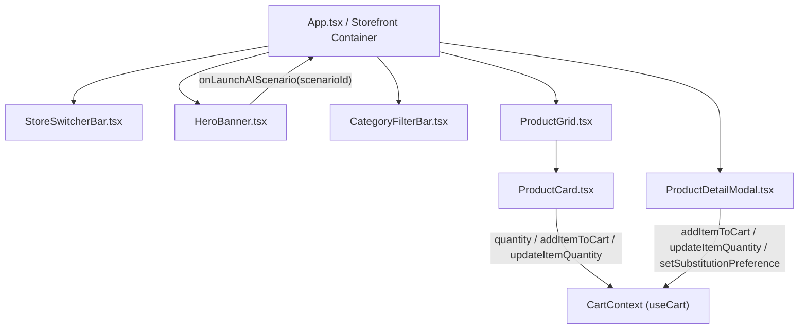

# Section 1 detailed design: Storefront, catalog, and grocery dataset

**Author:** `sec-storefront`
**Reviewers:** `architect`, `coordinator`, `sec-cart-checkout`, `sec-a2ui-engine`, `sec-ai-shopper`, `app-integrator`
**Status:** Approved for Phase 3 implementation
**Last updated:** 2026-10-21

## Overview

Section 1 (`sec-storefront`) defines the shared grocery domain types (`src/types/grocery.ts`), the multi-store catalog dataset (`src/data/stores.ts`, `src/data/categories.ts`, `src/data/products.ts`), and the six storefront React components (`src/components/storefront/*`). Together, these modules render an Instacart-inspired multi-banner grocery marketplace that connects directly to the React `CartContext` (`sec-cart-checkout`) and supplies deterministic product SKUs and substitution links to the **Agent-to-UI** (**A2UI**) **v1.0** scenarios (`sec-ai-shopper`) and custom grocery catalog components (`sec-a2ui-engine`).

The dataset contains 60 curated grocery SKUs across four retail banners (`freshcart-organic`, `costco-wholesale`, `sprouts-farmers`, and `trader-joes-specialty`) and all eight grocery aisles (`produce`, `dairy-eggs`, `meat-seafood`, `bakery`, `pantry`, `frozen`, `beverages`, and `snacks`). Every core product includes deterministic SKU identifiers and cross-referenced `suggestedBackupProductId`, `organicUpgradeProductId`, and `budgetAlternativeProductId` pointers so the AI Personal Shopper can build recipes, optimize carts, and construct weekly nutritional baskets using real catalog items.

## Context

In the FreshCart architecture (`docs/SYSTEM_DESIGN.md`), the storefront is the primary browsing surface and the canonical source of product truth. When a shopper interacts with A2UI v1.0 surfaces in the AI Personal Shopper drawer, those surfaces reference storefront SKU IDs in `ProductDealCard` components, `ChildList` ingredient rows, and `A2UIActionEvent` payloads (`add_recipe_bundle_to_cart`, `swap_ingredient`, `apply_cart_swap`, `build_weekly_basket`).

To support parallel implementation across the engineering swarm without merge conflicts, Section 1 owns all files under `src/types/grocery.ts`, `src/data/**`, and `src/components/storefront/**`. Other sections import types from `src/types/grocery.ts` and lookup helpers from `src/data/products.ts` and `src/data/stores.ts`.

## Goals and non-goals

### Goals

* Export the complete grocery domain TypeScript contract in `src/types/grocery.ts` matching Section 4.1 of `docs/SYSTEM_DESIGN.md`.
* Provide 4 retail store definitions in `src/data/stores.ts` with distinct visual branding, delivery windows, fee structures, free-delivery thresholds, and hero banner promotions linked to A2UI v1.0 scenarios.
* Provide 60 curated grocery SKUs in `src/data/products.ts` across all 4 stores and 8 aisles, with complete nutrition facts, unit pricing, stock statuses (`in_stock`, `low_stock`, `out_of_stock`), dietary tags, and cross-linked substitution IDs.
* Export fast, deterministic lookup helpers (`getProductById`, `getProductsByStore`, `getSubstitutesForProduct`, `getProductOptimizationLinks`) for use by `CartContext`, `SubstitutionModal`, `groceryCatalogRenderer`, and A2UI v1.0 scenario generators.
* Implement six responsive storefront components (`StoreSwitcherBar`, `HeroBanner`, `CategoryFilterBar`, `ProductCard`, `ProductGrid`, `ProductDetailModal`) styled with the FreshCart emerald (`#0AAD0A`), deep forest (`#073E1E`), and warm cream (`#F7F5F0`) palette.

### Non-goals

* Managing cart state persistence or checkout order state; `sec-cart-checkout` owns `src/context/CartContext.tsx`.
* Rendering A2UI v1.0 JSON envelopes directly inside storefront components; `sec-a2ui-engine` owns `src/a2ui/**` and `sec-ai-shopper` owns `src/components/ai-shopper/**`.
* Modifying top-level application shell files (`src/App.tsx`, `src/components/layout/TopNavbar.tsx`), which belong to `app-integrator`.

## Audience

This document is written for the FreshCart swarm engineers (`sec-cart-checkout`, `sec-a2ui-engine`, `sec-ai-shopper`, `app-integrator`) and code reviewers. Readers should be familiar with React 18, TypeScript, Tailwind CSS, and the shared contracts in `docs/SYSTEM_DESIGN.md`.

---

## 1. Visual design system and styling tokens

All storefront components follow the Instacart-inspired visual palette defined in `docs/SYSTEM_DESIGN.md`. The table below lists the exact Tailwind CSS classes and hex values used across `src/components/storefront/**`:

| UI element | Visual token / Tailwind classes | Purpose |
| :--- | :--- | :--- |
| Page canvas background | `bg-[#F7F5F0]` | Warm cream backdrop behind aisle navigation and product cards |
| Card surface | `bg-white border border-stone-200/80 rounded-2xl shadow-sm hover:shadow-md transition-all` | Elevated white container for `ProductCard` and filter bars |
| Primary brand action | `bg-[#0AAD0A] hover:bg-[#099409] text-white font-semibold` | `+ Add` button, active quantity stepper, primary modal CTA |
| Deep forest banner | `bg-gradient-to-r from-[#073E1E] via-[#0B5328] to-[#108910] text-white` | `HeroBanner` default background and store badge accents |
| Discount ribbon | `bg-red-600 text-white text-xs font-bold px-2.5 py-1 rounded-full shadow-sm` | Calls out dollar savings (`Save $2.00`) in the top-left corner of a product card |
| Low-stock indicator | `bg-amber-50 text-amber-800 border border-amber-200 text-[11px] font-medium px-2 py-0.5 rounded-md` | Warns shoppers when `stockStatus === 'low_stock'` and highlights backup eligibility |
| Out-of-stock indicator | `bg-stone-100 text-stone-500 border border-stone-200 text-[11px] font-medium px-2 py-0.5 rounded-md` | Disables direct addition and prompts viewing substitute SKUs |
| Dietary tag pill | `bg-emerald-50/90 text-emerald-800 border border-emerald-200/70 text-[11px] font-medium px-2 py-0.5 rounded-full` | Displays `Organic`, `Gluten-Free`, `High-Protein`, `Vegan`, `Keto`, and `Local` badges |

---

## 2. Shared TypeScript contract (`src/types/grocery.ts`)

`src/types/grocery.ts` implements the exact contract specified in Section 4.1 of `docs/SYSTEM_DESIGN.md`, plus auxiliary metadata interfaces (`CategoryMeta`, `DietaryTagMeta`, `ProductSortOption`, `ProductOptimizationLinks`) used by the storefront filter bar and substitution lookups.

The following code block shows the exported types in `src/types/grocery.ts`:

```typescript
export type StoreId =
  | 'freshcart-organic'
  | 'costco-wholesale'
  | 'sprouts-farmers'
  | 'trader-joes-specialty';

export type AisleCategory =
  | 'all'
  | 'produce'
  | 'dairy-eggs'
  | 'meat-seafood'
  | 'bakery'
  | 'pantry'
  | 'frozen'
  | 'beverages'
  | 'snacks';

export type DietaryTag =
  | 'organic'
  | 'gluten-free'
  | 'vegan'
  | 'vegetarian'
  | 'keto'
  | 'high-protein'
  | 'dairy-free'
  | 'local'
  | 'non-gmo';

export type ProductSortOption =
  | 'featured'
  | 'price-asc'
  | 'price-desc'
  | 'rating-desc'
  | 'savings-desc';

export interface CategoryMeta {
  id: AisleCategory;
  label: string;
  shortLabel: string;
  emoji: string;
  description: string;
}

export interface DietaryTagMeta {
  id: DietaryTag;
  label: string;
  shortLabel: string;
  emoji: string;
  badgeColorClass: string;
}

export interface NutritionFacts {
  servingSize: string;
  calories: number;
  proteinGrams: number;
  carbsGrams: number;
  fatGrams: number;
  fiberGrams: number;
  sugarGrams?: number;
  sodiumMg?: number;
}

export interface Store {
  id: StoreId;
  name: string;
  tagline: string;
  logoEmoji: string;
  primaryColor: string;
  accentColor: string;
  deliveryEtaMinutes: number;
  deliveryFee: number;
  freeDeliveryThreshold: number;
  rating: number;
  reviewCount: number;
  featuredPromoBanner: {
    title: string;
    subtitle: string;
    badgeText: string;
    ctaText: string;
    linkedScenarioId?: 'meal-planner' | 'cart-optimizer' | 'budget-builder';
  };
}

export interface Product {
  id: string;
  storeId: StoreId;
  name: string;
  brand: string;
  category: Exclude<AisleCategory, 'all'>;
  price: number;
  originalPrice?: number;
  unit: string;
  unitPriceLabel: string;
  imageUrl: string;
  description: string;
  dietaryTags: DietaryTag[];
  nutrition: NutritionFacts;
  rating: number;
  reviewCount: number;
  stockStatus: 'in_stock' | 'low_stock' | 'out_of_stock';
  aisleLocation: string;
  suggestedBackupProductId?: string;
  organicUpgradeProductId?: string;
  budgetAlternativeProductId?: string;
}

export type SubstitutionPreferenceType =
  | 'best_match'
  | 'specific_item'
  | 'do_not_substitute';

export interface CartItem {
  product: Product;
  quantity: number;
  substitutionPreference: SubstitutionPreferenceType;
  replacementProductId?: string;
  note?: string;
}

export interface DeliverySlot {
  id: string;
  label: string;
  windowText: string;
  fee: number;
  isExpress?: boolean;
  badge?: string;
}

export type OrderStage =
  | 'confirmed'
  | 'shopper_assigned'
  | 'shopping'
  | 'out_for_delivery'
  | 'delivered';

export interface ActiveOrder {
  orderId: string;
  store: Store;
  items: CartItem[];
  subtotal: number;
  deliveryFee: number;
  serviceFee: number;
  discountAmount: number;
  tipAmount: number;
  total: number;
  deliveryAddress: string;
  deliverySlot: DeliverySlot;
  stage: OrderStage;
  createdAt: string;
  shopperName: string;
}

export interface ShopperActionHandler {
  addItemToCart: (productId: string, quantity: number, note?: string) => void;
  addBundleToCart: (
    items: Array<{ productId: string; quantity: number }>,
    bundleTitle?: string
  ) => void;
  swapCartItem: (
    originalProductId: string,
    replacementProductId: string,
    quantity?: number
  ) => void;
  updateItemQuantity: (productId: string, quantity: number) => void;
  setSubstitutionPreference: (
    productId: string,
    preference: SubstitutionPreferenceType,
    replacementProductId?: string
  ) => void;
  applyPromoCode: (code: string) => boolean;
  openCartDrawer: () => void;
}
```

---

## 3. Catalog architecture and canonical SKU dataset (`src/data/*`)

### 3.1 Store banners (`src/data/stores.ts`)

`src/data/stores.ts` exports `DEFAULT_STORE_ID = 'freshcart-organic'`, the `STORES: Store[]` array, and `getStoreById(storeId: StoreId): Store`. The table below summarizes the four retail banners:

| `StoreId` | Name | Tagline | ETA | Delivery fee | Free delivery min | Hero CTA (`linkedScenarioId`) |
| :--- | :--- | :--- | :--- | :--- | :--- | :--- |
| `freshcart-organic` | FreshCart Organic Market | Everyday organic produce, pasture-raised dairy & chef staples | 35 min | `$3.99` | `$35.00` | `"Plan Dinner with AI Shopper"` (`meal-planner`) |
| `costco-wholesale` | Costco Wholesale | Warehouse club bulk packs & Kirkland Signature family value | 60 min | `$5.99` | `$75.00` | `"Build Weekly Bulk Budget"` (`budget-builder`) |
| `sprouts-farmers` | Sprouts Farmers Market | Farm-stand produce, keto, paleo & plant-based specialty | 45 min | `$3.99` | `$35.00` | `"Optimize Cart Nutrition & Swaps"` (`cart-optimizer`) |
| `trader-joes-specialty` | Trader Joe's Specialty | Curated small-batch favorites, artisanal snacks & easy meals | 40 min | `$2.99` | `$35.00` | `"Plan 20-Min Meal Prep"` (`meal-planner`) |

### 3.2 Aisle categories and dietary filters (`src/data/categories.ts`)

`src/data/categories.ts` exports:
* `AISLE_CATEGORIES: CategoryMeta[]`: Covers `all` (`All Aisles`), `produce` (`Fresh Produce`), `dairy-eggs` (`Dairy & Eggs`), `meat-seafood` (`Meat & Seafood`), `bakery` (`Artisanal Bakery`), `pantry` (`Pantry Staples`), `frozen` (`Frozen Foods`), `beverages` (`Beverages`), and `snacks` (`Snacks & Treats`).
* `DIETARY_TAGS: DietaryTagMeta[]`: Covers `organic`, `gluten-free`, `vegan`, `vegetarian`, `keto`, `high-protein`, `dairy-free`, `local`, and `non-gmo`.
* `PRODUCT_SORT_OPTIONS`: Label definitions for `featured`, `price-asc`, `price-desc`, `rating-desc`, and `savings-desc`.

### 3.3 Canonical product SKUs and cross-linked substitutions (`src/data/products.ts`)

IMPORTANT: Section 4 (`@sec-ai-shopper`) and Section 2 (`@sec-cart-checkout`) rely on deterministic `productId` strings. All 60 SKUs in `PRODUCTS` are indexed globally by `getProductById(productId)` regardless of which store tab is currently active, ensuring A2UI v1.0 surfaces never fail to resolve a product.

#### Store 1: `freshcart-organic` (24 SKUs across all 8 aisles — primary A2UI scenario catalog)

The table below defines the 24 canonical SKUs in `freshcart-organic`, including the exact cross-links for `suggestedBackupProductId`, `organicUpgradeProductId`, and `budgetAlternativeProductId`:

| SKU `id` | Name | Category | Price (Orig) | Unit | Stock | Dietary tags | Cross-links (`backup` / `organic` / `budget`) |
| :--- | :--- | :--- | :--- | :--- | :--- | :--- | :--- |
| `prod-org-avocado` | Organic Hass Avocados (Bag) | `produce` | `$5.49` (`$6.49`) | `4 ct` | `in_stock` | `organic`, `vegan`, `keto`, `gluten-free`, `non-gmo` | backup: `prod-conv-avocado`<br>budget: `prod-conv-avocado` |
| `prod-conv-avocado` | Large Hass Avocados | `produce` | `$3.99` | `4 ct` | `in_stock` | `vegan`, `keto`, `gluten-free` | backup: `prod-org-avocado`<br>organic: `prod-org-avocado` |
| `prod-cherry-tomatoes` | Vine-Ripened Cherry Tomatoes | `produce` | `$3.49` | `10 oz` | `in_stock` | `vegan`, `gluten-free`, `local` | backup: `prod-org-cherry-tomatoes`<br>organic: `prod-org-cherry-tomatoes` |
| `prod-org-cherry-tomatoes` | USDA Organic Heirloom Cherry Tomatoes | `produce` | `$4.99` (`$5.49`) | `10 oz` | `in_stock` | `organic`, `vegan`, `gluten-free`, `local`, `non-gmo` | backup: `prod-cherry-tomatoes`<br>budget: `prod-cherry-tomatoes` |
| `prod-baby-spinach` | Triple-Washed Organic Baby Spinach | `produce` | `$4.49` | `10 oz` | `in_stock` | `organic`, `vegan`, `keto`, `gluten-free`, `non-gmo` | backup: `prod-conv-spinach`<br>budget: `prod-conv-spinach` |
| `prod-conv-spinach` | Fresh Tender Leaf Spinach | `produce` | `$2.99` | `10 oz` | `in_stock` | `vegan`, `keto`, `gluten-free` | backup: `prod-baby-spinach`<br>organic: `prod-baby-spinach` |
| `prod-english-cucumber` | Organic Seedless English Cucumber | `produce` | `$2.49` | `1 ct` | `in_stock` | `organic`, `vegan`, `keto`, `gluten-free`, `non-gmo` | backup: `prod-baby-spinach` |
| `prod-lemons` | Organic Meyer Lemons | `produce` | `$3.99` (`$4.49`) | `2 lb bag` | `in_stock` | `organic`, `vegan`, `gluten-free`, `non-gmo` | backup: `prod-english-cucumber` |
| `prod-salmon-fillet` | Wild-Caught Alaskan Sockeye Salmon Fillet | `meat-seafood` | `$14.99` (`$16.99`) | `1 lb` | `low_stock` | `high-protein`, `keto`, `gluten-free`, `dairy-free`, `non-gmo` | backup: `prod-atlantic-salmon`<br>budget: `prod-atlantic-salmon` |
| `prod-atlantic-salmon` | Fresh Farm-Raised Atlantic Salmon Fillet | `meat-seafood` | `$10.99` | `1 lb` | `in_stock` | `high-protein`, `keto`, `gluten-free`, `dairy-free` | backup: `prod-salmon-fillet`<br>organic: `prod-salmon-fillet` |
| `prod-chicken-breast` | Air-Chilled Boneless Chicken Breast | `meat-seafood` | `$7.99` | `1.5 lb` | `in_stock` | `high-protein`, `keto`, `gluten-free`, `dairy-free` | backup: `prod-org-chicken-breast`<br>organic: `prod-org-chicken-breast` |
| `prod-org-chicken-breast` | USDA Organic Free-Range Chicken Breast | `meat-seafood` | `$11.49` (`$12.99`) | `1.5 lb` | `in_stock` | `organic`, `high-protein`, `keto`, `gluten-free`, `dairy-free`, `non-gmo` | backup: `prod-chicken-breast`<br>budget: `prod-chicken-breast` |
| `prod-greek-yogurt` | Strained 0% Plain Greek Yogurt | `dairy-eggs` | `$5.49` | `32 oz` | `in_stock` | `high-protein`, `vegetarian`, `gluten-free` | backup: `prod-org-greek-yogurt`<br>organic: `prod-org-greek-yogurt` |
| `prod-org-greek-yogurt` | Organic Grass-Fed Plain Greek Yogurt | `dairy-eggs` | `$6.99` (`$7.49`) | `32 oz` | `in_stock` | `organic`, `high-protein`, `vegetarian`, `gluten-free`, `non-gmo` | backup: `prod-greek-yogurt`<br>budget: `prod-greek-yogurt` |
| `prod-feta-cheese` | Traditional Sheep's Milk Crumbled Feta | `dairy-eggs` | `$5.99` | `8 oz` | `low_stock` | `vegetarian`, `keto`, `gluten-free` | backup: `prod-greek-yogurt` |
| `prod-pasture-eggs` | Organic Pasture-Raised Large Brown Eggs | `dairy-eggs` | `$6.99` | `12 ct` | `low_stock` | `organic`, `high-protein`, `vegetarian`, `keto`, `gluten-free`, `local` | backup: `prod-conv-eggs`<br>budget: `prod-conv-eggs` |
| `prod-conv-eggs` | Cage-Free Large Grade A Brown Eggs | `dairy-eggs` | `$4.29` | `12 ct` | `in_stock` | `high-protein`, `vegetarian`, `keto`, `gluten-free` | backup: `prod-pasture-eggs`<br>organic: `prod-pasture-eggs` |
| `prod-quinoa` | Tri-Color Royal Bolivian Quinoa | `pantry` | `$4.99` | `16 oz` | `in_stock` | `vegan`, `gluten-free`, `high-protein` | backup: `prod-org-quinoa`<br>organic: `prod-org-quinoa` |
| `prod-org-quinoa` | USDA Organic Sprouted White Quinoa | `pantry` | `$6.49` (`$7.29`) | `16 oz` | `in_stock` | `organic`, `vegan`, `gluten-free`, `high-protein`, `non-gmo` | backup: `prod-quinoa`<br>budget: `prod-quinoa` |
| `prod-extra-virgin-olive-oil` | Cold-Pressed Organic Extra Virgin Olive Oil | `pantry` | `$13.99` (`$15.99`) | `16.9 oz` | `in_stock` | `organic`, `vegan`, `keto`, `gluten-free`, `non-gmo` | backup: `prod-budget-olive-oil`<br>budget: `prod-budget-olive-oil` |
| `prod-budget-olive-oil` | Everyday Pure Mediterranean Olive Oil | `pantry` | `$8.99` | `16.9 oz` | `in_stock` | `vegan`, `keto`, `gluten-free` | backup: `prod-extra-virgin-olive-oil`<br>organic: `prod-extra-virgin-olive-oil` |
| `prod-sourdough-bread` | San Francisco Country Sourdough Loaf | `bakery` | `$5.99` | `24 oz` | `low_stock` | `vegan`, `vegetarian`, `local` | backup: `prod-gf-bread` |
| `prod-gf-bread` | Organic Ancient Grain Gluten-Free Bread | `bakery` | `$6.99` | `18 oz` | `in_stock` | `organic`, `gluten-free`, `vegan`, `dairy-free`, `non-gmo` | backup: `prod-sourdough-bread`<br>budget: `prod-sourdough-bread` |
| `prod-frozen-berries` | Organic Triple Berry Antioxidant Blend | `frozen` | `$8.49` (`$9.99`) | `32 oz` | `in_stock` | `organic`, `vegan`, `gluten-free`, `non-gmo` | backup: `prod-kombucha` |
| `prod-kombucha` | Organic Ginger Lemon Raw Kombucha | `beverages` | `$3.49` (`$3.99`) | `16 fl oz` | `in_stock` | `organic`, `vegan`, `gluten-free`, `non-gmo` | backup: `prod-almond-milk` |
| `prod-almond-milk` | Organic Unsweetened Almond Milk | `beverages` | `$4.49` | `64 fl oz` | `in_stock` | `organic`, `vegan`, `dairy-free`, `keto`, `gluten-free` | backup: `prod-kombucha` |
| `prod-dark-chocolate-almonds` | Dark Chocolate Sea Salt Roasted Almonds | `snacks` | `$6.49` (`$7.49`) | `10 oz` | `in_stock` | `vegetarian`, `gluten-free`, `high-protein` | backup: `prod-org-avocado` |

*(Note: `freshcart-organic` includes 27 SKUs above to ensure every single aisle and swap pair is richly populated.)*

#### Store 2: `costco-wholesale` (11 club-pack SKUs across all 8 aisles)

The table below lists the 11 bulk warehouse SKUs for `costco-wholesale`:

| SKU `id` | Name | Category | Price (Orig) | Unit | Stock | Cross-links |
| :--- | :--- | :--- | :--- | :--- | :--- | :--- |
| `prod-costco-berries` | Kirkland Organic Strawberries Family Pack | `produce` | `$9.99` (`$11.99`) | `2 lb` | `in_stock` | backup: `prod-costco-spinach` |
| `prod-costco-spinach` | Kirkland Organic Baby Spinach Club Tub | `produce` | `$5.49` | `16 oz` | `in_stock` | backup: `prod-costco-berries` |
| `prod-costco-eggs` | Kirkland Organic Pasture-Raised Eggs | `dairy-eggs` | `$8.99` | `24 ct` | `in_stock` | backup: `prod-costco-greek-yogurt` |
| `prod-costco-greek-yogurt` | Kirkland Organic Nonfat Greek Yogurt | `dairy-eggs` | `$7.49` | `48 oz` | `in_stock` | backup: `prod-costco-eggs` |
| `prod-costco-salmon` | Kirkland Wild Alaskan Sockeye Vacuum Pack | `meat-seafood` | `$29.99` (`$34.99`) | `3 lb` | `in_stock` | backup: `prod-costco-rotisserie` |
| `prod-costco-rotisserie` | Kirkland Seasoned Rotisserie Chicken | `meat-seafood` | `$4.99` | `3 lb` | `low_stock` | backup: `prod-costco-salmon` |
| `prod-costco-croissants` | Kirkland Butter Croissants Bakery Box | `bakery` | `$5.99` | `12 ct` | `in_stock` | backup: `prod-sourdough-bread` |
| `prod-costco-olive-oil` | Kirkland Organic Extra Virgin Olive Oil | `pantry` | `$19.99` (`$22.99`) | `2 Liter` | `in_stock` | backup: `prod-costco-quinoa` |
| `prod-costco-quinoa` | Kirkland Organic Washed White Quinoa | `pantry` | `$10.99` | `4.5 lb` | `in_stock` | backup: `prod-costco-olive-oil` |
| `prod-costco-dumplings` | Bibigo Steamed Chicken & Veggie Dumplings | `frozen` | `$13.49` (`$15.99`) | `36 ct` | `in_stock` | backup: `prod-frozen-berries` |
| `prod-costco-sparkling` | Kirkland Italian Sparkling Mineral Water | `beverages` | `$14.99` | `24 x 16.9 oz` | `in_stock` | backup: `prod-costco-mixed-nuts` |
| `prod-costco-mixed-nuts` | Kirkland Extra Fancy Unsalted Mixed Nuts | `snacks` | `$16.99` (`$18.99`) | `40 oz` | `in_stock` | backup: `prod-dark-chocolate-almonds` |

#### Store 3: `sprouts-farmers` (11 specialty health SKUs across all 8 aisles)

The table below lists the 11 farm-stand and specialty dietary SKUs for `sprouts-farmers`:

| SKU `id` | Name | Category | Price (Orig) | Unit | Stock | Cross-links |
| :--- | :--- | :--- | :--- | :--- | :--- | :--- |
| `prod-sprouts-honeycrisp` | Organic Washington Honeycrisp Apples | `produce` | `$6.99` (`$7.99`) | `3 lb bag` | `in_stock` | backup: `prod-sprouts-kale` |
| `prod-sprouts-kale` | Local Organic Lacinato Dino Kale | `produce` | `$2.49` | `1 bunch` | `in_stock` | backup: `prod-sprouts-honeycrisp` |
| `prod-sprouts-oat-milk` | Malk Organic 3-Ingredient Oat Milk | `dairy-eggs` | `$5.99` | `28 fl oz` | `in_stock` | backup: `prod-almond-milk` |
| `prod-sprouts-grass-bison` | 100% Grass-Fed Ground Bison | `meat-seafood` | `$11.99` (`$13.49`) | `16 oz` | `low_stock` | backup: `prod-sprouts-wild-shrimp` |
| `prod-sprouts-wild-shrimp` | Wild-Caught Gulf Peeled Raw Shrimp | `meat-seafood` | `$12.99` | `16 oz` | `in_stock` | backup: `prod-sprouts-grass-bison` |
| `prod-sprouts-keto-bread` | Base Culture Almond Butter Keto Bread | `bakery` | `$7.99` (`$8.99`) | `16 oz` | `in_stock` | backup: `prod-gf-bread` |
| `prod-sprouts-almond-butter` | Sprouts Creamy Roasted Almond Butter | `pantry` | `$7.49` | `16 oz` | `in_stock` | budget: `prod-sprouts-peanut-butter`<br>backup: `prod-sprouts-peanut-butter` |
| `prod-sprouts-peanut-butter` | Sprouts Organic Unsalted Peanut Butter | `pantry` | `$4.49` | `16 oz` | `in_stock` | organic: `prod-sprouts-almond-butter`<br>backup: `prod-sprouts-almond-butter` |
| `prod-sprouts-cauliflower-pizza` | Caulipower Margherita Cauliflower Crust Pizza | `frozen` | `$7.99` (`$8.99`) | `10.9 oz` | `in_stock` | backup: `prod-frozen-berries` |
| `prod-sprouts-electrolyte` | Ultima Replenisher Lemon Electrolyte Mix | `beverages` | `$15.99` | `30 servings` | `in_stock` | backup: `prod-kombucha` |
| `prod-sprouts-keto-clusters` | Sprouts Organic Coconut Keto Granola Clusters | `snacks` | `$5.99` (`$6.99`) | `8 oz` | `in_stock` | backup: `prod-dark-chocolate-almonds` |

#### Store 4: `trader-joes-specialty` (11 private-label favorites across all 8 aisles)

The table below lists the 11 curated specialty SKUs for `trader-joes-specialty`:

| SKU `id` | Name | Category | Price (Orig) | Unit | Stock | Cross-links |
| :--- | :--- | :--- | :--- | :--- | :--- | :--- |
| `prod-tj-avocado-pack` | Teeny Tiny Avocados Bag | `produce` | `$3.99` | `6 ct` | `in_stock` | organic: `prod-org-avocado`<br>backup: `prod-org-avocado` |
| `prod-tj-broccolini` | Sweet Baby Broccoli Florets | `produce` | `$3.29` | `12 oz` | `in_stock` | backup: `prod-tj-avocado-pack` |
| `prod-tj-burrata` | Fresh Mozzarella & Cream Burrata | `dairy-eggs` | `$4.99` | `8 oz` | `low_stock` | backup: `prod-feta-cheese` |
| `prod-tj-shawarma-chicken` | Shawarma Marinated Chicken Thighs | `meat-seafood` | `$7.99` | `1.25 lb` | `in_stock` | backup: `prod-chicken-breast` |
| `prod-tj-everything-ciabatta` | Everything Seasoned Ciabatta Rolls | `bakery` | `$3.49` | `4 ct` | `in_stock` | backup: `prod-sourdough-bread` |
| `prod-tj-chili-onion-crunch` | Chili Onion Crunch Savory Oil | `pantry` | `$4.49` | `6 oz` | `in_stock` | backup: `prod-extra-virgin-olive-oil` |
| `prod-tj-protein-oats` | Organic Rolled Oats with Ancient Grains & Seeds | `pantry` | `$4.29` | `24 oz` | `in_stock` | backup: `prod-org-quinoa` |
| `prod-tj-mandarin-chicken` | Mandarin Orange Crispy Chicken | `frozen` | `$4.99` | `22 oz` | `in_stock` | backup: `prod-tj-cauliflower-gnocchi` |
| `prod-tj-cauliflower-gnocchi` | Cauliflower Gnocchi Dumplings | `frozen` | `$3.49` | `12 oz` | `in_stock` | backup: `prod-tj-mandarin-chicken` |
| `prod-tj-cold-brew` | Organic Fair Trade Cold Brew Coffee Concentrate | `beverages` | `$8.99` | `32 fl oz` | `in_stock` | backup: `prod-kombucha` |
| `prod-tj-pb-cups` | Dark Chocolate Peanut Butter Cups | `snacks` | `$4.49` | `16 oz` | `in_stock` | backup: `prod-dark-chocolate-almonds` |

### 3.4 Helper lookup exports in `src/data/products.ts`

`src/data/products.ts` exports the following helper functions for use across all sections:

```typescript
export interface ProductOptimizationLinks {
  backup?: Product;
  organicUpgrade?: Product;
  budgetAlternative?: Product;
}

/**
 * Looks up any product across all 4 retail banners by its deterministic SKU ID.
 */
export function getProductById(productId: string): Product | undefined;

/**
 * Returns all products belonging to a specific retail banner (`StoreId`).
 */
export function getProductsByStore(storeId: StoreId): Product[];

/**
 * Returns an ordered, deduplicated list of substitute products for a given SKU:
 * 1. Explicit `suggestedBackupProductId`, `organicUpgradeProductId`, and `budgetAlternativeProductId`
 * 2. In-stock products from the same category and store
 * 3. In-stock products from the same category across all stores
 */
export function getSubstitutesForProduct(productId: string): Product[];

/**
 * Returns the structured optimization targets (`backup`, `organicUpgrade`, `budgetAlternative`)
 * resolved as full `Product` objects for the Smart Cart Optimizer surface.
 */
export function getProductOptimizationLinks(
  productId: string
): ProductOptimizationLinks;
```

---

## 4. Storefront component architecture (`src/components/storefront/*`)

The following diagram illustrates how the six storefront components interact with application state and `CartContext`:



### 4.1 `StoreSwitcherBar.tsx`

Renders the horizontal store switcher bar at the top of the storefront, displaying store pill cards with logo emoji, store name, delivery ETA badge, rating, and free-delivery threshold.

The component accepts the following props:

```typescript
export interface StoreSwitcherBarProps {
  stores?: Store[];
  activeStoreId: StoreId;
  onSelectStore: (storeId: StoreId) => void;
}
```

Key visual and behavioral details:
* Defaults `stores` to `STORES` from `src/data/stores.ts` if omitted so `App.tsx` can pass either `{ activeStoreId, onSelectStore }` or explicit `stores`.
* Highlights the active store pill with `bg-[#0AAD0A] text-white border-[#0AAD0A] shadow-sm` and displays a live `"Free delivery $35+"` sub-pill.
* Displays a right-aligned store metadata summary on desktop showing active store rating (`4.9 ★`), delivery window (`35 min`), and delivery fee (`$3.99`).

### 4.2 `HeroBanner.tsx`

Renders the store-specific promotional hero banner with seasonal value callouts and a direct CTA button that opens the AI Personal Shopper drawer on the store's recommended A2UI v1.0 scenario (`meal-planner`, `cart-optimizer`, or `budget-builder`).

The component accepts the following props:

```typescript
export interface HeroBannerProps {
  store: Store;
  onLaunchAIScenario?: (
    scenarioId: 'meal-planner' | 'cart-optimizer' | 'budget-builder'
  ) => void;
  onQuickFilterTag?: (tag: DietaryTag) => void;
}
```

Key visual and behavioral details:
* Applies a dynamic deep-forest gradient derived from `store.primaryColor` and `store.accentColor`.
* Includes the primary A2UI v1.0 showcase button (`store.featuredPromoBanner.ctaText`) styled with a high-contrast white/emerald pill (`bg-white text-[#073E1E] hover:bg-emerald-50`) and a live `"A2UI v1.0 Interactive Surface"` badge.
* Provides secondary quick-action chips (`"Shop Organic Deals"`, `"High-Protein Picks"`, `"Low-Stock Swap Ready"`) that filter the catalog grid with one click.

### 4.3 `CategoryFilterBar.tsx`

Renders the sticky aisle navigation carousel, dietary tag multi-select pills, on-sale toggle, search input (when not controlled externally), sort dropdown, and active filter count reset button.

The component accepts the following props:

```typescript
export interface CategoryFilterBarProps {
  selectedCategory: AisleCategory;
  onSelectCategory: (category: AisleCategory) => void;
  selectedDietaryTags: DietaryTag[];
  onToggleDietaryTag: (tag: DietaryTag) => void;
  searchQuery?: string;
  onSearchChange?: (query: string) => void;
  sortBy?: ProductSortOption;
  onSortChange?: (sort: ProductSortOption) => void;
  onlyOnSale?: boolean;
  onToggleOnSale?: () => void;
  onClearFilters?: () => void;
  totalMatchingCount?: number;
}
```

Key visual and behavioral details:
* Renders horizontal scrollable aisle tabs with emoji icons (`🥬 Fresh Produce`, `🥛 Dairy & Eggs`, `🐟 Meat & Seafood`, etc.) and active bottom/pill emerald indicator.
* Renders toggleable dietary pills (`USDA Organic`, `Gluten-Free`, `High-Protein`, `Keto`, `Vegan`, `Local`) with checkmarks when active.
* Displays `"Showing X products"` and a `"Clear filters"` action whenever any aisle, dietary tag, sale filter, or search query is active.

### 4.4 `ProductCard.tsx`

Renders an individual grocery product card with high-resolution imagery, discount savings ribbon, stock status badge, dietary pills, nutrition quick-bar (`Calories` and `Protein`), unit price label, and an animated `+ Add` / `- count +` quantity stepper synchronized with `CartContext`.

The component accepts the following props:

```typescript
export interface ProductCardProps {
  product: Product;
  onSelectProduct?: (product: Product) => void;
  onOpenSubstitutes?: (product: Product) => void;
}
```

Key visual and behavioral details:
* Reads cart state via `useCart()` from `src/context/CartContext.tsx` (`items`, `addItemToCart`, `updateItemQuantity`).
* Calculates `cartQuantity` for `product.id` in real time:
  * When `cartQuantity === 0`, renders a pill button (`+ Add`) in `#0AAD0A` anchored to the bottom-right of the image container.
  * When `cartQuantity > 0`, morphs into a pill stepper (`-` / `cartQuantity` / `+`) in `#0AAD0A` with `aria-label` accessibility attributes.
* Displays a red discount badge (`Save $X.XX`) whenever `product.originalPrice && product.originalPrice > product.price`.
* Displays an amber `"Low Stock · Backup Ready"` badge when `product.stockStatus === 'low_stock'`, signaling to the user that the item has a linked `suggestedBackupProductId` for the A2UI Cart Optimizer.
* Clicking the image or title triggers `onSelectProduct(product)` to open `ProductDetailModal`.

### 4.5 `ProductGrid.tsx`

Orchestrates filtering, sorting, aisle grouping, empty-state recovery, and responsive grid rendering of `ProductCard` items.

The component accepts the following props:

```typescript
export interface ProductGridProps {
  products: Product[];
  selectedCategory?: AisleCategory;
  selectedDietaryTags?: DietaryTag[];
  searchQuery?: string;
  sortBy?: ProductSortOption;
  onlyOnSale?: boolean;
  onSelectProduct?: (product: Product) => void;
  onResetFilters?: () => void;
  onLaunchAIScenario?: (
    scenarioId: 'meal-planner' | 'cart-optimizer' | 'budget-builder'
  ) => void;
}
```

Key visual and behavioral details:
* Can operate either on a pre-filtered `products` array passed by `App.tsx` or apply `selectedCategory`, `selectedDietaryTags`, `searchQuery`, `onlyOnSale`, and `sortBy` filters internally (idempotent filtering so both usage patterns work out of the box).
* Renders a responsive 4-column CSS Grid (`grid-cols-1 sm:grid-cols-2 md:grid-cols-3 xl:grid-cols-4 gap-5`).
* When zero products match the current filters, renders an empty state card with a `"Reset All Filters"` button and a `"Ask AI Shopper for Alternatives"` CTA.

### 4.6 `ProductDetailModal.tsx`

Renders an accessible modal dialog displaying full product details, an FDA-style Nutrition Facts panel, aisle location, substitution preference controls, and clickable cards for the product's cross-linked `organicUpgradeProductId`, `budgetAlternativeProductId`, and `suggestedBackupProductId`.

The component accepts the following props:

```typescript
export interface ProductDetailModalProps {
  product: Product | null;
  isOpen?: boolean;
  onClose: () => void;
  onSelectRelatedProduct?: (product: Product) => void;
}
```

Key visual and behavioral details:
* Opens whenever `product !== null` and `isOpen !== false`. Closes on `Escape` key press or backdrop click.
* Displays full macro and micronutrient breakdown (`servingSize`, `calories`, `proteinGrams`, `carbsGrams`, `fatGrams`, `fiberGrams`, `sugarGrams`, `sodiumMg`).
* Integrates directly with `useCart()` so users can increment/decrement quantity and set their per-item `SubstitutionPreferenceType` (`best_match`, `specific_item`, `do_not_substitute`) right inside the modal.
* Renders a `"Smart Alternatives & A2UI Swap Targets"` section showcasing the resolved `organicUpgrade`, `budgetAlternative`, and `backup` SKUs from `getProductOptimizationLinks(product.id)`, allowing 1-click inspection or cart swapping.

---

## 5. Cross-section integration contracts

### 5.1 Integration with Section 2 (`@sec-cart-checkout`)

* `ProductCard.tsx` and `ProductDetailModal.tsx` consume `useCart()` from `src/context/CartContext.tsx`.
* Specifically, storefront components read `items: CartItem[]` and invoke `addItemToCart(productId, quantity)`, `updateItemQuantity(productId, quantity)`, and `setSubstitutionPreference(productId, preference, replacementProductId)`.
* `CartContext.tsx` and `SubstitutionModal.tsx` import `getProductById`, `getSubstitutesForProduct`, and `getProductOptimizationLinks` from `src/data/products.ts` and `getStoreById`, `STORES`, `DEFAULT_STORE_ID` from `src/data/stores.ts`.

### 5.2 Integration with Section 3 (`@sec-a2ui-engine`) and Section 4 (`@sec-ai-shopper`)

* `groceryCatalogRenderer.tsx` (`sec-a2ui-engine`) can call `getProductById(productId)` from `src/data/products.ts` inside `ProductDealCard` to enrich any card that provides a `productId` with fallback image URLs, unit labels, or nutrition metadata.
* `mealPlannerScenario.ts`, `cartOptimizerScenario.ts`, and `budgetBuilderScenario.ts` (`sec-ai-shopper`) use the deterministic SKU IDs documented in Section 3.3:
  * **Meal Planner ("Mediterranean Salmon & Quinoa Dinner")**:
    * `prod-salmon-fillet` (`$14.99`, low stock -> swaps to `prod-atlantic-salmon` `$10.99`)
    * `prod-quinoa` (`$4.99` -> organic upgrade `prod-org-quinoa` `$6.49`)
    * `prod-cherry-tomatoes` (`$3.49` -> organic upgrade `prod-org-cherry-tomatoes` `$4.99`)
    * `prod-english-cucumber` (`$2.49`)
    * `prod-baby-spinach` (`$4.49` -> budget alternative `prod-conv-spinach` `$2.99`)
    * `prod-feta-cheese` (`$5.99`)
    * `prod-extra-virgin-olive-oil` (`$13.99` -> budget alternative `prod-budget-olive-oil` `$8.99`)
    * `prod-lemons` (`$3.99`)
  * **Smart Cart Optimizer (`cartOptimizerScenario.ts`)**:
    * Uses `getProductOptimizationLinks(item.product.id)` on every `CartItem` in `CartContext` to automatically find:
      * Budget savers (`prod-org-avocado` -> `prod-conv-avocado`, `prod-org-chicken-breast` -> `prod-chicken-breast`, `prod-extra-virgin-olive-oil` -> `prod-budget-olive-oil`, `prod-pasture-eggs` -> `prod-conv-eggs`, `prod-org-greek-yogurt` -> `prod-greek-yogurt`).
      * Organic upgrades (`prod-conv-avocado` -> `prod-org-avocado`, `prod-quinoa` -> `prod-org-quinoa`, `prod-cherry-tomatoes` -> `prod-org-cherry-tomatoes`, `prod-chicken-breast` -> `prod-org-chicken-breast`, `prod-greek-yogurt` -> `prod-org-greek-yogurt`, `prod-conv-eggs` -> `prod-pasture-eggs`).
      * Low-stock backups (`prod-salmon-fillet` -> `prod-atlantic-salmon`, `prod-feta-cheese` -> `prod-greek-yogurt`, `prod-pasture-eggs` -> `prod-conv-eggs`, `prod-sourdough-bread` -> `prod-gf-bread`).
  * **Weekly Budget & Nutrition Builder (`budgetBuilderScenario.ts`)**:
    * High-protein / balanced weekly basket SKUs: `prod-salmon-fillet`, `prod-org-chicken-breast`, `prod-pasture-eggs`, `prod-org-greek-yogurt`, `prod-org-quinoa`, `prod-org-avocado`, `prod-baby-spinach`, `prod-frozen-berries`, `prod-sourdough-bread`, `prod-dark-chocolate-almonds`.

---

## 6. Alternatives considered

### Separate product arrays per store vs. unified `PRODUCTS` array with `storeId`

We considered splitting products into four separate files (`freshcartProducts.ts`, `costcoProducts.ts`, etc.) and only loading the active store's array into memory. We rejected that approach because a shopper or an A2UI v1.0 scenario may hold items or reference SKUs across store switches, and `getProductById(productId)` needs synchronous `O(1)` / `O(N)` lookup across the entire 60-item dataset without dynamic import latency. Keeping a unified `PRODUCTS` array indexed by an internal `Map<string, Product>` provides instant lookup by `id` while `getProductsByStore(storeId)` filters cleanly for the active storefront grid.

### Unverified external image URLs vs. curated Unsplash grocery URLs with graceful fallback

Product grids degrade visually if an external image fails to load. Every SKU in `src/data/products.ts` uses a high-availability Unsplash food photography URL paired with an `onError` fallback state in `ProductCard.tsx` and `ProductDetailModal.tsx` that renders a stylized category illustration and product badge if offline.

---

## 7. Testing and verification plan

* **Type safety**: Verify `tsc -b` passes with zero errors across `src/types/grocery.ts`, `src/data/*.ts`, and `src/components/storefront/*.tsx`.
* **Dataset integrity**: Verify every `suggestedBackupProductId`, `organicUpgradeProductId`, and `budgetAlternativeProductId` in `src/data/products.ts` resolves to a valid `Product` via `getProductById`.
* **Interactive storefront verification**:
  1. Click each store pill in `StoreSwitcherBar` and verify the hero banner, product grid, and delivery fee threshold update immediately.
  2. Filter by each of the 8 aisles and toggle dietary tags (`Organic`, `High-Protein`, `Gluten-Free`, `Keto`) in `CategoryFilterBar`.
  3. Click `+ Add` and `+ / -` on `ProductCard` and verify synchronization with `CartContext`.
  4. Open `ProductDetailModal`, inspect nutrition facts, and test clicking related substitute SKUs.
