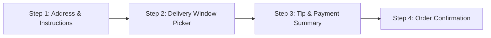

# Section 2 detailed design: Cart context, drawer, substitution modal, checkout, and order tracker

**Author:** `sec-cart-checkout`
**Status:** Ready for Phase 3 implementation
**Last updated:** 2026-10-21

## Overview and scope

This document specifies the architecture, TypeScript interfaces, calculation formulas, and component designs for Section 2 of **FreshCart** (`sec-cart-checkout`). Section 2 manages the shopping cart state, store-aware pricing and fee calculations, per-item substitution rules, promo code evaluation, multi-step checkout scheduling, live order tracking, and the `ShopperActionHandler` bridge consumed by **Agent-to-UI** (**A2UI**) **v1.0** surfaces.

### Audience

This design targets the FreshCart engineering swarm (`app-integrator`, `sec-storefront`, `sec-a2ui-engine`, and `sec-ai-shopper`). Readers should be familiar with React 18 Context, TypeScript, Tailwind CSS, and the shared domain contracts in `docs/SYSTEM_DESIGN.md`.

### In scope

* `src/context/CartContext.tsx`: React state provider, `localStorage` persistence, derived monetary metrics, toast queue for AI Personal Shopper actions, and `useCart()` hook.
* `src/components/cart/CartDrawer.tsx`: Slide-over cart drawer with free-delivery progress bar, `"Optimize Cart with AI (A2UI v1.0)"` CTA banner, item list, promo code input, and savings breakdown.
* `src/components/cart/CartItemRow.tsx`: Line-item row with quantity stepper, unit/extended pricing, savings callout, substitution status badge, and optional shopper note.
* `src/components/cart/SubstitutionModal.tsx`: Per-item dialog for selecting `"Best match"`, `"Specific replacement"` (with store SKU picker), or `"Don't substitute"`.
* `src/components/checkout/CheckoutModal.tsx`: 4-step modal flow covering delivery address and instructions, Express and 2-hour delivery window selection, shopper tip and payment summary, and order confirmation.
* `src/components/checkout/OrderTrackerBanner.tsx`: Interactive 4-stage live progress tracker (`Confirmed` -> `Personal Shopper Assigned` -> `Shopping in Progress` -> `Out for Delivery` -> `Delivered`) with manual step simulation and auto-progression.

### Out of scope

* Storefront product grid and catalog dataset implementation (`sec-storefront`).
* A2UI v1.0 surface state management and message evaluation (`sec-a2ui-engine`).
* AI Personal Shopper scenario definitions (`sec-ai-shopper`).

---

## 1. Cart and order state context (`src/context/CartContext.tsx`)

`CartContext` is the single source of truth for cart line items, active store selection, promo codes, checkout modal visibility, active orders, and action feedback toasts. It implements the `ShopperActionHandler` contract from `src/types/grocery.ts` so A2UI v1.0 action events (`add_recipe_bundle_to_cart`, `apply_cart_swap`, `apply_all_optimizations`, `build_weekly_basket`) mutate real application state.

### 1.1 TypeScript interfaces exported by `src/context/CartContext.tsx`

```typescript
import type {
  ActiveOrder,
  CartItem,
  DeliverySlot,
  OrderStage,
  Product,
  ShopperActionHandler,
  Store,
  StoreId,
  SubstitutionPreferenceType,
} from '../types/grocery';

export type PromoCodeId = 'FRESH10' | 'A2UIV1' | 'ORGANIC15';

export interface PromoCodeRule {
  code: PromoCodeId;
  label: string;
  description: string;
  discountType: 'flat' | 'percent_all' | 'percent_organic';
  value: number; // 10 for $10 flat, 15 for 15%, etc.
  minSubtotal: number;
}

export interface FreeDeliveryProgress {
  threshold: number;
  currentSubtotal: number;
  amountRemaining: number;
  percentComplete: number; // 0 to 100
  isUnlocked: boolean;
}

export interface CartToast {
  id: string;
  title: string;
  description?: string;
  variant: 'success' | 'info' | 'warning';
  source: 'user' | 'a2ui-shopper';
  createdAt: number;
}

export interface PlaceOrderInput {
  deliveryAddress: string;
  aptOrSuite?: string;
  deliveryInstructions?: string;
  leaveAtDoor: boolean;
  deliverySlot: DeliverySlot;
  tipAmount: number;
  paymentMethodLabel: string;
}

export interface CartContextValue extends ShopperActionHandler {
  // Core Cart & Store State
  items: CartItem[];
  allStoreItems: Record<StoreId, CartItem[]>;
  activeStoreId: StoreId;
  activeStore: Store;
  setActiveStoreId: (storeId: StoreId) => void;

  // Derived Item Counts & Lookups
  totalItemCount: number;
  uniqueItemCount: number;
  getItemQuantity: (productId: string) => number;
  getCartItem: (productId: string) => CartItem | undefined;

  // Monetary & Fee Calculations
  subtotal: number;
  originalSubtotal: number;
  productSavings: number;
  deliveryFee: number;
  serviceFee: number;
  discountAmount: number;
  totalSavings: number;
  estimatedTotalBeforeTip: number;
  promoCode: string | null;
  appliedPromoRule: PromoCodeRule | null;
  promoError: string | null;
  removePromoCode: () => void;
  freeDeliveryProgress: FreeDeliveryProgress;

  // Additional Cart Mutations (extending ShopperActionHandler)
  removeItemFromCart: (productId: string) => void;
  updateItemNote: (productId: string, note: string) => void;
  clearCart: () => void;

  // Drawer, Substitution Modal & Checkout Modal Controls
  isCartOpen: boolean;
  closeCartDrawer: () => void;
  toggleCartDrawer: () => void;
  isCheckoutOpen: boolean;
  openCheckoutModal: () => void;
  closeCheckoutModal: () => void;
  editingSubstitutionProductId: string | null;
  openSubstitutionModal: (productId: string) => void;
  closeSubstitutionModal: () => void;

  // AI Shopper Surface Launcher Hook
  onRequestOptimizeCart?: () => void;
  triggerOptimizeCartWithAI: () => void;

  // Active Orders & Live Tracker Controls
  activeOrders: ActiveOrder[];
  placeOrder: (input: PlaceOrderInput) => ActiveOrder;
  advanceOrderStage: (orderId: string) => void;
  setOrderStage: (orderId: string, stage: OrderStage) => void;
  dismissOrder: (orderId: string) => void;

  // Toast Notification Queue (for A2UI v1.0 & Cart Actions)
  toasts: CartToast[];
  addToast: (toast: Omit<CartToast, 'id' | 'createdAt'>) => void;
  dismissToast: (id: string) => void;
}
```

### 1.2 Provider props and initial starter cart

`<CartProvider>` accepts optional configuration props so `App.tsx` can wire store switching or AI Shopper drawer triggers cleanly:

```typescript
export interface CartProviderProps {
  children: React.ReactNode;
  initialStoreId?: StoreId;
  externalActiveStoreId?: StoreId;
  onActiveStoreChange?: (storeId: StoreId) => void;
  onRequestOptimizeCart?: () => void;
}
```

IMPORTANT: On first load (when `localStorage.getItem('freshcart_cart_v1')` is empty), `CartProvider` seeds the `freshcart-organic` cart with 3 starter items (for example, conventional avocados, conventional Greek yogurt, and wild salmon or sourdough bread) totaling approximately `$24.00–$28.00`. This initial state ensures that:
1. The free-delivery progress bar immediately shows progress toward the `$35.00` threshold (`Add $X.XX more for FREE delivery`).
2. A user who clicks `"Optimize Cart with AI (A2UI v1.0)"` right away has live items in their cart for Scenario B (`cartOptimizerScenario.ts`) to inspect and swap.

### 1.3 Pricing, promo code, and fee formulas

`CartContext` computes all monetary totals deterministically on every render from `items` and `activeStore`:

1. **Subtotal (`subtotal`)**:
   $$\text{subtotal} = \sum (\text{item.product.price} \times \text{item.quantity})$$
2. **Original subtotal and product sale savings (`productSavings`)**:
   $$\text{originalSubtotal} = \sum ((\text{item.product.originalPrice} ?? \text{item.product.price}) \times \text{item.quantity})$$
   $$\text{productSavings} = \max(0, \text{originalSubtotal} - \text{subtotal})$$
3. **Free-delivery progress (`freeDeliveryProgress`)**:
   * `threshold = activeStore.freeDeliveryThreshold` (`$35.00` for FreshCart Organic, Sprouts, and Trader Joe's; `$75.00` for Costco Wholesale).
   * `amountRemaining = Math.max(0, threshold - subtotal)`.
   * `percentComplete = Math.min(100, Math.round((subtotal / threshold) * 100))`.
   * `isUnlocked = subtotal >= threshold && subtotal > 0`.
4. **Delivery fee (`deliveryFee`)**:
   * `0` when `subtotal === 0` or `freeDeliveryProgress.isUnlocked === true` or promo code `A2UIV1` free-delivery perk applies.
   * Otherwise `activeStore.deliveryFee` (e.g., `$3.99` or `$5.99`).
5. **Service fee (`serviceFee`)**:
   * `0` when `subtotal === 0`.
   * Otherwise `Math.max(1.99, Number((subtotal * 0.05).toFixed(2)))` (5% platform service fee, minimum `$1.99`).
6. **Supported promo codes (`PromoCodeId`)**:

| Code | Rule description | Minimum subtotal | Calculation |
| :--- | :--- | :--- | :--- |
| `FRESH10` | `$10.00` off orders of `$30.00+` | `$30.00` | `discountAmount = 10.00` |
| `A2UIV1` | `15%` off entire order (A2UI v1.0 Showcase Promo) | `$15.00` | `discountAmount = Number((subtotal * 0.15).toFixed(2))` |
| `ORGANIC15` | `15%` off all USDA Organic items in cart | `$0.00` | `15%` of subtotal for items where `product.dietaryTags.includes('organic')` |

7. **Total savings (`totalSavings`)**:
   $$\text{totalSavings} = \text{productSavings} + \text{discountAmount} + (\text{freeDeliveryProgress.isUnlocked} ? \text{activeStore.deliveryFee} : 0)$$

### 1.4 `ShopperActionHandler` behavior and AI Shopper toast feedback

When the A2UI v1.0 Action Event Bridge invokes methods on `ShopperActionHandler`, `CartContext` resolves products via `getProductById(productId)` (from `src/data/products.ts`, with a safe fallback lookup across all catalog products) and emits a `CartToast` (`source: 'a2ui-shopper'`, auto-dismissed after 4,500 ms):

* `addItemToCart(productId, quantity, note)`: Upserts the SKU into the cart. If `quantity <= 0`, removes the item. Default `substitutionPreference` is `'best_match'`, and if the product defines `suggestedBackupProductId`, pre-links `replacementProductId`.
* `addBundleToCart(items, bundleTitle)`: Batch-upserts multiple `{ productId, quantity }` entries in a single state transition and pushes a toast: `"Added ${items.length} items from ${bundleTitle ?? 'AI Meal Plan'} to your cart"`.
* `swapCartItem(originalProductId, replacementProductId, quantity)`: Replaces `originalProductId` in-place (preserving its index position in the cart list) with `replacementProductId`. Uses `quantity` if provided, or preserves the original item's quantity. Pushes a toast: `"Swapped ${oldProduct.name} → ${newProduct.name}"`.
* `updateItemQuantity(productId, quantity)`: Sets exact quantity; removes item if `quantity <= 0`.
* `setSubstitutionPreference(productId, preference, replacementProductId)`: Updates the item's `substitutionPreference` and optional `replacementProductId`.
* `applyPromoCode(code)`: Normalizes `code.trim().toUpperCase()`, validates against `PROMO_RULES` and `minSubtotal`, sets `promoCode` and `promoError`, and returns `true` if valid or `false` otherwise.
* `openCartDrawer()`: Sets `isCartOpen = true`.

---

## 2. Slide-over cart drawer (`src/components/cart/CartDrawer.tsx`)

`CartDrawer` is a slide-over right panel (`max-w-md w-full`) with a semi-transparent backdrop (`bg-stone-950/40 backdrop-blur-xs`) and keyboard `Escape` support.

### 2.1 Component props

```typescript
export interface CartDrawerProps {
  onOptimizeCartWithAI?: () => void;
}
```

NOTE: If `onOptimizeCartWithAI` is passed as a prop, clicking `"Optimize Cart with AI (A2UI v1.0)"` invokes it and closes or docks the cart drawer; otherwise it calls `triggerOptimizeCartWithAI()` from `useCart()`, which also dispatches a browser custom event `new CustomEvent('freshcart:open-ai-shopper', { detail: { scenarioId: 'cart-optimizer' } })` so `App.tsx` or `AIShopperDrawer` can listen either via prop or event.

### 2.2 Visual sections inside `CartDrawer`

1. **Store header bar**:
   * Displays the active store badge (`activeStore.logoEmoji`, `activeStore.name`), estimated delivery time (`35 min`), and close (`X`) button.
2. **Free-delivery progress banner**:
   * When `freeDeliveryProgress.isUnlocked` is `false`: shows `"Add $X.XX more for FREE delivery"` with an animated emerald progress bar (`bg-[#0AAD0A]`, transition `duration-500`).
   * When `freeDeliveryProgress.isUnlocked` is `true`: shows a celebratory green pill (`"🎉 You've unlocked FREE delivery on this order!"`) with a full `100%` emerald bar.
3. **One-click A2UI v1.0 Smart Cart Optimizer card**:
   * Prominent gradient banner (`bg-gradient-to-r from-[#073E1E] to-[#108910] text-white rounded-xl p-3.5`) directly below the progress bar when `items.length > 0`.
   * Displays a live summary of optimization opportunities in the current cart: counts how many items in `items` have `budgetAlternativeProductId`, `organicUpgradeProductId`, or `stockStatus === 'low_stock'`.
   * Primary button: **`"Optimize Cart with AI (A2UI v1.0)"`** (`Sparkles` icon).
4. **Scrollable cart items list**:
   * Renders `<CartItemRow />` for each `CartItem`.
   * If `items.length === 0`, renders an illustrated empty state with a `"Add Starter Grocery Bundle"` quick-fill button and a `"Browse Storefront"` button.
5. **Promo code and savings accordion**:
   * Interactive input field + `"Apply"` button plus 3 quick-apply promo chips (`FRESH10`, `A2UIV1`, `ORGANIC15`) so users can test promo calculation in one click.
   * Displays active promo badge with remove (`×`) button or inline validation message (`promoError`).
6. **Sticky footer with fee breakdown and Checkout CTA**:
   * Line items for `Subtotal`, `Product & Promo Savings` (in emerald green), `Estimated Delivery` (`FREE` with strikethrough original fee when unlocked), `Service Fee`, and `Estimated Total`.
   * Primary CTA button: `"Go to Checkout · $XX.XX"` (`bg-[#0AAD0A] hover:bg-[#108910] text-white font-semibold py-3.5 px-5 rounded-xl`), which closes `CartDrawer` and opens `CheckoutModal`.

---

## 3. Cart item row (`src/components/cart/CartItemRow.tsx`)

`CartItemRow` renders an individual `CartItem` inside `CartDrawer`.

### 3.1 Component props

```typescript
export interface CartItemRowProps {
  item: CartItem;
  onOpenSubstitutionModal: (productId: string) => void;
}
```

### 3.2 Layout and interactive controls

* **Product thumbnail & stock indicator**: `56x56` rounded image (`rounded-lg object-cover border border-stone-200`) with an amber `"Low Stock"` dot if `item.product.stockStatus === 'low_stock'`.
* **Title, unit label & dietary tags**: Product name, unit size (`16 oz`), unit price (`$4.99 each`), and extended line total (`(item.product.price * item.quantity).toFixed(2)`), plus strikethrough original total if on sale.
* **Animated `+/-` quantity stepper**:
  * Decrement button shows a `Trash2` icon when `item.quantity === 1` and a `Minus` icon when `item.quantity > 1`.
  * Increment button (`Plus`) increments quantity in `CartContext`.
* **Per-item substitution badge button**:
  * Clicking the badge opens `SubstitutionModal` for `item.product.id`.
  * Visual badge states:
    1. `best_match`: Emerald/stone pill — `"🔄 Sub: Best match"` (or `"🔄 Sub: [Backup Name]"` if `suggestedBackupProductId` is known).
    2. `specific_item`: Sky-blue pill — `"✓ Sub: [Replacement Product Name]"`.
    3. `do_not_substitute`: Amber pill — `"✕ Don't substitute (Refund)"`.
* **Shopper note toggle**: Optional inline note input (`"Add note for shopper, e.g. 'Firm avocados please'"`).

---

## 4. Substitution preference modal (`src/components/cart/SubstitutionModal.tsx`)

`SubstitutionModal` lets the user configure how their personal shopper should handle out-of-stock scenarios for a specific `CartItem`.

### 4.1 Component props

```typescript
export interface SubstitutionModalProps {
  isOpen?: boolean;
  productId?: string | null;
  onClose?: () => void;
}
```

### 4.2 Interactive features

1. **Target product header**: Shows the current cart item, its stock status badge (`Low Stock — Backup Recommended` when `low_stock`), and price.
2. **3-option radio group (`SubstitutionPreferenceType`)**:
   * **Option 1: `best_match` ("Best match")** — Let the personal shopper or AI choose the closest comparable item.
   * **Option 2: `specific_item` ("Choose a specific replacement")** — Expands a candidate SKU grid populated from:
     * `product.suggestedBackupProductId`
     * `product.organicUpgradeProductId`
     * `product.budgetAlternativeProductId`
     * Same-category products in the active store (`category === product.category && id !== product.id`).
   * **Option 3: `do_not_substitute` ("Don't substitute")** — Refund the item if unavailable.
3. **Save action**: Updates `setSubstitutionPreference(productId, selectedPref, selectedReplacementId)` and displays a confirmation toast.

---

## 5. Multi-step checkout modal (`src/components/checkout/CheckoutModal.tsx`)

`CheckoutModal` guides the user through a 4-step Instacart checkout experience with step indicators and validation.

### 5.1 Step architecture



#### Step 1: Delivery address and shopper instructions

* Preset address selector (`"742 Evergreen Terrace, San Francisco, CA 94110"`, `"1600 Amphitheatre Pkwy, Mountain View, CA 94043"`) or editable street address + apartment/suite inputs.
* `"Leave at my door if I'm not around"` checkbox toggle (`default: true`).
* Delivery instructions textarea (e.g., `"Gate code #1234, leave by the green planter"`).

#### Step 2: Delivery slot picker (Express & 2-hour windows)

Renders selectable `DeliverySlot` cards with dynamic pricing based on `freeDeliveryProgress.isUnlocked`:

| Slot ID | Label | Window text | Fee (Standard / Unlocked Free) | Badge |
| :--- | :--- | :--- | :--- | :--- |
| `slot-express` | `Priority Express` | `Within ${activeStore.deliveryEtaMinutes} mins` | `+$2.99` Express surcharge | `⚡ Fastest` |
| `slot-1hr` | `Today · 1-Hour Window` | `Within 1 hour` | `$3.99` / `FREE` | `Popular` |
| `slot-today-2pm` | `Today · 2:00 PM – 4:00 PM` | `2-hour scheduled window` | `$3.99` / `FREE` | `Standard` |
| `slot-today-4pm` | `Today · 4:00 PM – 6:00 PM` | `2-hour scheduled window` | `$2.99` / `FREE` | `Save $1.00` |
| `slot-tomorrow-9am` | `Tomorrow · 9:00 AM – 11:00 AM` | `Morning fresh drop` | `$1.99` / `FREE` | `Eco Route` |

#### Step 3: Shopper tip and payment summary

* **Shopper tip selector**:
  * Preset percentage buttons: `10%`, `15%` (default recommended), `20%`, `25%`, plus a `Custom $` numeric input.
  * Note clarifying that `100% of your tip goes directly to your personal shopper`.
* **Simulated payment method selector**:
  * Apple Pay (`•••• 4242`), Visa Signature (`•••• 8819`), or FreshCart Plus Credits.
* **Complete itemized order ledger**:
  * Items subtotal, product sale savings, promo discount (`promoCode`), delivery slot fee, service fee, shopper tip, and final `Total`.
* **Primary CTA**: `"Place Order · $XX.XX"` — invokes `placeOrder(...)`, clears the active store's cart items, transitions the modal to Step 4, and activates `OrderTrackerBanner` in the main app shell.

#### Step 4: Order confirmation screen

* Displays the generated `orderId` (e.g., `#FC-84920`), assigned personal shopper card (e.g., `"Maya Lin · 4.98 ★ · 1,420 deliveries"`), delivery window summary, and a `"Track Live Order Status"` button that closes the modal and scrolls to `OrderTrackerBanner`.

---

## 6. Live order status tracker (`src/components/checkout/OrderTrackerBanner.tsx`)

`OrderTrackerBanner` renders a prominent, collapsible live status card at the top of the storefront whenever `activeOrders.length > 0`.

### 6.1 4-stage + delivered progression model

The tracker visualizes the `OrderStage` lifecycle defined in `src/types/grocery.ts`:

| Stage key (`OrderStage`) | UI Step Label | Subtitle / Live Activity Message | Progress % |
| :--- | :--- | :--- | :--- |
| `'confirmed'` | `1. Confirmed` | `Order received by ${store.name}. Preparing your picking list.` | `20%` |
| `'shopper_assigned'` | `2. Personal Shopper Assigned` | `${shopperName} is heading to Aisle 1 (${items.length} items).` | `45%` |
| `'shopping'` | `3. Shopping in Progress` | `${shopperName} has picked ${pickedCount} of ${items.length} items · All substitutions honored.` | `75%` |
| `'out_for_delivery'` | `4. Out for Delivery` | `${shopperName} is on the way to ${deliveryAddress} · Arriving soon!` | `92%` |
| `'delivered'` | `✓ Delivered` | `Order delivered at front door. Enjoy your FreshCart groceries!` | `100%` |

### 6.2 Interactive controls for demo and testing

* **Auto-Play / Simulate Next Stage button**: Includes a `"Simulate Next Stage →"` button (`advanceOrderStage(orderId)`) and an optional `"Auto-Advance (8s)"` toggle so evaluators can watch the order progress through all stages without waiting for real-time hours.
* **Expandable order receipt drawer**: Clicking `"View Order Details (${order.items.length} items)"` expands the full item list, substitution choices applied, and receipt breakdown.
* **Dismiss button**: Allows dismissing completed (`'delivered'`) orders from the banner.

---

## 7. Cross-section integration contract

### 7.1 Exports from `src/context/CartContext.tsx`

* `CartProvider`: Top-level React context provider wrapping the application in `src/App.tsx`.
* `useCart(): CartContextValue`: Hook used by:
  * **`sec-storefront`**: Calls `getItemQuantity(product.id)`, `addItemToCart(product.id, 1, note)`, `updateItemQuantity(product.id, nextQty)`, and reads/updates `activeStoreId`.
  * **`sec-ai-shopper` & `sec-a2ui-engine`**: Passes `useCart()` (which implements `ShopperActionHandler`) to the A2UI v1.0 Action Event Bridge so `add_recipe_bundle_to_cart`, `apply_cart_swap`, `apply_all_optimizations`, and `build_weekly_basket` mutate the live cart and emit toast notifications.
  * **`app-integrator`**: Reads `totalItemCount`, `subtotal`, `openCartDrawer()`, `activeOrders`, and `toasts` in `TopNavbar.tsx` and `App.tsx`.

### 7.2 Exports from Section 2 UI components

* `src/components/cart/CartDrawer.tsx` -> `export const CartDrawer: React.FC<CartDrawerProps>`
* `src/components/cart/CartItemRow.tsx` -> `export const CartItemRow: React.FC<CartItemRowProps>`
* `src/components/cart/SubstitutionModal.tsx` -> `export const SubstitutionModal: React.FC<SubstitutionModalProps>`
* `src/components/checkout/CheckoutModal.tsx` -> `export const CheckoutModal: React.FC`
* `src/components/checkout/OrderTrackerBanner.tsx` -> `export const OrderTrackerBanner: React.FC`
