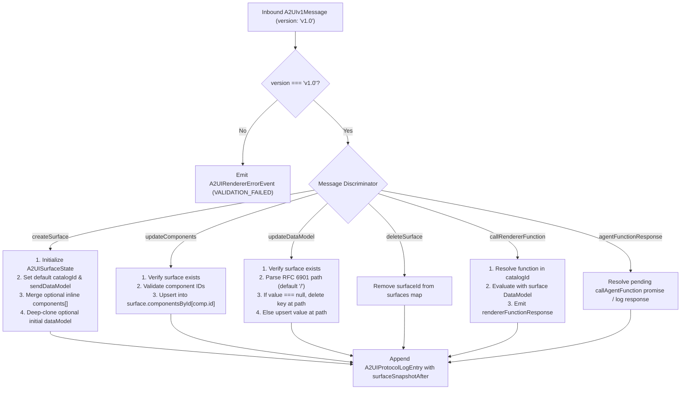

# Section 3 detailed design: A2UI v1.0 protocol engine, multi-catalog renderer, and live protocol inspector

**Author:** `sec-a2ui-engine`
**Status:** Ready for Phase 3 implementation
**Parent specification:** [SYSTEM_DESIGN.md](../SYSTEM_DESIGN.md)
**Last updated:** 2026-10-21

## Overview and scope

Section 3 (`sec-a2ui-engine`) provides the client-side **Agent-to-UI** (**A2UI**) **v1.0** runtime engine, multi-catalog React renderer, and live protocol debugging suite for **FreshCart**. It is designed directly against the normative A2UI v1.0 candidate schemas (`specification/v1_0/json/agent_to_renderer.json`, `renderer_to_agent.json`, `common_types.json`, `catalog_definition.json`, and `catalogs/basic/v1/catalog.json`) and incorporates all empirical compatibility findings from [A2UI_ONBOARDING_DISCOVERY.md](../A2UI_ONBOARDING_DISCOVERY.md).

### Owned files

| File path | Responsibility |
| :--- | :--- |
| `src/types/a2ui-v1.ts` | Normative A2UI v1.0 TypeScript interfaces (`A2UIv1Message`, `A2UIActionEvent`, `A2UIDataBinding`, `A2UIFunctionCall`, `A2UICheckRule`, `A2UIValidationResult`, `A2UISurfaceState`, plus inspector log & validation types). |
| `src/a2ui/SurfaceManager.ts` | Immutable state reducer and lifecycle manager for v1.0 surfaces (`createSurface`, `updateComponents`, `updateDataModel`, `deleteSurface`, `callRendererFunction`, `agentFunctionResponse`), RFC 6901 JSON Pointer mutation engine, and step-by-step replay snapshot store. |
| `src/a2ui/DataModelBinder.ts` | RFC 6901 `@path` resolver (root and relative `ChildList` collection scopes), `@@` literal unescaping, `@call` function evaluator (15 standard v1.0 functions + `contains` and `equals`), `@index` evaluator, and two-way input binding mutator. |
| `src/a2ui/ValidationEngine.ts` | Client-side evaluator for `Checkable` component `checks` (`A2UICheckRule[]`), coercing booleans and `A2UIValidationResult` objects into per-component validation states (`error`, `warning`, `info`). |
| `src/a2ui/A2UISurfaceRenderer.tsx` | Root React surface host performing multi-catalog resolution (`component.catalogId` → `surface.catalogId` → error), adjacency-list traversal from `"root"`, `ChildList` template instantiation, two-way input binding updates, and outbound `A2UIActionEvent` dispatch. |
| `src/a2ui/catalogs/basicCatalogRenderer.tsx` | Native React + Tailwind CSS implementation of all 18 A2UI v1.0 Basic Catalog components (`Text`, `Image`, `Icon`, `Video`, `AudioPlayer`, `Row`, `Column`, `List`, `Card`, `Tabs`, `Modal`, `Divider`, `Button`, `TextField`, `CheckBox`, `ChoicePicker`, `Slider`, `DateTimeInput`). |
| `src/a2ui/catalogs/groceryCatalogRenderer.tsx` | Domain-specific custom catalog components (`ProductDealCard`, `NutritionSummary`) registered under `FRESHCART_GROCERY_CATALOG_ID`. |
| `src/a2ui/inspector/ProtocolInspectorDrawer.tsx` | Slide-over/docked developer drawer providing a live inbound/outbound v1.0 message log, step-by-step streaming envelope replay controls, live JSON envelope editor with a v0.9-vs-v1.0 linter, and an interactive `DataModel` tree inspector. |

---

## 1. Architecture of `SurfaceManager.ts` (`src/a2ui/SurfaceManager.ts`)

### 1.1 State model and protocol log structures (`src/types/a2ui-v1.ts` additions)

In addition to the core wire types defined in `docs/SYSTEM_DESIGN.md` Section 4.2, `src/types/a2ui-v1.ts` exports the following runtime and inspector types so `AIShopperDrawer`, `App.tsx`, and `ProtocolInspectorDrawer` share a single strongly typed contract:

```typescript
export type A2UIMessageDirection = 'agent_to_renderer' | 'renderer_to_agent';

export type A2UIEnvelopeKind =
  | 'createSurface'
  | 'updateComponents'
  | 'updateDataModel'
  | 'deleteSurface'
  | 'callRendererFunction'
  | 'agentFunctionResponse'
  | 'action'
  | 'rendererFunctionResponse'
  | 'error';

export interface A2UIProtocolLogEntry {
  id: string;
  seq: number;
  timestamp: string;
  direction: A2UIMessageDirection;
  kind: A2UIEnvelopeKind;
  surfaceId?: string;
  sourceLabel?: string;
  payload: A2UIv1Message | A2UIActionEvent | A2UIRendererErrorEvent | Record<string, unknown>;
  /** Snapshot of the target surface state immediately after this message was applied */
  surfaceSnapshotAfter?: A2UISurfaceState | null;
}

export interface A2UISurfaceManagerState {
  surfaces: Record<string, A2UISurfaceState>;
  log: A2UIProtocolLogEntry[];
  outboundResponses: Array<A2UIRendererErrorEvent | { version: 'v1.0'; rendererFunctionResponse: A2UIFunctionResponsePayload }>;
}
```

### 1.2 Processing rules for all six `agent_to_renderer` v1.0 message types



#### 1. `createSurface` (`A2UICreateSurfaceMessage`)
* **Spec rules (`agent_to_renderer.json#/$defs/CreateSurfaceMessage`)**:
  * Implicitly instantiates the canonical `"Surface"` container with `"child": "root"`.
  * Accepts `surfaceId` (required), optional `catalogId` (surface-level default catalog; defaults to `A2UI_BASIC_CATALOG_ID` if omitted in permissive mode, or stored as `""` so components must declare their own `catalogId` in strict mode), optional `sendDataModel` (boolean, defaults to `false`), optional inline `components` (`A2UIComponentBase[]`), optional initial `dataModel` (`Record<string, unknown>`), and optional `metadata.extensions`.
  * **Uniqueness & stream re-run handling**: Per the v1.0 specification, creating a surface with an already-existing `surfaceId` without deleting it is an integrity error in strict protocol mode. However, in interactive UI scenarios where a user clicks "Replay Stream" or switches prompt chips targeting `"meal-planner-surface"`, `processA2UIMessage(state, message, options)` supports `options.allowSurfaceOverwrite ?? true`: when `true`, a new `createSurface` cleanly resets that `surfaceId` state (while logging an informational inspector note if a previous surface with that ID was active); when `false` (strict conformance mode), it emits an `A2UIRendererErrorEvent` (`code: "SURFACE_ALREADY_EXISTS"`).
  * If `createSurface.components` is provided, each component is indexed into `componentsById[comp.id]`.
  * If `createSurface.dataModel` is provided, it is deep-cloned as the initial `surface.dataModel` (defaulting to `{}`).

#### 2. `updateComponents` (`A2UIUpdateComponentsMessage`)
* **Spec rules (`agent_to_renderer.json#/$defs/UpdateComponentsMessage`)**:
  * Looks up `surface = state.surfaces[surfaceId]`. If no surface exists, emits `A2UIRendererErrorEvent` (`code: "SURFACE_NOT_FOUND"`).
  * Iterates through `updateComponents.components`:
    * Rejects any component with `component === "Surface"` (`code: "VALIDATION_FAILED"`, as `"Surface"` is reserved and immutable).
    * Merges each component into `surface.componentsById[component.id] = component` (replacing any prior definition with the same `id` while preserving untouched components in the adjacency list).
    * Updates `surface.updatedAt = new Date().toISOString()`.

#### 3. `updateDataModel` (`A2UIUpdateDataModelMessage`)
* **Spec rules (`agent_to_renderer.json#/$defs/UpdateDataModelMessage`)**:
  * Looks up `surface = state.surfaces[surfaceId]`.
  * `value` is **required** in v1.0 (`"value" in updateDataModel` must be `true`).
  * **Root replacement (`!path || path === "" || path === "/"`)**:
    * If `value === null`, resets `surface.dataModel = {}`.
    * If `value` is a non-null plain object, replaces `surface.dataModel` with a deep clone of `value`.
  * **Nested RFC 6901 JSON Pointer mutation (`path` starting with `"/"`, e.g. `"/servings"`, `"/dietary/organicOnly"`, `"/ingredients/0/checked"`)**:
    * Splits `path.slice(1).split('/')` and unescapes each token per RFC 6901 (`~1` → `/`, `~0` → `~`).
    * Clones the ancestor chain immutably so React reference equality checks trigger re-renders only on affected subtrees.
    * **Key deletion (`value === null`)**:
      * In A2UI v1.0, setting `value: null` explicitly deletes the target key at `path` (`delete parentObj[lastToken]`, or for an array index `parentArray.splice(index, 1)`).
    * **Upsert / Replace (`value !== null`)**:
      * Auto-vivifies missing intermediate containers (creating an array if the next token is a non-negative integer index `^\d+$`, or an object `{}` otherwise) and assigns `parent[lastToken] = structuredClone(value)`.

#### 4. `deleteSurface` (`A2UIDeleteSurfaceMessage`)
* Removes `surfaceId` from `state.surfaces` and records the deletion in `state.log` with `surfaceSnapshotAfter: null`.

#### 5. `callRendererFunction` (`A2UICallRendererFunctionMessage`)
* Executes a renderer-side function invoked by the agent (`callRendererFunction: { surfaceId?, functionCallId, callFunction }`):
  * Verifies `callFunction.catalogId` is a registered catalog (`A2UI_BASIC_CATALOG_ID` or `FRESHCART_GROCERY_CATALOG_ID`) and that the function's `allowedCallers` permits agent invocation (`"agentOnly"` or `"rendererOrAgent"`).
  * Evaluates `callFunction` using `DataModelBinder.evaluateFunctionCall` against the specified `surfaceId`'s `dataModel` (or `{}` if `surfaceId` is omitted).
  * Appends `{ version: 'v1.0', rendererFunctionResponse: { functionCallId, value } }` (or `{ functionCallId, error: { code: 'INVALID_FUNCTION_CALL', message } }`) to `state.outboundResponses` and `state.log`.

#### 6. `agentFunctionResponse` (`A2UIAgentFunctionResponseMessage`)
* Logs the inbound `agentFunctionResponse` (`{ functionCallId, value?, error? }`) in `state.log` and resolves any pending renderer-initiated RPC callback registered for `functionCallId`.

### 1.3 Exported API of `src/a2ui/SurfaceManager.ts`

```typescript
export function createInitialSurfaceManagerState(): A2UISurfaceManagerState;

export function applyJSONPointerUpdate(
  rootModel: Record<string, unknown>,
  pointerPath: string | undefined,
  value: unknown
): Record<string, unknown>;

export function processA2UIMessage(
  state: A2UISurfaceManagerState,
  message: A2UIv1Message,
  options?: {
    sourceLabel?: string;
    strictSurfaceUniqueness?: boolean;
  }
): A2UISurfaceManagerState;

export function processA2UIMessageBatch(
  state: A2UISurfaceManagerState,
  messages: A2UIv1Message[],
  sourceLabel?: string
): A2UISurfaceManagerState;

export function mutateSurfaceDataModel(
  state: A2UISurfaceManagerState,
  surfaceId: string,
  pointerPath: string,
  value: unknown,
  sourceLabel?: string
): A2UISurfaceManagerState;

export function recordOutboundActionEvent(
  state: A2UISurfaceManagerState,
  event: A2UIActionEvent
): A2UISurfaceManagerState;
```

---

## 2. Evaluation rules in `DataModelBinder.ts` (`src/a2ui/DataModelBinder.ts`)

### 2.1 Evaluation context & collection scope (`DataEvaluationContext`)

Every component property, `ChildList` template item, `checks` condition, and `Action.event.context` payload is evaluated within a `DataEvaluationContext`:

```typescript
export interface DataEvaluationContext {
  /** Root dataModel of the active surface */
  rootDataModel: Record<string, unknown>;
  /**
   * Current JSON Pointer scope prefix for ChildList template iteration.
   * Default is "" (root scope). Inside a ChildList template bound to
   * path "/ingredients" at index 2, scopePath is "/ingredients/2".
   */
  scopePath: string;
  /**
   * 0-based iteration index when evaluating inside a ChildList template scope.
   * Undefined when evaluating at the surface root scope.
   */
  collectionIndex?: number;
  /** Default catalogId of the surface */
  defaultCatalogId: string;
  /** Optional flag indicating whether evaluation was triggered by a direct user gesture (for openUrl) */
  isUserActivated?: boolean;
}
```

### 2.2 RFC 6901 `@path` resolution rules (absolute vs. relative paths)

1. **Detection (`isDataBinding`)**:
   * An object `val` is an `A2UIDataBinding` if and only if `typeof val === 'object' && val !== null && !Array.isArray(val) && '@path' in val && typeof val['@path'] === 'string'`.
   * IMPORTANT: Plain objects containing an unprefixed `"path"` key (`{ path: "/servings" }`) are **never** treated as `DataBinding` in v1.0—they evaluate as literal objects (and are flagged by the Protocol Inspector linter as a likely v0.9 migration mistake).
2. **Absolute vs. Relative JSON Pointer resolution (`resolvePointerPath(rawPath, scopePath)`)**:
   * **Root reference (`rawPath === "/" || rawPath === ""`)**: Resolves to the entire `rootDataModel` (or current scoped item if `rawPath === "."`).
   * **Absolute path (`rawPath.startsWith("/")`, e.g., `{"@path": "/servings"}` or `{"@path": "/dietary/glutenFree"}`)**:
     * Always resolves from `context.rootDataModel`, even when evaluated inside a `ChildList` template row! This allows a template row (e.g., `ingredient_row`) to access both per-item properties (`{"@path": "name"}`) and surface-root properties (`{"@path": "/servings"}`).
   * **Relative path inside a `ChildList` template scope (`!rawPath.startsWith("/")`, e.g., `{"@path": "name"}`, `{"@path": "price"}`, `{"@path": "./checked"}`)**:
     * Strips any leading `"./"`, prefixes `context.scopePath` (e.g., `"/ingredients/0"` + `"/"` + `"name"` → `"/ingredients/0/name"`), and resolves against `context.rootDataModel`.
   * **RFC 6901 token traversal (`getValueAtPointer(rootDataModel, canonicalPath)`)**:
     * Splits `canonicalPath.slice(1).split('/')`, decodes `~1` → `/` and `~0` → `~`, and walks objects/arrays safely. Returns `undefined` if any intermediate segment is `null`, `undefined`, or out of bounds.

### 2.3 Literal `@` key escaping (`@@`)

Per the A2UI v1.0 Evolution Guide (`common_types.json#/$defs/DynamicValue`):
* When resolving a plain literal object inside `evaluateDynamicValue`:
  * Any key starting with `"@@"` is unescaped by stripping one leading `@` (e.g., `"@@path"` → `"@path"`, `"@@type"` → `"@type"`).
  * Any key matching `^@([^@]|$)` other than `"@path"` or `"@call"` is a reserved protocol directive violation and logs a protocol warning.

### 2.4 Built-in `@call` function catalog & exact evaluation rules

An object is an `A2UIFunctionCall` if `typeof val === 'object' && val !== null && '@call' in val && typeof val['@call'] === 'string'`.

Before executing the target function, `DataModelBinder` recursively evaluates all arguments in `call.args` against `context`.

| Function `@call` name | Return type | Arguments (`args`) | Exact v1.0 evaluation specification |
| :--- | :--- | :--- | :--- |
| **`@index`** | `number` | `{ offset?: DynamicNumber }` | System function valid **only** when `typeof context.collectionIndex === 'number'`. Returns `context.collectionIndex + Number(offset ?? 0)`. For example, `{"@call": "@index", "args": {"offset": 1}}` on the first template item (`index = 0`) returns `1`. If called outside a `ChildList` template scope, returns `0` and logs an `INVALID_FUNCTION_CALL` warning. |
| **`formatString`** | `string` | `{ value?: DynamicString, template?: DynamicString, ... }` | Supports **two** interpolation syntaxes:<br>1. **Normative v1.0 `${expression}` syntax** (`catalogs/basic/v1/catalog.json`): Interpolates `${/json/pointer}` or `${relative/path}` against `context`, and inline function calls such as `${formatCurrency(value:${/estimatedTotal}, currency:'USD')}` or `${@index(offset:1)}`. Unescapes `\${` to literal `${`.<br>2. **Positional/Named template syntax** (used in Scenario 4 blueprints, e.g., `args: { template: "#{0}", "0": {"@call": "@index", "args": {"offset": 1}} }`): Replaces `{key}` and `${key}` tokens with the evaluated `args[key]` string. |
| **`formatNumber`** | `string` | `{ value: DynamicNumber, decimals?: DynamicNumber, grouping?: DynamicBoolean }` | Coerces `value` to a finite `number` (default `0`). Uses `Intl.NumberFormat('en-US', { useGrouping: grouping ?? true, minimumFractionDigits: decimals, maximumFractionDigits: decimals })` to return the formatted string. |
| **`formatCurrency`** | `string` | `{ value: DynamicNumber, currency: DynamicString, decimals?: DynamicNumber, grouping?: DynamicBoolean }` | Coerces `value` to a finite `number` (default `0`) and formats with `Intl.NumberFormat('en-US', { style: 'currency', currency: currency || 'USD', useGrouping: grouping ?? true, minimumFractionDigits: decimals ?? 2, maximumFractionDigits: decimals ?? 2 })` (e.g., `"$48.93"`). |
| **`formatDate`** | `string` | `{ value: DynamicValue, format: DynamicString }` | Parses `value` (ISO 8601 string or epoch ms) into a `Date`. Replaces Unicode TR35 tokens in `format`: `yyyy` (4-digit year), `yy` (2-digit year), `MMMM` (full month), `MMM` (short month), `MM` (2-digit month), `M` (month), `EEEE` (full weekday), `E` (short weekday), `dd` (2-digit day), `d` (day), `HH` (00–23), `H` (0–23), `hh` (01–12), `h` (1–12), `mm` (00–59), `ss` (00–59), `a` (`AM`/`PM`). |
| **`pluralize`** | `string` | `{ value: DynamicNumber, zero?: DynamicString, one?: DynamicString, two?: DynamicString, few?: DynamicString, many?: DynamicString, other: DynamicString }` | Evaluates `count = Number(value ?? 0)`. If `count === 0 && args.zero !== undefined`, returns `String(args.zero)`. Otherwise uses `new Intl.PluralRules('en-US').select(count)` (`"one"` vs `"other"`) to pick the matching category string, falling back to `String(args.other)`. |
| **`required`** | `A2UIValidationResult` | `{ value: DynamicValue }` | Checks that `value` is not `null`, `undefined`, `""` (empty/whitespace-only string), or `[]` (empty array). Returns `{ valid: true }` when non-empty, or `{ valid: false, code: 'REQUIRED', message: 'This field is required.', severity: 'error' }`. |
| **`numeric`** | `A2UIValidationResult` | `{ value: DynamicNumber, min?: number, max?: number }` | Coerces `value` to `num = Number(value)` (rejecting `""`, `null`, `undefined`, or `Number.isNaN(num)`). Checks `min !== undefined && num < min` and `max !== undefined && num > max`. Returns `{ valid: true }` or `{ valid: false, code: 'NUMERIC_RANGE', message: ..., severity: 'error' }`. |
| **`regex`** | `A2UIValidationResult` | `{ value: DynamicString, pattern: string }` | Tests `new RegExp(pattern).test(String(value ?? ''))`. Returns `{ valid: true }` or `{ valid: false, code: 'REGEX_MISMATCH', message: 'Value does not match required format.', severity: 'error' }`. |
| **`length`** | `A2UIValidationResult` | `{ value: DynamicString, min?: number, max?: number }` | Measures `len = Array.isArray(value) ? value.length : String(value ?? '').length`. Checks `min` and `max` bounds and returns `{ valid: true }` or `{ valid: false, code: 'LENGTH_OUT_OF_BOUNDS', message: ..., severity: 'error' }`. |
| **`email`** | `A2UIValidationResult` | `{ value: DynamicString }` | Tests `^[^\s@]+@[^\s@]+\.[^\s@]+$` against `String(value ?? '')` and returns an `A2UIValidationResult`. |
| **`and`** | `boolean` | `{ values: DynamicBoolean[] }` | Evaluates each entry in `values` using `coerceToBoolean(item)` (which unwraps `A2UIValidationResult.valid` if an item is a validation function call!). Returns `true` if all items are truthy. |
| **`or`** | `boolean` | `{ values: DynamicBoolean[] }` | Evaluates each entry in `values` using `coerceToBoolean(item)` and returns `true` if at least one item is truthy. |
| **`not`** | `boolean` | `{ value: DynamicBoolean }` | Evaluates `!coerceToBoolean(args.value)`. |
| **`contains`** | `boolean` | `{ value?: DynamicValue, list?: DynamicValue, item?: DynamicValue, substring?: DynamicString }` | Compatibility helper: if `Array.isArray(list \|\| value)`, checks whether it includes `item ?? substring`; if string, checks `String(value).includes(String(substring ?? item))`. |
| **`equals`** | `boolean` | `{ a?: DynamicValue, b?: DynamicValue, left?: DynamicValue, right?: DynamicValue, value?: DynamicValue, other?: DynamicValue }` | Deep-compares the two operands (`a ?? left ?? value` vs `b ?? right ?? other`) and returns a boolean. |
| **`openUrl`** | `void` | `{ url: DynamicString }` | Verifies `url` is a safe `http:` or `https:` URL and opens it in a new tab (`window.open(url, '_blank', 'noopener,noreferrer')`) when triggered by a user action (`requiresUserActivation: true`). |

### 2.5 Two-way input binding resolution (`resolveWritablePointerPath`)

When an input component (`Slider`, `CheckBox`, `TextField`, `ChoicePicker`, `DateTimeInput`) has a `value` property defined as an `A2UIDataBinding` (`{"@path": "..."}`):

1. `resolveWritablePointerPath(rawValueProp, context)` inspects `rawValueProp`:
   * If `isDataBinding(rawValueProp)` is `true`, it computes the canonical root JSON Pointer using `resolvePointerPath(rawValueProp['@path'], context.scopePath)`:
     * Example 1 (Root path): `{"@path": "/servings"}` with `scopePath = ""` → `"/servings"`.
     * Example 2 (Relative path inside `ChildList` template): `{"@path": "checked"}` inside `scopePath = "/ingredients/1"` → `"/ingredients/1/checked"`.
   * When the user interacts with the input control, the component invokes `onUpdateDataModel(canonicalPointerPath, newValue)`, which:
     1. Immediately updates the surface's `dataModel` via `SurfaceManager.mutateSurfaceDataModel`;
     2. Invokes the host's `onDataModelChange?.(surfaceId, canonicalPointerPath, newValue)` callback so `AIShopperDrawer` can run reactive scenario recalculations (such as scaling recipe quantities or recalculating `/allocatedSpend`).

---

## 3. Client-side validation engine (`src/a2ui/ValidationEngine.ts`)

### 3.1 `A2UICheckRule` evaluation & `A2UIValidationResult` coercion

In A2UI v1.0 (`common_types.json#/$defs/CheckRule`), any `Checkable` component (`Button`, `TextField`, `CheckBox`, `ChoicePicker`, `Slider`, `DateTimeInput`) may declare `checks?: A2UICheckRule[]`:

```typescript
export interface EvaluatedCheckItem {
  valid: boolean;
  code?: string;
  message: string;
  severity: 'error' | 'warning' | 'info';
}

export interface ComponentValidationState {
  isValid: boolean;
  hasErrors: boolean;
  hasWarnings: boolean;
  items: EvaluatedCheckItem[];
  firstErrorMessage?: string;
}
```

#### Exact evaluation algorithm (`evaluateComponentChecks(checks, context)`):
For each `rule` in `component.checks ?? []`:
1. Evaluate `rawOutcome = evaluateDynamicValue(rule.condition, context)`.
2. **Case A — Structured `A2UIValidationResult` returned** (e.g., from `required`, `numeric`, `regex`, `length`, `email`, or a data model object with `{ valid: boolean }`):
   * `valid = Boolean(rawOutcome.valid)`.
   * `severity = rawOutcome.severity ?? 'error'`.
   * **Message precedence (v1.0 spec)**: If `!valid`, use `rule.message || rawOutcome.message || 'Validation check failed.'` so author-specified `CheckRule.message` overrides generic function error messages while dynamic `ValidationResult.message` is used when `rule.message` is omitted.
3. **Case B — Boolean or primitive returned** (e.g., `condition: {"@path": "/isBudgetValid"}` or `condition: {"@call": "and", ...}`):
   * Coerce `valid = Boolean(rawOutcome)`.
   * `severity = 'error'`.
   * `message = rule.message || 'Validation requirement not met.'`.
4. **Aggregation**:
   * `hasErrors = items.some(item => !item.valid && item.severity === 'error')`.
   * `hasWarnings = items.some(item => !item.valid && item.severity === 'warning')`.
   * `isValid = !hasErrors`.

### 3.2 Visual rendering of validation states & `Button` disabling

1. **Input components (`TextField`, `Slider`, `CheckBox`, `ChoicePicker`, `DateTimeInput`)**:
   * **`error` (`!item.valid && item.severity === 'error'`)**: Renders a crisp red border (`border-red-500 bg-red-50/40 focus:ring-red-500`), an alert icon (`AlertCircle`), and a compact validation message pill (`text-xs font-medium text-red-600`) directly beneath the input with `role="alert"`.
   * **`warning` (`!item.valid && item.severity === 'warning'`)**: Renders an amber border (`border-amber-500 bg-amber-50/40`) and amber helper text (`text-xs text-amber-700`).
   * **`info` (`!item.valid && item.severity === 'info'`)**: Renders a sky-blue informational note (`text-xs text-sky-700`).
2. **`Button` components with `checks`**:
   * When `validationState.hasErrors` is `true` on a `Button`:
     * The `<button>` element is rendered with `disabled={true}` and `aria-disabled="true"`, styled with `opacity-50 cursor-not-allowed`, preventing `action` dispatch.
     * Each failed check's `message` is displayed in an inline validation callout banner directly beneath (or above) the button so the user immediately sees *why* the action button is disabled (for example, *"Allocated basket spend exceeds your weekly budget cap"* in Scenario C).

---

## 4. Multi-catalog component mapping (`basicCatalogRenderer.tsx` & `groceryCatalogRenderer.tsx`)

### 4.1 Multi-catalog resolution order in `A2UISurfaceRenderer.tsx`

Per Section 2.7 of the A2UI v1.0 Evolution Guide, `A2UISurfaceRenderer` resolves every component's implementation using strict catalog precedence:

1. Determine `effectiveCatalogId = component.catalogId || surface.catalogId`.
2. If `!effectiveCatalogId`, render an inline protocol error card and emit `A2UIRendererErrorEvent` (`code: "VALIDATION_FAILED"`, `message: "Missing catalogId on component and surface"`).
3. Route by `effectiveCatalogId`:
   * `A2UI_BASIC_CATALOG_ID` (`"https://a2ui.org/specification/v1_0/catalogs/basic/catalog.json"`): Dispatches to `BasicCatalogComponentRenderer` (`src/a2ui/catalogs/basicCatalogRenderer.tsx`).
   * `FRESHCART_GROCERY_CATALOG_ID` (`"https://freshcart.app/catalogs/grocery/v1/catalog.json"`): Dispatches to `GroceryCatalogComponentRenderer` (`src/a2ui/catalogs/groceryCatalogRenderer.tsx`).
   * Also supports fallback recognition if a scenario omits `catalogId` on `ProductDealCard` or `NutritionSummary` (logging a helpful inspector notice while rendering the component seamlessly).

### 4.2 Complete mapping for all 18 A2UI v1.0 Basic Catalog components (`src/a2ui/catalogs/basicCatalogRenderer.tsx`)

All 18 components support `weight` (`style={{ flexGrow: component.weight }}` when inside a `Row`, `Column`, or `List`) and `accessibility` (`aria-label`, `aria-description`, `aria-live`, `aria-hidden`).

| # | Component | v1.0 Schema Properties & Compatibility Aliases | React + Tailwind Rendering Specification |
| :--- | :--- | :--- | :--- |
| 1 | **`Text`** | `text: DynamicString` (required)<br>`variant?: 'caption' \| 'body'` (plus compatibility support for `usageHint` / `variant`: `'h1' \| 'h2' \| 'h3' \| 'h4'`) | Parses lightweight inline Markdown in `text` (leading `# `, `## `, `### ` headings, `**bold**`, `*italic*`, `` `code` ``, bullet lists) and applies semantic typography: `h1`/`#` (`text-xl font-bold text-stone-900`), `h2`/`##` (`text-lg font-bold text-stone-900`), `h3`/`###` (`text-base font-semibold text-stone-800`), `caption` (`text-xs text-stone-500`), `body` (`text-sm text-stone-700`). |
| 2 | **`Image`** | `url: DynamicString` (required)<br>`description?: DynamicString`<br>`fit?: 'contain' \| 'cover' \| 'fill' \| 'none' \| 'scaleDown'`<br>`variant?: 'icon' \| 'avatar' \| 'smallFeature' \| 'mediumFeature' \| 'largeFeature' \| 'header'` | Renders an `` with graceful fallback placeholder on load error, `alt={resolvedDescription || ''}`, `object-*` class mapped from `fit`, and size classes mapped from `variant` (`icon`: `w-6 h-6`, `avatar`: `w-10 h-10 rounded-full`, `smallFeature`: `w-16 h-16 rounded-lg`, `mediumFeature`: `w-full h-36 rounded-xl`, `largeFeature`: `w-full h-52 rounded-xl`, `header`: `w-full h-44 rounded-t-xl object-cover`). |
| 3 | **`Icon`** | `name: DynamicString \| { svgPath: DynamicString }` (required) | Maps standard A2UI v1.0 icon names (`shoppingCart`, `check`, `add`, `delete`, `warning`, `info`, `error`, `star`, `favorite`, `search`, `refresh`, `calendarToday`, `locationOn`, `payment`, `settings`, `close`, `arrowForward`, `arrowBack`, etc.) to `lucide-react` icons, or renders an inline `<svg><path d={svgPath} /></svg>` when `{ svgPath }` is passed. |
| 4 | **`Video`** | `url: DynamicString` (required)<br>`posterUrl?: DynamicString` *(new in v1.0)* | Renders a styled `<video controls poster={resolvedPosterUrl} src={resolvedUrl} className="w-full rounded-xl bg-stone-900" />`. |
| 5 | **`AudioPlayer`** | `url: DynamicString` (required)<br>`description?: DynamicString` | Renders a compact card with an audio icon, `resolvedDescription` title label, and `<audio controls src={resolvedUrl} className="w-full h-9" />`. |
| 6 | **`Row`** | `children: ChildList` (required)<br>`justify?: 'start' \| 'center' \| 'end' \| 'spaceBetween' \| 'spaceAround' \| 'spaceEvenly' \| 'stretch'` (alias: `justifyContent`)<br>`align?: 'start' \| 'center' \| 'end' \| 'stretch'` (alias: `alignItems`)<br>`gap?: 'xs' \| 'sm' \| 'md' \| 'lg'` | Renders `<div className="flex flex-row flex-wrap sm:flex-nowrap ...">` mapping `justify` (`justify-start`, `justify-center`, `justify-end`, `justify-between`, `justify-around`, `justify-evenly`) and `align` (`items-start`, `items-center`, `items-end`, `items-stretch`). Supports both static `string[]` IDs and dynamic `ChildList` template `{ componentId, path }`. |
| 7 | **`Column`** | `children: ChildList` (required)<br>`justify?: ...` (alias: `justifyContent`)<br>`align?: ...` (alias: `alignItems`)<br>`gap?: 'xs' \| 'sm' \| 'md' \| 'lg'` | Renders `<div className="flex flex-col ...">` with vertical spacing (`gap-2.5` default) and supports both static `string[]` IDs and dynamic `ChildList` template `{ componentId, path }`. |
| 8 | **`List`** | `children: ChildList` (required)<br>`direction?: 'vertical' \| 'horizontal'`<br>`align?: 'start' \| 'center' \| 'end' \| 'stretch'` | Renders a semantic `<div role="list">` laid out vertically (`flex-col divide-y divide-stone-200/60 gap-2`) or horizontally (`flex-row overflow-x-auto gap-3 pb-1`), supporting `ChildList` templates with `@index` scope injection. |
| 9 | **`Card`** | `child: ComponentId` (required; also supports `children?: ChildList` fallback) | Renders a polished FreshCart container (`bg-white rounded-2xl border border-stone-200/90 shadow-xs p-4 transition-all`) wrapping the resolved `child` component. |
| 10 | **`Tabs`** | `tabs: Array<{ title: DynamicString, child: ComponentId }>` (required; also supports `tabItems` alias) | Maintains local active tab index (`useState(0)`), renders an Instacart-styled pill tab bar (`bg-stone-100 p-1 rounded-xl`, active tab `bg-white text-emerald-700 shadow-xs font-semibold`), and renders the active tab's `child` component ID below. |
| 11 | **`Modal`** | `trigger: ComponentId` (required)<br>`content: ComponentId` (required) | Renders a wrapper around the `trigger` component ID that opens a backdrop-blurred modal dialog (`fixed inset-0 z-50 flex items-center justify-center bg-black/50 backdrop-blur-xs`) rendering the `content` component ID with a close button. |
| 12 | **`Divider`** | `axis?: 'horizontal' \| 'vertical'` | Renders `<hr className="border-stone-200 my-2 w-full" />` for `horizontal` or `<div className="w-px self-stretch bg-stone-200 mx-2" />` for `vertical`. |
| 13 | **`Button`** | `child?: ComponentId` (spec required) or `label?: DynamicString` (shorthand fallback)<br>`action: A2UIAction` (required)<br>`variant?: 'default' \| 'primary' \| 'borderless' \| 'secondary'`<br>`checks?: A2UICheckRule[]` | Evaluates `checks` via `ValidationEngine`. Styles by `variant`: `primary` (`bg-[#0AAD0A] hover:bg-[#089208] text-white font-semibold shadow-xs rounded-xl px-4 py-2.5`), `default`/`secondary` (`bg-stone-100 hover:bg-stone-200 text-stone-800 font-medium rounded-xl px-3.5 py-2`), `borderless` (`text-emerald-700 hover:underline px-2 py-1`). Renders `child` component (or `label` text) inside `<button>`. On click (when valid), triggers `onExecuteAction(component.id, component.action, context)`. |
| 14 | **`TextField`** | `label: DynamicString` (required)<br>`value?: DynamicString`<br>`placeholder?: DynamicString` *(new in v1.0)*<br>`variant?: 'shortText' \| 'longText' \| 'number' \| 'obscured'`<br>`checks?: A2UICheckRule[]` | Renders a labeled input (`<textarea>` for `longText`, `<input type="number">` for `number`, `<input type="password">` for `obscured`, `<input type="text">` for `shortText`) with two-way `@path` binding (`onChange` updates the bound DataModel path) and live `checks` validation feedback below. |
| 15 | **`CheckBox`** | `label: DynamicString` (required)<br>`value: DynamicBoolean` (required)<br>`checks?: A2UICheckRule[]` | Renders an interactive checkbox toggle with custom emerald checked state (`accent-[#0AAD0A] w-4 h-4 rounded`), bound two-way to the boolean `@path` in `value`, plus validation message support. |
| 16 | **`ChoicePicker`** | `options: Array<{ label: DynamicString, value: string }>` (required)<br>`value: DynamicStringList` (required)<br>`label?: DynamicString`<br>`variant?: 'mutuallyExclusive' \| 'multipleSelection' \| 'singleSelection'`<br>`displayStyle?: 'checkbox' \| 'chips'`<br>`filterable?: boolean`<br>`checks?: A2UICheckRule[]` | Supports optional search filter input when `filterable: true`. Renders either interactive pill chips (`displayStyle === 'chips'`, emerald active pill `bg-emerald-600 text-white border-emerald-600`) or checkbox/radio rows (`displayStyle === 'checkbox'`). Clicking an option updates the bound `string[]` array at `value` (`[opt.value]` for `mutuallyExclusive`/`singleSelection`, or toggled in `string[]` for `multipleSelection`). |
| 17 | **`Slider`** | `value: DynamicNumber` (required)<br>`max: number` (required)<br>`min?: number` (default `0`)<br>`steps?: number` *(new in v1.0)*<br>`label?: DynamicString`<br>`checks?: A2UICheckRule[]` | Computes `stepSize = steps && steps > 0 ? (max - min) / steps : 1`. Renders a header showing `label` and a live emerald badge with the current numeric `value`, an `<input type="range" min={min} max={max} step={stepSize} />` with `#0AAD0A` accent styling, min/max ticks, and instant two-way `@path` updates. |
| 18 | **`DateTimeInput`** | `value: DynamicString` (required)<br>`label?: DynamicString`<br>`enableDate?: boolean`<br>`enableTime?: boolean`<br>`min?: DynamicString`<br>`max?: DynamicString`<br>`checks?: A2UICheckRule[]` | Selects input type (`datetime-local` when both `enableDate` and `enableTime`, `time` when only `enableTime`, `date` otherwise), binds two-way to `value`, and validates `checks`. |

### 4.3 Custom FreshCart Grocery Catalog components (`src/a2ui/catalogs/groceryCatalogRenderer.tsx`)

Registered under `FRESHCART_GROCERY_CATALOG_ID = "https://freshcart.app/catalogs/grocery/v1/catalog.json"`:

#### 1. `ProductDealCard`
* **Resolved properties**:
  * `productId`: `string` (resolved from `A2UIDynamicString`)
  * `title`: `string` (falls back to store catalog lookup via `products` prop if omitted)
  * `price`: `number`
  * `originalPrice`?: `number`
  * `unit`?: `string`
  * `badgeText`?: `string` (e.g., `"Chef Pairing · Save $1.50"`, `"Budget Saver · Save $3.00"`, `"USDA Organic"`)
  * `imageUrl`?: `string`
  * `quantity`?: `number`
  * `action`?: `A2UIAction`
  * `actionLabel`?: `string` (e.g., `"Swap in Cart"`, `"Add Pairing to Cart"`, `"Swap Applied ✓"`)
* **Visual & interactive design**:
  * Renders a horizontal grocery deal card with product thumbnail (`w-16 h-16 rounded-xl object-cover`), emerald/amber promotional ribbon (`badgeText`), title, unit weight, formatted price (`$4.99`) with strikethrough `originalPrice` (`$6.49`) and calculated savings pill, and an interactive CTA button (`actionLabel`) that dispatches `action` via `A2UISurfaceRenderer` (with automatic `"Applied ✓"` visual state styling when `actionLabel` contains `"✓"` or `"Applied"`).

#### 2. `NutritionSummary`
* **Resolved properties**:
  * `calories`: `number`
  * `proteinGrams`: `number`
  * `carbsGrams`: `number`
  * `fatGrams`: `number`
  * `fiberGrams`?: `number`
  * `servings`?: `number`
  * `dailyCalorieTarget`?: `number` (default `2000`)
* **Visual design**:
  * Renders a compact nutrition facts & macro dashboard card with:
    * Header showing per-serving calories (`{calories} kcal / serving`) and servings badge (`{servings} servings`), plus a progress bar comparing `calories` against `dailyCalorieTarget`.
    * 4 color-coded macro stat pills with visual proportion bars: **Protein** (`{proteinGrams}g`, emerald), **Carbs** (`{carbsGrams}g`, amber), **Fat** (`{fatGrams}g`, sky), and **Fiber** (`{fiberGrams}g`, violet).

---

## 5. Exact props of `<A2UISurfaceRenderer />` and `<ProtocolInspectorDrawer />`

### 5.1 `<A2UISurfaceRenderer />` (`src/a2ui/A2UISurfaceRenderer.tsx`)

To support both `AIShopperDrawer.tsx` (Section 4) and standalone testing/integration in `App.tsx`, `<A2UISurfaceRenderer />` exports the following props interface:

```typescript
import type {
  A2UISurfaceState,
  A2UIActionEvent,
  A2UIRendererErrorEvent,
} from '../types/a2ui-v1';
import type { Product } from '../types/grocery';

export interface A2UISurfaceRendererProps {
  /** Active A2UI v1.0 surface state to render */
  surface: A2UISurfaceState | null | undefined;
  /**
   * Fired when an interactive component (e.g. Button, ProductDealCard)
   * dispatches a resolved A2UI v1.0 Action event.
   */
  onAction?: (event: A2UIActionEvent) => void;
  /**
   * Fired when a two-way bound input component (Slider, CheckBox, TextField,
   * ChoicePicker, DateTimeInput) mutates a JSON Pointer path in the surface DataModel.
   */
  onDataModelChange?: (
    surfaceId: string,
    pointerPath: string,
    newValue: unknown
  ) => void;
  /**
   * Optional callback when the renderer detects a protocol or catalog error.
   */
  onRendererError?: (errorEvent: A2UIRendererErrorEvent) => void;
  /**
   * Optional store products list for custom grocery components (ProductDealCard)
   * to enrich product thumbnails or metadata by productId.
   */
  products?: Product[];
  /** Optional CSS class for the surface root wrapper */
  className?: string;
  /** Whether to show a subtle v1.0 surface metadata badge in the corner */
  showSurfaceBadge?: boolean;
}
```

### 5.2 `<ProtocolInspectorDrawer />` (`src/a2ui/inspector/ProtocolInspectorDrawer.tsx`)

`<ProtocolInspectorDrawer />` provides 4 integrated tabs (**Stream Log**, **Step-by-Step Replayer**, **Live v1.0 JSON Editor & Validator**, and **Raw DataModel Tree**):

```typescript
import type {
  A2UISurfaceState,
  A2UIv1Message,
  A2UIProtocolLogEntry,
} from '../../types/a2ui-v1';

export interface ProtocolInspectorDrawerProps {
  isOpen: boolean;
  onClose: () => void;
  /** Map of all active surfaces keyed by surfaceId */
  surfaces: Record<string, A2UISurfaceState>;
  /** Currently focused surfaceId in the inspector */
  activeSurfaceId?: string;
  onSelectSurface?: (surfaceId: string) => void;
  /** Chronological log of all inbound (agent_to_renderer) and outbound (renderer_to_agent) v1.0 envelopes */
  protocolLog: A2UIProtocolLogEntry[];
  /** Dispatches a live custom/edited A2UI v1.0 JSON message (or array of messages) into SurfaceManager */
  onInjectMessage: (message: A2UIv1Message | A2UIv1Message[], sourceLabel?: string) => void;
  /** Directly updates a path in the active surface's DataModel from the Raw DataModel Tree inspector */
  onEditDataModelPath?: (surfaceId: string, path: string, value: unknown) => void;
  /** Clears the protocol message log */
  onClearLog?: () => void;
  /** Optional trigger to open the Onboarding Findings Modal from inside the inspector */
  onOpenOnboardingReport?: () => void;
}
```

### 5.3 Live v1.0 schema validator & v0.9-to-v1.0 migration linter inside `ProtocolInspectorDrawer.tsx`

The **Live JSON Envelope Editor** tab inside `ProtocolInspectorDrawer.tsx` runs `validateA2UIv1Envelope(rawJsonText)` on every keystroke and surfaces structured diagnostics catching real-world v0.9 vs. v1.0 mistakes:

1. **Missing or non-v1.0 `version` field**: Flags envelopes missing `"version": "v1.0"` or using `"version": "v0.9"` / `"v0.8"`.
2. **Legacy v0.9 `"path"` in `DataBinding` positions (`DOC-GAP-03`)**: Detects objects like `{"path": "/servings"}` inside component properties (excluding valid `ChildList` templates `{ componentId, path }` and `updateDataModel.path`) and suggests quick-fixing to `{"@path": "/servings"}`.
3. **Legacy v0.9 `"call"` in `FunctionCall` positions (`DOC-GAP-03`)**: Detects `{"call": "formatCurrency", ...}` and suggests quick-fixing to `{"@call": "formatCurrency", ...}`.
4. **Hyphenated component `id` violating UAX #31 (`BUG-03`, `DOC-GAP-04`)**: Warns if any component `id` contains `-` (e.g., `"id": "main-col"`) since `@a2ui/web_core@0.14.0`'s `PayloadValidator` throws `A2uiValidationError` on non-UAX #31 component IDs, and offers a 1-click auto-fix converting hyphens to underscores (`"main_col"`).
5. **Removed `Text.variant` enum values (`BUG-06`)**: Warns if a `Text` component sets `"variant": "h1"`–`"h5"` (removed in v1.0 `basicCatalog` in favor of `"caption" | "body"` + Markdown `#` headings).
6. **Removed `createSurface.theme` property**: Warns if `createSurface` includes `"theme"` or `"primaryColor"` (removed in v1.0).
7. **Missing required `updateDataModel.value`**: Flags `updateDataModel` envelopes that omit `value` (teaching that v1.0 requires `"value": null` to delete keys).

---

## 6. Verification plan for Section 3

1. **Strict TypeScript build**: `tsc -b` passes with zero errors across `src/types/a2ui-v1.ts` and all files in `src/a2ui/**`.
2. **Full v1.0 envelope lifecycle verification**:
   * `createSurface` with both single-shot inline `components`/`dataModel` and multi-packet streaming (`createSurface` → `updateComponents` → `updateDataModel`).
   * `updateDataModel` with root replacement (`"/"`), nested JSON Pointer paths (`"/dietary/organicOnly"`), array item paths (`"/ingredients/0/checked"`), and `value: null` key deletion.
3. **Complete `@path`, `@call`, `@index`, and `checks` coverage**:
   * Every built-in function (`formatString`, `formatNumber`, `formatCurrency`, `formatDate`, `pluralize`, `required`, `numeric`, `regex`, `length`, `email`, `and`, `or`, `not`, `contains`, `equals`, `openUrl`, `@index`) is unit-testable and exercised by Scenarios A, B, and C.
   * Failing `checks` on `TextField` and `Button` render visible validation messages and disable invalid `Button` actions until fixed.
