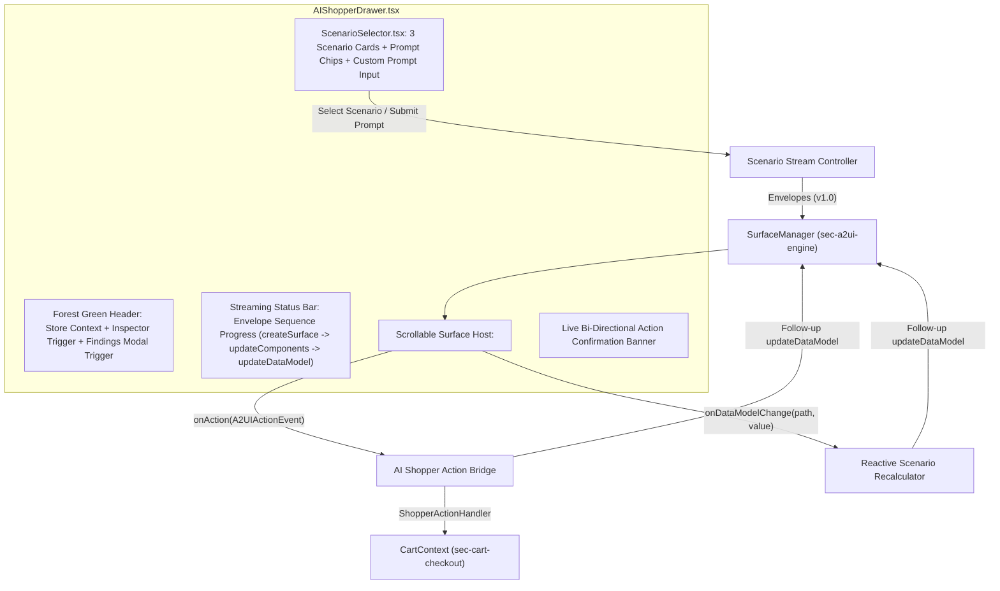

# Section 4 detailed design: AI personal shopper, A2UI v1.0 scenarios, and onboarding report UI

**Author:** `sec-ai-shopper`
**Status:** Ready for Phase 3 implementation
**Parent specification:** [SYSTEM_DESIGN.md](../SYSTEM_DESIGN.md)
**Last updated:** 2026-10-21

## Overview and scope

Section 4 (`sec-ai-shopper`) implements the user-facing **AI Personal Shopper** workspace, the three interactive **Agent-to-UI** (**A2UI**) **v1.0** grocery scenario generators, the bi-directional action handler bridge connecting A2UI v1.0 surfaces to `CartContext`, and the in-app **A2UI v1.0 Onboarding Findings Viewer**.

### Audience

This design document targets the FreshCart engineering swarm (`coordinator`, `architect`, `sec-storefront`, `sec-cart-checkout`, `sec-a2ui-engine`, and `app-integrator`). Readers should be familiar with the shared TypeScript contracts in `docs/SYSTEM_DESIGN.md` Section 4.

### In scope

* `src/components/ai-shopper/AIShopperDrawer.tsx`: Docked or slide-over AI Personal Shopper workspace hosting active A2UI v1.0 surfaces via `<A2UISurfaceRenderer />`, real-time streaming progress indicators, bi-directional action bridge, and quick-launch triggers for the Protocol Inspector and Onboarding Report.
* `src/components/ai-shopper/ScenarioSelector.tsx`: Scenario switcher cards, natural-language prompt chips, custom prompt input with intent routing, and streaming playback controls.
* `src/components/ai-shopper/OnboardingReportModal.tsx`: Interactive modal displaying the findings from onboarding into A2UI v1.0 from public documentation, npm packages, and GitHub specifications.
* `src/scenarios/mealPlannerScenario.ts`: Multi-packet A2UI v1.0 streaming scenario for `meal-planner-surface`.
* `src/scenarios/cartOptimizerScenario.ts`: Context-aware A2UI v1.0 streaming scenario for `cart-optimizer-surface` generated dynamically from live `CartContext` items.
* `src/scenarios/budgetBuilderScenario.ts`: Multi-packet A2UI v1.0 streaming scenario for `budget-nutrition-surface` featuring `checks` validation rules.
* `src/scenarios/onboardingFindingsData.ts`: Structured dataset capturing A2UI v1.0 discovery results, npm vs. GitHub matrices, documentation gaps, and framework bugs.

### Out of scope

* Core A2UI v1.0 state reducer, RFC 6901 `@path` evaluation, `@call` built-in functions, and catalog component implementations (`src/a2ui/**`, owned by `sec-a2ui-engine`).
* Storefront product grid (`src/components/storefront/**`, owned by `sec-storefront`) and cart state storage (`src/context/CartContext.tsx`, owned by `sec-cart-checkout`).

---

## 1. UX and component architecture of `AIShopperDrawer.tsx` and `ScenarioSelector.tsx`

### Layout and visual hierarchy

`AIShopperDrawer.tsx` renders as a persistent right-hand split panel (`w-full max-w-[540px]`) or responsive slide-over drawer styled with FreshCart's deep forest green header (`#073E1E`), warm cream canvas (`#FAF8F5`), and emerald accents (`#0AAD0A`).



### Component props contracts

The following TypeScript interfaces define the props for the Section 4 UI components:

```typescript
import type { StoreId, Product, CartItem, ShopperActionHandler } from '../../types/grocery';
import type { A2UIv1Message, A2UIActionEvent, A2UISurfaceState } from '../../types/a2ui-v1';

export type ScenarioId = 'meal-planner' | 'cart-optimizer' | 'budget-builder';

export interface StreamingProgressState {
  isStreaming: boolean;
  currentStepIndex: number;
  totalSteps: number;
  currentEnvelopeType:
    | 'idle'
    | 'createSurface'
    | 'updateComponents'
    | 'updateDataModel'
    | 'deleteSurface'
    | 'complete';
  streamMode: 'simulated' | 'instant';
}

export interface AIShopperDrawerProps {
  isOpen: boolean;
  onClose: () => void;
  activeStoreId: StoreId;
  storeName: string;
  products: Product[];
  cartItems: CartItem[];
  actionHandler: ShopperActionHandler;
  initialScenarioId?: ScenarioId;
  /** Dispatches an inbound A2UI v1.0 message into the shared SurfaceManager & Inspector log */
  onDispatchA2UIMessage: (message: A2UIv1Message, sourceLabel?: string) => void;
  /** Records an outbound A2UIActionEvent in the Protocol Inspector log */
  onRecordOutboundAction?: (event: A2UIActionEvent) => void;
  /** Active surface state map from SurfaceManager */
  surfaces: Record<string, A2UISurfaceState>;
  /** Opens the Section 3 Protocol Inspector Drawer */
  onOpenProtocolInspector: (surfaceId?: string) => void;
  /** Opens the Section 4 Onboarding Findings Modal */
  onOpenOnboardingReport: () => void;
}

export interface ScenarioSelectorProps {
  activeScenarioId: ScenarioId;
  onSelectScenario: (scenarioId: ScenarioId) => void;
  onSubmitCustomPrompt: (promptText: string) => void;
  onReplayStream: () => void;
  streamMode: 'simulated' | 'instant';
  onToggleStreamMode: (mode: 'simulated' | 'instant') => void;
  cartItemCount: number;
  isStreaming: boolean;
}

export interface OnboardingReportModalProps {
  isOpen: boolean;
  onClose: () => void;
  onOpenProtocolInspector?: () => void;
}
```

### Real-time streaming sequence indicator

When the user switches scenarios, clicks a prompt chip, or clicks **Replay v1.0 Stream**, `AIShopperDrawer` executes a staged packet stream:

1. **Step 1 (`createSurface` — 0 ms)**: Dispatches `A2UICreateSurfaceMessage` with `version: "v1.0"`, `surfaceId`, `catalogId: A2UI_BASIC_CATALOG_ID`, `sendDataModel: true`, initial skeleton layout, and initial `dataModel`.
2. **Step 2 (`updateComponents` — +220 ms in simulated mode)**: Dispatches `A2UIUpdateComponentsMessage` containing the complete component graph (`Slider`, `ChoicePicker`, `CheckBox`, `Tabs`, `ChildList` templates, `ProductDealCard`, `NutritionSummary`, and `Button` actions).
3. **Step 3 (`updateDataModel` — +440 ms in simulated mode)**: Dispatches `A2UIUpdateDataModelMessage` populating the full SKU arrays, computed totals, and nutritional macros.

IMPORTANT: Users can toggle between **Simulated Stream (220ms/packet)** to watch progressive A2UI v1.0 surface hydration and **Instant Mode (0ms)** for immediate rendering. Every packet is forwarded through `onDispatchA2UIMessage` so the `<ProtocolInspectorDrawer />` captures the exact chronological envelope sequence.

### Natural-language prompt chips and custom prompt bar

`ScenarioSelector.tsx` provides three structured entry points:

1. **Scenario switcher tabs**:
   * **Meal Planner (`meal-planner`)**: "Recipe-to-Cart & Scaling (`@path`, `@index`)"
   * **Smart Cart Optimizer (`cart-optimizer`)**: "Live Cart Substitutions (`ProductDealCard`, `Tabs`)"
   * **Budget & Macros (`budget-builder`)**: "Weekly Planner & Validation (`checks`, `@call`)"
2. **One-click natural-language prompt chips**:
   * *"Mediterranean salmon dinner for 6 (Gluten-Free)"* → launches `meal-planner-surface` pre-configured with `/servings: 6`, `/selectedMealPlan: ["mediterranean-salmon"]`, `/dietary/glutenFree: true`.
   * *"High-protein meal prep bowls for 4 (100% Organic)"* → launches `meal-planner-surface` with `/servings: 4`, `/selectedMealPlan: ["high-protein-bowls"]`, `/dietary/organicOnly: true`.
   * *"Find budget & organic swaps for my current cart"* → launches `cart-optimizer-surface` dynamically analyzing current `CartContext` items.
   * *"Weekly high-protein grocery basket under $120 (max 25 min prep)"* → launches `budget-nutrition-surface` with `/weeklyBudget: 120`, `/householdGoals: ["High-Protein", "Under 30-Min Prep"]`, `/maxPrepMinutes: "25"`.
3. **Custom prompt input bar**:
   * Parses natural-language input for numbers (servings count `for N`, budget cap `under $X` or `$X`, prep minutes `X min`), dietary keywords (`organic`, `gluten-free`, `keto`, `vegan`, `high-protein`), and intent keywords (`swap`, `cart`, `save`, `budget`, `weekly`, `macro`, `recipe`, `dinner`, `meal`).
   * Routes to the matching scenario generator with customized initial `dataModel` parameters and streams the resulting A2UI v1.0 packets into the active surface.

---

## 2. Detailed A2UI v1.0 scenario envelope blueprints

All three scenarios strictly adhere to the A2UI v1.0 specification (`version: "v1.0"`):
* Data bindings use `{"@path": "/..."}` (or relative paths inside a `ChildList` template scope).
* Function invocations use `{"@call": "...", "args": {...}}`.
* Collection index numbering inside `ChildList` templates uses `{"@call": "@index", "args": {"offset": 1}}`.
* `ChildList` templates use unprefixed `path`: `{"componentId": "...", "path": "/..."}`.
* Domain-specific components (`ProductDealCard`, `NutritionSummary`) declare `"catalogId": "https://freshcart.app/catalogs/grocery/v1/catalog.json"`.

### 2.1 Scenario A: Meal planner & recipe-to-cart (`src/scenarios/mealPlannerScenario.ts`)

* **Surface ID**: `"meal-planner-surface"`
* **Default Catalog ID**: `"https://a2ui.org/specification/v1_0/catalogs/basic/catalog.json"`
* **Supported meal plans**:
  1. `mediterranean-salmon`: **Mediterranean Herb Salmon & Tri-Color Quinoa** (Wild Alaskan Sockeye Salmon, Organic Tri-Color Quinoa, Organic Hass Avocados, Organic Baby Spinach, Cold-Pressed Extra Virgin Olive Oil, Organic Meyer Lemons).
  2. `high-protein-bowls`: **High-Protein Harvest Chicken & Avocado Power Bowls** (Organic Free-Range Chicken Breast, Organic Tri-Color Quinoa, Organic Greek Yogurt, Organic Hass Avocados, Organic Baby Spinach, Organic Black Beans).

#### Scenario A DataModel structure (`meal-planner-surface`)

```json
{
  "recipeTitle": "Mediterranean Herb Salmon & Quinoa Dinner",
  "recipeSubtitle": "Chef-curated 25-min sheet-pan dinner · Mapped to live store SKUs",
  "selectedMealPlan": ["mediterranean-salmon"],
  "servings": 4,
  "prepTimeMinutes": 25,
  "dietary": {
    "glutenFree": true,
    "organicOnly": false
  },
  "nutrition": {
    "calories": 610,
    "proteinGrams": 44,
    "carbsGrams": 38,
    "fatGrams": 28,
    "fiberGrams": 8,
    "dailyCalorieTarget": 2000
  },
  "ingredients": [
    {
      "productId": "prod-salmon-fillet",
      "swapProductId": "prod-org-chicken-breast",
      "name": "Wild Alaskan Sockeye Salmon Fillet",
      "unit": "1.5 lbs (scaled for 4 servings)",
      "baseQty": 2,
      "scaledQty": 2,
      "unitPrice": 12.99,
      "price": 25.98,
      "isOrganic": false,
      "dietaryBadge": "Wild Caught · Gluten-Free",
      "checked": true,
      "swapLabel": "Swap to Organic"
    }
  ],
  "featuredPairing": {
    "productId": "prod-org-avocado",
    "title": "Organic Hass Avocados (4 ct Bag)",
    "price": 4.99,
    "originalPrice": 6.49,
    "unit": "4 count bag",
    "badgeText": "Chef Pairing · Save $1.50",
    "imageUrl": "https://images.unsplash.com/photo-1523049673857-eb18f1d7b578?auto=format&fit=crop&w=500&q=80"
  },
  "estimatedTotal": 48.93,
  "perServingCost": 12.23,
  "bundleAdded": false,
  "lastActionConfirmation": "Ready to scale & add to cart"
}
```

#### Scenario A component tree & v1.0 bindings

The following table specifies the components emitted in `updateComponents` for `meal-planner-surface`:

| Component `id` | `component` type | `catalogId` | Key v1.0 properties, `@path` bindings, `@call` functions, and `action` payloads |
| :--- | :--- | :--- | :--- |
| `root` | `Column` | Basic (default) | `children: ["header_card", "controls_card", "nutrition_widget", "ingredients_card", "pairing_deal_card", "footer_action_card"]`, `gap: "md"` |
| `header_card` | `Card` | Basic | `child: "header_col"` |
| `title_text` | `Text` | Basic | `text: {"@path": "/recipeTitle"}`, `usageHint: "h2"` |
| `subtitle_text` | `Text` | Basic | `text: {"@path": "/recipeSubtitle"}`, `usageHint: "caption"` |
| `meal_style_picker` | `ChoicePicker` | Basic | `label: "Select Meal Plan Style"`, `variant: "singleSelection"`, `displayStyle: "chips"`, `value: {"@path": "/selectedMealPlan"}`, `options: [{"label": "Mediterranean Salmon & Quinoa", "value": "mediterranean-salmon"}, {"label": "High-Protein Chicken Bowls", "value": "high-protein-bowls"}]` |
| `servings_slider` | `Slider` | Basic | `label: "Scale Servings"`, `min: 1`, `max: 12`, `steps: 11`, `value: {"@path": "/servings"}` |
| `cb_gluten_free` | `CheckBox` | Basic | `label: "Strict Gluten-Free SKUs"`, `value: {"@path": "/dietary/glutenFree"}` |
| `cb_organic_only` | `CheckBox` | Basic | `label: "Upgrade All to 100% USDA Organic"`, `value: {"@path": "/dietary/organicOnly"}` |
| `nutrition_widget` | `NutritionSummary` | `FRESHCART_GROCERY_CATALOG_ID` | `calories: {"@path": "/nutrition/calories"}`, `proteinGrams: {"@path": "/nutrition/proteinGrams"}`, `carbsGrams: {"@path": "/nutrition/carbsGrams"}`, `fatGrams: {"@path": "/nutrition/fatGrams"}`, `fiberGrams: {"@path": "/nutrition/fiberGrams"}`, `servings: {"@path": "/servings"}`, `dailyCalorieTarget: {"@path": "/nutrition/dailyCalorieTarget"}` |
| `ingredients_list` | `Column` | Basic | `children: { "componentId": "ingredient_row", "path": "/ingredients" }` (v1.0 `ChildList` template) |
| `ingredient_row` | `Row` | Basic | `children: ["ing_index_badge", "ing_checkbox", "ing_info_col", "ing_price_text", "ing_swap_btn"]`, `alignItems: "center"`, `justifyContent: "spaceBetween"` |
| `ing_index_badge` | `Text` | Basic | `text: {"@call": "formatString", "args": {"template": "#{0}", "0": {"@call": "@index", "args": {"offset": 1}}}}`, `usageHint: "caption"` |
| `ing_checkbox` | `CheckBox` | Basic | `label: {"@path": "name"}`, `value: {"@path": "checked"}` (relative `@path` inside `/ingredients` item scope) |
| `ing_unit_text` | `Text` | Basic | `text: {"@path": "unit"}`, `usageHint: "caption"` |
| `ing_price_text` | `Text` | Basic | `text: {"@call": "formatCurrency", "args": {"value": {"@path": "price"}, "currency": "USD"}}`, `usageHint: "body"` |
| `ing_swap_btn` | `Button` | Basic | `label: {"@path": "swapLabel"}`, `variant: "secondary"`, `action: { "event": { "name": "swap_ingredient", "context": { "index": {"@call": "@index"}, "productId": {"@path": "productId"}, "swapProductId": {"@path": "swapProductId"} } } }` |
| `pairing_deal_card` | `ProductDealCard` | `FRESHCART_GROCERY_CATALOG_ID` | `productId: {"@path": "/featuredPairing/productId"}`, `title: {"@path": "/featuredPairing/title"}`, `price: {"@path": "/featuredPairing/price"}`, `originalPrice: {"@path": "/featuredPairing/originalPrice"}`, `unit: {"@path": "/featuredPairing/unit"}`, `badgeText: {"@path": "/featuredPairing/badgeText"}`, `imageUrl: {"@path": "/featuredPairing/imageUrl"}`, `actionLabel: "Add Pairing to Cart"`, `action: { "event": { "name": "add_pairing_item", "context": { "productId": {"@path": "/featuredPairing/productId"}, "quantity": 1 } } }` |
| `total_cost_text` | `Text` | Basic | `text: {"@call": "formatCurrency", "args": {"value": {"@path": "/estimatedTotal"}, "currency": "USD"}}`, `usageHint: "h3"` |
| `status_confirm_text` | `Text` | Basic | `text: {"@path": "/lastActionConfirmation"}`, `usageHint: "caption"` |
| `btn_add_bundle` | `Button` | Basic | `label: "Add Scaled Recipe Bundle to Cart"`, `variant: "primary"`, `action: { "event": { "name": "add_recipe_bundle_to_cart", "userMessage": "Add scaled recipe bundle to my cart", "context": { "servings": {"@path": "/servings"}, "recipeTitle": {"@path": "/recipeTitle"}, "dietary": {"@path": "/dietary"}, "ingredients": {"@path": "/ingredients"} } } }` |

---

### 2.2 Scenario B: Smart cart substitution & savings optimizer (`src/scenarios/cartOptimizerScenario.ts`)

* **Surface ID**: `"cart-optimizer-surface"`
* **Context-aware generation**: `buildCartOptimizerStream(cartItems: CartItem[], products: Product[], activeStoreId: StoreId)` inspects the user's current `CartContext.items`.
* **Fallback behavior when cart is empty**: If `cartItems.length === 0`, the scenario analyzes a curated 4-item starter basket from the active store and includes a top action button `"Seed Sample Cart & Apply Swaps"` so the user can test one-click swaps without leaving the panel.

#### Optimization categories & v1.0 `Tabs` layout

`cart-optimizer-surface` renders a `Tabs` component (`id: "optimizer_tabs"`) with four tabs:

1. **All Smart Swaps (`tab_all_swaps`)**: Displays every recommended substitution across budget, organic, and low-stock protection using a `ChildList` template `{ "componentId": "swap_recommendation_card", "path": "/swaps" }`.
2. **Budget Savers (`tab_budget_savers`)**: Displays store-brand and bulk-pack alternatives (resolved via `product.budgetAlternativeProductId` or lower-price category peers) with per-item savings badges (`"Save $2.50"`).
3. **Organic Upgrades (`tab_organic_upgrades`)**: Displays USDA Organic upgrades (resolved via `product.organicUpgradeProductId`) for conventional items currently in the cart.
4. **Backup Protection (`tab_backup_protection`)**: Highlights cart items with `stockStatus === 'low_stock'` and pairs each with a high-inventory backup SKU (`product.suggestedBackupProductId`), dispatching `set_backup_preference` or `apply_cart_swap`.

#### Scenario B DataModel structure (`cart-optimizer-surface`)

```json
{
  "headline": "Smart Cart Analysis · 4 Optimization Opportunities Found",
  "subheadline": "Live analysis of your active cart items with 1-click SKU swaps",
  "cartItemCount": 4,
  "potentialSavings": 6.40,
  "totalSavingsApplied": 0.0,
  "swapsAppliedCount": 0,
  "lowStockCount": 1,
  "allApplied": false,
  "lastActionConfirmation": "Click any swap card below to update your live cart.",
  "swaps": [
    {
      "swapId": "swap-0",
      "category": "Budget Saver",
      "originalProductId": "prod-salmon-fillet",
      "originalName": "Wild Alaskan Sockeye Salmon Fillet",
      "originalPrice": 12.99,
      "replacementProductId": "prod-atlantic-salmon-value",
      "replacementName": "FreshCart Value Atlantic Salmon Portions",
      "replacementPrice": 9.99,
      "unit": "16 oz pack",
      "quantity": 1,
      "savingsAmount": 3.00,
      "badgeText": "Budget Saver · Save $3.00",
      "imageUrl": "https://images.unsplash.com/photo-1519708227418-c8fd9a32b7a2?auto=format&fit=crop&w=500&q=80",
      "reason": "Same 34g protein per serving at 23% lower cost per oz.",
      "applied": false,
      "actionLabel": "Swap in Cart (Save $3.00)"
    }
  ],
  "featuredDeal": {
    "productId": "prod-org-avocado",
    "title": "Organic Hass Avocados (4 ct Value Bag)",
    "price": 4.99,
    "originalPrice": 6.99,
    "unit": "4 ct bag",
    "badgeText": "Top Cart Swap · Save $2.00"
  }
}
```

#### Scenario B actions

* `apply_cart_swap`: Dispatched by each `ProductDealCard` or swap row `Button` with `context: { swapId: {"@path": "swapId"}, index: {"@call": "@index"}, originalProductId: {"@path": "originalProductId"}, replacementProductId: {"@path": "replacementProductId"}, quantity: {"@path": "quantity"}, savingsAmount: {"@path": "savingsAmount"} }`.
* `apply_all_optimizations`: Dispatched by the primary footer `Button` with `context: { swaps: {"@path": "/swaps"}, potentialSavings: {"@path": "/potentialSavings"} }`.

---

### 2.3 Scenario C: Weekly budget & macro planner (`src/scenarios/budgetBuilderScenario.ts`)

* **Surface ID**: `"budget-nutrition-surface"`
* **Purpose**: Showcases full A2UI v1.0 input controls (`Slider`, `ChoicePicker`, `TextField`, `CheckBox`, `Tabs`, `Modal`, `Divider`, `Button`), custom `NutritionSummary` and `ProductDealCard`, and client-side `checks` validation (`A2UICheckRule[]`).

#### Scenario C v1.0 `checks` validation rules

The following table defines the client-side `checks` configured on `budget-nutrition-surface` components:

| Component `id` | Component type | Bound `@path` | `checks` rule definition (`condition` & `message`) |
| :--- | :--- | :--- | :--- |
| `input_max_prep` | `TextField` | `{"@path": "/maxPrepMinutes"}` | 1. `condition: {"@call": "required", "args": {"value": {"@path": "/maxPrepMinutes"}}}` → `"Maximum prep time is required."`<br>2. `condition: {"@call": "numeric", "args": {"value": {"@path": "/maxPrepMinutes"}, "min": 10, "max": 120}}` → `"Enter a valid prep time between 10 and 120 minutes."` |
| `input_custom_note` | `TextField` | `{"@path": "/customNote"}` | 1. `condition: {"@call": "length", "args": {"value": {"@path": "/customNote"}, "max": 120}}` → `"Personal shopper note must be 120 characters or fewer."` |
| `picker_household_goals` | `ChoicePicker` | `{"@path": "/householdGoals"}` | 1. `condition: {"@call": "required", "args": {"value": {"@path": "/householdGoals"}}}` → `"Select at least one nutritional or household goal."` |
| `btn_build_weekly_basket` | `Button` | N/A (Action button) | 1. `condition: {"@path": "/isBudgetValid"}` → `"Allocated basket spend exceeds your weekly budget cap. Raise the budget slider or remove an item."`<br>2. `condition: {"@call": "numeric", "args": {"value": {"@path": "/maxPrepMinutes"}, "min": 10, "max": 120}}` → `"Fix validation errors on Max Prep Time before building basket."` |

#### Scenario C DataModel structure (`budget-nutrition-surface`)

```json
{
  "plannerTitle": "Weekly Nutritional & Budget Basket Builder",
  "weeklyBudget": 140,
  "allocatedSpend": 112.42,
  "remainingBudget": 27.58,
  "isBudgetValid": true,
  "householdGoals": ["High-Protein", "USDA Organic"],
  "maxPrepMinutes": "30",
  "customNote": "Prefer firm avocados and thickest salmon cuts for meal prep.",
  "autoApplyPromo": true,
  "promoCodeToApply": "A2UIV1",
  "weeklyNutrition": {
    "calories": 2150,
    "proteinGrams": 148,
    "carbsGrams": 185,
    "fatGrams": 78,
    "fiberGrams": 34,
    "servings": 7,
    "dailyCalorieTarget": 2200
  },
  "curatedBasket": [
    {
      "productId": "prod-salmon-fillet",
      "title": "Wild Alaskan Sockeye Salmon Fillet",
      "price": 12.99,
      "originalPrice": 14.99,
      "unit": "1 lb fillet",
      "quantity": 2,
      "badgeText": "High-Protein Staple · 44g Protein",
      "included": true
    }
  ],
  "basketAdded": false,
  "lastActionConfirmation": "All budget & nutrition checks passing ✓"
}
```

---

## 3. Outbound `A2UIActionEvent` bridge and bi-directional surface updates

### End-to-end event lifecycle

When a user interacts with an A2UI v1.0 surface inside `AIShopperDrawer.tsx`, two distinct reactive flows operate:

#### Flow 1: Two-way DataModel input changes (`onDataModelChange`)

When a user drags a `Slider` (`/servings` or `/weeklyBudget`), toggles a `CheckBox` (`/dietary/organicOnly`, `/dietary/glutenFree`, or relative `checked`), selects a `ChoicePicker` chip (`/selectedMealPlan` or `/householdGoals`), or types into a `TextField` (`/maxPrepMinutes`, `/customNote`):

1. `<A2UISurfaceRenderer />` immediately applies the local `updateDataModel` change at the bound JSON Pointer path and notifies `AIShopperDrawer` via `onDataModelChange(surfaceId, path, value)`.
2. `AIShopperDrawer` runs the scenario's reactive recalculator (`recalculateMealPlannerDataModel` or `recalculateBudgetBuilderDataModel`):
   * In **Meal Planner**: Changing `/servings`, `/selectedMealPlan`, `/dietary/organicOnly`, or `/ingredients/{i}/checked` recalculates each ingredient's `scaledQty` (`Math.max(1, Math.round(baseQty * servings / 4))`), line-item `price`, `/estimatedTotal`, `/perServingCost`, and `/nutrition` macros, then dispatches a synthesized `A2UIUpdateDataModelMessage` (`version: "v1.0"`) so all dependent `@path` and `@call` nodes update instantaneously.
   * In **Budget Builder**: Changing `/weeklyBudget`, `/householdGoals`, or `/curatedBasket/{i}/included` recalculates `/allocatedSpend`, `/remainingBudget`, and `/isBudgetValid = allocatedSpend <= weeklyBudget`. If the user lowers `/weeklyBudget` below `/allocatedSpend` (e.g., dragging the slider down to `$70` when the basket is `$112.42`), `/isBudgetValid` becomes `false`, triggering the v1.0 `checks` rule on `btn_build_weekly_basket` and displaying the validation banner.

#### Flow 2: Outbound `A2UIActionEvent` dispatch (`onAction`)

When a user clicks a `Button` or `ProductDealCard` CTA:

1. `<A2UISurfaceRenderer />` resolves all `A2UIDynamicValue` properties inside `action.event.context` and `action.event.userMessage` against the active surface `dataModel` (and current `ChildList` item scope when inside a collection template).
2. `<A2UISurfaceRenderer />` emits a spec-compliant `A2UIActionEvent` (`version: "v1.0"`) to `AIShopperDrawer` and logs it to the Protocol Inspector.
3. `AIShopperDrawer` executes the corresponding `ShopperActionHandler` method on `CartContext` AND dispatches a follow-up `A2UIUpdateDataModelMessage` back to the surface so the A2UI v1.0 UI visually confirms the completed action:

| Outbound `event.action.name` | `ShopperActionHandler` invocation on `CartContext` | Follow-up v1.0 `updateDataModel` dispatched back to surface |
| :--- | :--- | :--- |
| `add_recipe_bundle_to_cart` | Filters `context.ingredients` where `checked !== false`, scales quantities for `context.servings`, and calls `actionHandler.addBundleToCart(scaledItems, context.recipeTitle)`. | Updates `/bundleAdded = true` and `/lastActionConfirmation = "Added {count} scaled ingredients ({servings} servings) to Cart ✓"`. |
| `swap_ingredient` | Looks up `context.swapProductId` in the store catalog. | Updates `/ingredients/{index}` with the replacement SKU's `productId`, `name`, `unitPrice`, `price`, `swapLabel: "Swapped ✓"`, recalculates `/estimatedTotal`, and sets `/lastActionConfirmation = "Swapped ingredient #{index + 1} to {newName} ✓"`. |
| `add_pairing_item` | Calls `actionHandler.addItemToCart(context.productId, context.quantity ?? 1, "Chef pairing from AI Meal Planner")`. | Updates `/lastActionConfirmation = "Added Chef Pairing to Cart ✓"`. |
| `apply_cart_swap` | Calls `actionHandler.swapCartItem(context.originalProductId, context.replacementProductId, context.quantity)`. | Updates `/swaps/{index}/applied = true`, `/swaps/{index}/actionLabel = "Swap Applied ✓"`, increments `/swapsAppliedCount`, adds `context.savingsAmount` to `/totalSavingsApplied`, and sets `/lastActionConfirmation = "Swap Applied in Cart ✓"`. |
| `apply_all_optimizations` | Iterates over all unapplied swaps in `context.swaps` and calls `actionHandler.swapCartItem(...)` for each, plus `actionHandler.setSubstitutionPreference(...)` for low-stock items. | Marks every entry in `/swaps` as `applied: true`, sets `/allApplied = true`, `/totalSavingsApplied = potentialSavings`, and `/lastActionConfirmation = "All Cart Optimizations Applied ✓"`. |
| `seed_sample_cart` | Calls `actionHandler.addBundleToCart(defaultSampleItems, "Starter Cart for Optimization")` and re-runs `buildCartOptimizerStream`. | Streams updated `/swaps` reflecting the newly seeded cart items. |
| `build_weekly_basket` | Calls `actionHandler.addBundleToCart(includedItems, "Weekly Nutritional Basket")`, optionally calls `actionHandler.applyPromoCode("A2UIV1")` if `/autoApplyPromo` is true, and calls `actionHandler.openCartDrawer()`. | Updates `/basketAdded = true` and `/lastActionConfirmation = "Weekly Basket Added to Cart & Promo A2UIV1 Applied ✓"`. |

---

## 4. SKU mapping contract with Section 1 (`sec-storefront`)

To guarantee that Scenario A, Scenario B, and Scenario C always resolve valid `Product` records even if the user switches stores (`freshcart-organic`, `costco-wholesale`, `sprouts-farmers`, `trader-joes-specialty`), each scenario generator uses a two-tier SKU resolution strategy:

1. **Primary deterministic SKU lookup**: Looks up canonical IDs from `products` (`prod-salmon-fillet`, `prod-org-quinoa`, `prod-org-avocado`, `prod-conv-avocado`, `prod-baby-spinach`, `prod-greek-yogurt`, `prod-org-chicken-breast`, `prod-extra-virgin-olive-oil`, `prod-org-eggs`, `prod-sourdough-bread`, `prod-almond-milk`, `prod-protein-oats`, etc.).
2. **Store-aware category fallback**: If a canonical SKU ID is not in the currently selected store banner, a helper `resolveStoreProduct(products, activeStoreId, preferredIds, categoryFallback)` picks the best matching SKU in the active store or falls back to the cross-store product definition so no scenario ever references an undefined product.

---

## 5. `OnboardingReportModal.tsx` and `onboardingFindingsData.ts` design

### Purpose

As part of our zero-prior-knowledge onboarding test of **A2UI v1.0**, FreshCart embeds an interactive engineering report (`OnboardingReportModal.tsx`) directly in the application UI. Users and reviewers can open this report from the top navigation bar or from the AI Personal Shopper header.

### Data model in `src/scenarios/onboardingFindingsData.ts`

```typescript
export type FindingCategory =
  | 'discoverability'
  | 'npm-packaging'
  | 'doc-gap'
  | 'spec-mismatch'
  | 'renderer-bug';

export type FindingSeverity = 'critical' | 'high' | 'medium' | 'low';

export interface OnboardingFinding {
  id: string;
  title: string;
  category: FindingCategory;
  severity: FindingSeverity;
  affectedTarget: string; // e.g., "@a2ui/react (npm)", "a2ui.org docs", "specification/v1_0"
  summary: string;
  reproductionOrEvidence: string;
  freshcartWorkaround: string;
  recommendationForA2UITeam: string;
}

export interface PackageMatrixRow {
  packageName: string;
  npmVersion: string;
  githubPath: string;
  v1SupportStatus: 'v0.8 / v0.9 Only' | 'Partial / Experimental' | 'Spec Only (No npm v1.0)';
  react19PeerDepStatus: string;
  notes: string;
}

export interface WireFormatShiftRow {
  feature: string;
  v08_v09Syntax: string;
  v10Syntax: string;
  breakingImpact: string;
}
```

### Curated onboarding findings included in `onboardingFindingsData.ts`

`onboardingFindingsData.ts` ships with structured data covering four tabs in `OnboardingReportModal.tsx`:

1. **Tab 1: Discovery & npm vs. GitHub Matrix**:
   * Documents what an external React engineer encounters when searching `a2ui.org`, GitHub (`google/A2UI`), and npm (`@a2ui/react`, `@a2ui/web_core`, `@a2ui/lit`, `@a2ui/angular`, `@a2ui/markdown-it`).
   * Highlights that while `specification/v1_0` exists in the GitHub repository with rich JSON schemas (`agent_to_renderer.json`, `renderer_to_agent.json`, `common_types.json`, `catalogs/basic/v1/catalog.json`), public npm packages (`@a2ui/react`, `@a2ui/web_core`, `@a2ui/lit`) lag behind on v0.8/v0.9 protocol structures or lack published v1.0 builds.
2. **Tab 2: v0.8/v0.9 vs. v1.0 Protocol Breaking Changes**:
   * Side-by-side comparison table of the wire format changes that trip up developers migrating to or onboarding onto A2UI v1.0:
     * **Envelope discriminator**: Explicit `"version": "v1.0"` required on every message (`createSurface`, `updateComponents`, `updateDataModel`, `deleteSurface`, `callRendererFunction`, `action`).
     * **Reserved `@` sigils**: `DataBinding` changed from `{"path": "/servings"}` to `{"@path": "/servings"}`; `FunctionCall` changed from `{"call": "formatCurrency", "args": ...}` to `{"@call": "formatCurrency", "args": ...}`.
     * **Collection index function**: Added `{"@call": "@index", "args": {"offset": 1}}` for `ChildList` template scopes (`{ "componentId": "...", "path": "/..." }` where `path` remains unprefixed).
     * **Single-shot `createSurface`**: `createSurface` in v1.0 accepts optional inline `components` and `dataModel` in addition to incremental `updateComponents` / `updateDataModel`.
     * **Multi-catalog component mixing**: Components can override the surface's default `catalogId` per component (`catalogId: FRESHCART_GROCERY_CATALOG_ID`).
     * **Bi-directional renderer functions**: Added `callRendererFunction` and `agentFunctionResponse` with `functionCallId` correlation.
3. **Tab 3: Documentation Gaps (`docs/A2UI_DOCUMENTATION_GAPS.md`)**:
   * Interactive filterable cards detailing missing React v1.0 quickstarts, mixed v0.8/v0.9/v1.0 terminology on public landing pages, undocumented `@path` vs. unprefixed `path` distinctions (e.g., `ChildList.path` and `updateDataModel.path` are unprefixed while `DataBinding` uses `@path`), and lack of multi-catalog registration examples in React.
4. **Tab 4: Packaging & Framework Issues (`docs/A2UI_BUGS_AND_ISSUES.md`)**:
   * Filterable issue log covering npm publication gaps for v1.0 schemas, peer dependency constraints with React 19 / modern Vite toolchains, and schema validation edge cases, plus a **Copy Full Markdown Report** button and a **Launch Live Protocol Inspector** button.

---

## 6. Verification checklist for Section 4

1. **Strict TypeScript verification**: All files under `src/components/ai-shopper/**` and `src/scenarios/**` compile cleanly under `tsc -b` with zero `any` casts and strict adherence to `src/types/grocery.ts` and `src/types/a2ui-v1.ts`.
2. **A2UI v1.0 envelope conformance**:
   * Every emitted envelope in `mealPlannerScenario.ts`, `cartOptimizerScenario.ts`, and `budgetBuilderScenario.ts` contains `"version": "v1.0"`.
   * Every dynamic property binding uses `{"@path": "..."}` and every function invocation uses `{"@call": "..."}`.
   * Custom components (`ProductDealCard`, `NutritionSummary`) explicitly set `"catalogId": FRESHCART_GROCERY_CATALOG_ID`.
3. **Bi-directional reactivity**:
   * Dragging the `/servings` slider in `meal-planner-surface` live-updates ingredient quantities, line-item prices, nutrition summary macros, and `/estimatedTotal`.
   * Clicking `"Add Scaled Recipe Bundle to Cart"` adds the exact scaled quantities to `CartContext` and updates the A2UI surface banner to confirm the action.
   * Launching `cart-optimizer-surface` reflects the user's real cart items and executes 1-click SKU swaps via `swapCartItem`.
   * Lowering `/weeklyBudget` below `/allocatedSpend` or entering an invalid `/maxPrepMinutes` value in `budget-nutrition-surface` triggers v1.0 `checks` validation errors and blocks submission until resolved.
